# Les images et icônes

## Ajouter une image dans un projet SwiftUI

Aux yeux de votre application, une image est une ressource (en anglais : **asset**).

### Ajouter l'image au projet

Pour utiliser une image dans une application SwiftUI, il faut d'abord l'ajouter dans Assets.xcassets :

- Dans Xcode, cliquez sur `Assets.xcassets` dans la zone de gauche.
- À partir du Finder, faites glisser l'image dans la zone centrale qui liste les ressources du projet (au départ, elle ne contient que AccentColor et AppIcon).

  ou
- Dans Xcode, cliquez sur `Assets.xcassets` dans la zone de gauche.
- Cliquez sur le + au bas de la zone centrale qui liste les ressources du projet, sélectionnez **Import** puis retrouvez dans vos dossiers l'image désirée.

  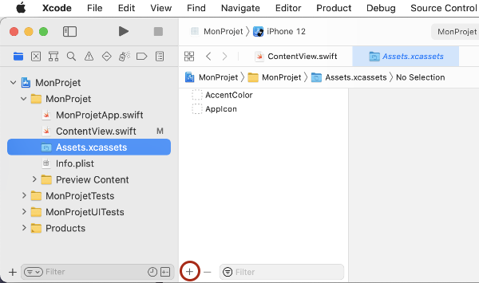

### Nom de l'image

Par défaut, le nom de l'image correspond au nom de son fichier sans son extension, ce qui peut poser problème.

Ce nom est important puisqu'il sera utilisé dans le code. Souvent, il faudra renommer les images.

Le nom doit être unique dans le projet.  
Par convention, on utilisera la-casse-kebab.

### Utiliser une image

Pour ajouter l'image dans une vue :

```swift title="SwiftUI"
Image("nom-image")
    .resizable()
    .scaledToFit()
```

## AsyncImage pour afficher une image à partir d'un URL

Dans une application SwiftUI, la structure [AsyncImage](https://developer.apple.com/documentation/swiftui/asyncimage) permet d'afficher une image en provenance d'un URL.

```swift title="SwiftUI"
AsyncImage(url: URL(string: "https://mobile1.profinfo.ca/images/apple-touch-icon.png"))
```

### Image de chargement en cours

Pour indiquer que l'image est en cours de chargement, il est d'usage d'afficher une petite animation  (en anglais : **spinner**).

Ceci sera possible grâce au paramètre `placeholder`.

Notez qu'à ce moment, vous êtes obligés de fournir également le paramètre `content`.

```swift title="SwiftUI"
AsyncImage(
  url: URL(string: "https://mobile1.profinfo.ca/images/apple-touch-icon.png"),
  content: { image in
    image
  },
  placeholder: {
    ProgressView()
  }
)
```

### Taille de l'image

La taille de l'image n'est connue que lorsque l'image est chargée. Ceci pourrait poser problème. Il est donc recommandé de fixer sa taille avec le modifieur `.frame()`.

Afin que l'image soit correctement dimensionnée, il faudra prendre soin de la rendre redimensionnable dans le paramètre `content`.

```swift title="SwiftUI"
AsyncImage(
  url: URL(string: "https://mobile1.profinfo.ca/images/apple-touch-icon.png"),
  content: { image in
    image
     .resizable()
     .aspectRatio(contentMode: .fit)
  },
  placeholder: {
    ProgressView()
  }
)
.frame(width: 244, height: 72)
```

### État du chargement

 Le code sera plus complet si vous tenez compte de l'état du chargement.

```swift title="SwiftUI"
AsyncImage(url: URL(string: "https://mobile1.profinfo.ca/images/apple-touch-icon.png")) { phase in
  switch phase {
    case .empty:
      // l'image n'est pas encore chargée
      ProgressView()
    case .success(let image):
      // l'image a été chargée avec succèes
      image
       .resizable()
       .aspectRatio(contentMode: .fit)
    case .failure(let error):
      // l'image n'a pas pu être chargée
      Image(systemName: "exclamationmark.icloud")
      let _ = print(error.localizedDescription)   // sans "let _ =", on aurait l'erreur "Type '()' cannot conform to 'View'"
    @unknown default:
      // au cas où des états supplémentaires seraient ajoutés dans une future version de SwiftUI
      Image(systemName: "photo")
  }
}
.frame(width: 244, height: 72)
```

## Ajuster une image

Dans une application SwiftUI, une image peut être affichée [à partir d'un fichier qui a été ajouté au projet](../complements/quelques-vues-swiftui.md#ajouter-une-image-dans-un-projet-swiftui) ou encore [directement à partir d'un URL](les-images-et-icones.md#asyncimage-pour-afficher-une-image-a-partir-dun-url).

Par défaut, l'image conserve sa taille originale sans tenir compte de la taille de l'écran ni de ce qui s'y trouve déjà.

```swift title="SwiftUI"
Image("papier")
```

Dans Xcode, on peut configurer le canevas pour que des lignes bleues entourent l'espace qu'une vue occupe effectivement à l'écran quand on clique sur cette vue dans le code.

Ici, il est clair que l'image est plus large que l'écran du iPhone.

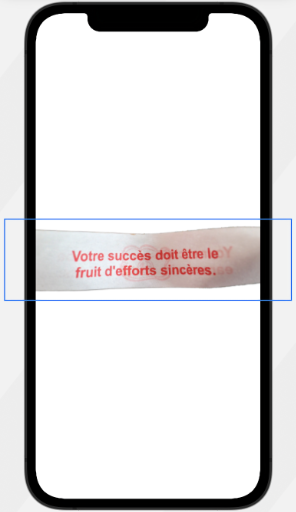

Pour qu'elle soit ajustée à l'écran et à l'espace qui est disponible, il faut utiliser le modifieur [.resizable()](https://developer.apple.com/documentation/SwiftUI/Image/resizable(capInsets:resizingMode:)).

Ce modifieur se charge de redimensionner l'image pour qu'elle remplisse l'espace disponible sans en déborder.

Le problème, c'est que ceci déforme généralement l'image.

```swift title="SwiftUI"
Image("papier")
  .resizable()
```

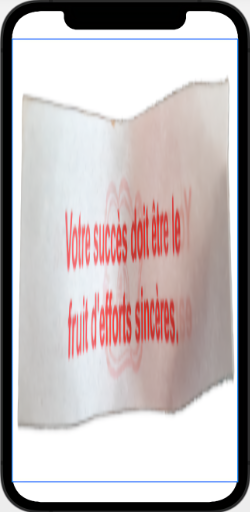

Pour qu'elle conserve son ratio original, il faut ajouter le modifieur [.scaledToFit()](https://developer.apple.com/documentation/swiftui/view/scaledtofit()).

Donc, `.resizable()` et `.scaledToFit()` appliqués à l'image font en sorte qu'elle prendra tout l'espace disponible sans en déborder et sans changer son aspect.

```swift title="SwiftUI"
Image("papier")
  .resizable()
  .scaledToFit()
```

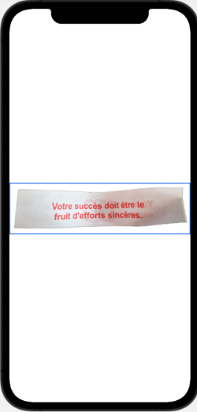

Si vous souhaitez imposer une taille à l'image, le modifieur [.frame()](https://developer.apple.com/documentation/swiftui/view/frame(width:height:alignment:)) est ce qu'il vous faut. Il permet de définir un cadre invisible qui force l'image à s'y adapter.

Pour obtenir le résultat souhaité, il faut d'abord appliquer `.resizable()` et `.scaledToFit()` à l'image.

```swift title="SwiftUI"
Image("papier")
  .resizable()
  .scaledToFit()
  .frame(width: 200, height: 200)
```

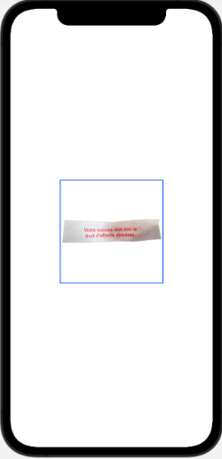

Si désiré, on peut passer un troisième paramètre à .frame() pour spécifier comment aligner l'image dans son cadre.

```swift title="SwiftUI"
Image("papier")
  .resizable()
  .scaledToFit()
  .frame(width: 200, height: 200, alignment: .bottom)
```

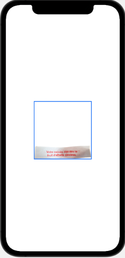

Que la taille de l'image soit imposée par un cadre ou pas, il est possible de la déplacer par rapport à son emplacement original. Ceci est réalisé à l'aide du modifieur [.offset()](https://developer.apple.com/documentation/swiftui/view/offset(x:y:)). Il permet d'effectuer un décallage en X, en Y ou les deux.

Je vous fais la démonstration ici avec un cadre puisque vous verrez mieux le résultat.

```swift title="SwiftUI"
Image("papier")
  .resizable()
  .scaledToFit()
  .frame(width: 200, height: 200)
  .offset(x: 50)
```

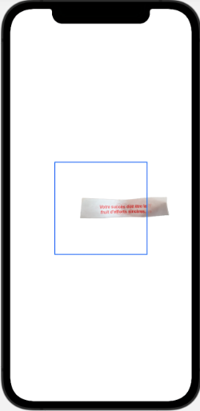

Lorsqu'une image sort d'un cadre, il est possible de cacher la partie qui dépasse en ajoutant le modificateur [.clipped()](https://developer.apple.com/documentation/swiftui/view/clipped(antialiased:)).

```swift title="SwiftUI"
Image("papier")
  .resizable()
  .scaledToFit()
  .frame(width: 200, height: 200)
  .offset(x: 50)
  .clipped()
```

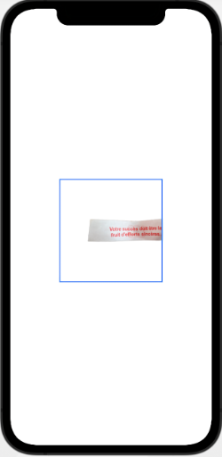

Si vous préférez donner une forme à l'image, vous pouvez travailler avec le modifieur [.clipShape()](https://developer.apple.com/documentation/swiftui/view/clipshape(_:style:)).

Toute partie de l'image qui déborde la forme spécifiée sera cachée.

Différentes formes sont disponibles : [Circle()](https://developer.apple.com/documentation/swiftui/circle), [Ellipse()](https://developer.apple.com/documentation/swiftui/ellipse), [Capsule()](https://developer.apple.com/documentation/swiftui/capsule), [RoundedRectangle()](https://developer.apple.com/documentation/swiftui/roundedrectangle), [Rectangle()](https://developer.apple.com/documentation/swiftui/rectangle), etc. Il est même possible de définir nos propres formes à l'aide de [Path()](https://developer.apple.com/documentation/swiftui/path).

```swift title="SwiftUI"
Image("papier")
  .frame(width: 320, height: 80)
  .clipShape(Capsule())
```

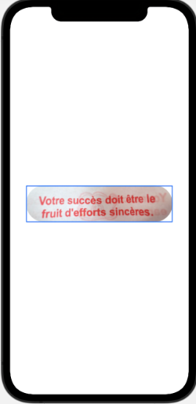

Lorsqu'on maîtrise bien les différents modifeurs, il est même possible de n'afficher qu'une partie précise de l'image.

Remarquez que j'ai retiré le modifieur `.resizable()` pour que l'image conserve sa pleine taille. Le modifieur `.scaledToFit()` n'est ainsi plus nécessaire.

```swift title="SwiftUI"
Image("papier")
  .frame(width: 92, height: 30)
  .offset(x: 30, y: 5)
  .clipped()
```

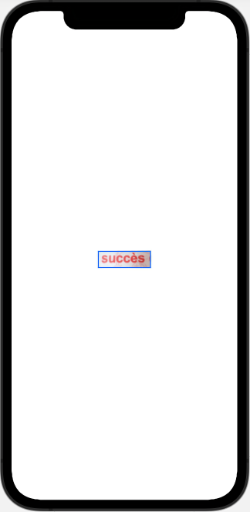

## Modifier la couleur d'une image par programmation

SwiftUI permet de modifier les couleurs d'une image par programmation grâce à différentes méthodes qui permettent de jouer sur les profils colorimétriques d'une image, par exemple :

- .renderingMode() (pour remplir complètement une image à l'aide d'une couleur)
- [.brightness()](https://developer.apple.com/documentation/swiftui/view/brightness(_:))
- [.saturation()](https://developer.apple.com/documentation/swiftui/view/saturation(_:))
- [.contrast()](https://developer.apple.com/documentation/swiftui/view/contrast(_:))
- [.opacity()](https://developer.apple.com/documentation/swiftui/view/opacity(_:))
- [.colorMultiply()](https://developer.apple.com/documentation/swiftui/view/colormultiply(_:))
- [.hueRotation()](https://developer.apple.com/documentation/swiftui/view/huerotation(_:))
- [.colorInvert()](https://developer.apple.com/documentation/swiftui/view/colorinvert())

Voici quelques exemples visuels.

Dans la première impression d'écran, l'image du haut est l'originale et les autres ont été ajustées par programmation. Dans les suivantes, l'image de gauche est l'originale et celle de droite a été ajustée.

```swift title="SwiftUI"
struct ContentView: View {
    var body: some View {
        VStack {
            Image("roger")
                .resizable()
                .scaledToFit()
            HStack(spacing: 0) {
                VStack {
                    Text(".renderingMode")
                    Image("roger")
                        .renderingMode(.template)
                        .resizable()
                        .scaledToFit()
                        .foregroundStyle(.blue)
                }
                VStack {
                    Text(".brightness")
                    Image("roger")
                        .resizable()
                        .scaledToFit()
                        .brightness(0.2)
                }
            }
            HStack(spacing: 0) {
                VStack {
                    Text(".saturation")
                    Image("roger")
                        .resizable()
                        .scaledToFit()
                        .saturation(1.5)
                }
                VStack {
                    Text(".contrast")
                    Image("roger")
                        .resizable()
                        .scaledToFit()
                        .contrast(1.9)
                }
            }
        }
    }
}
```

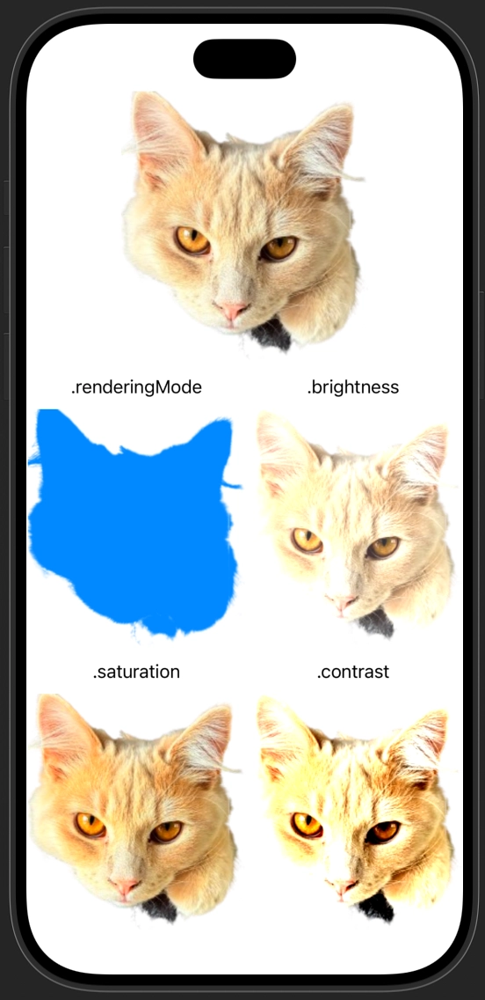

 Si vous travaillez avec une image dont les traits principaux sont en noir, voici une astuce pour transformer les traits noirs dans la couleur de votre choix.

```swift title="SwiftUI"
HStack {
  Image("oiseau")
    .resizable()
    .scaledToFit()
  Image("oiseau")
    .resizable()
    .scaledToFit()
    .colorInvert()   // colorMultiply n’a aucun effet sur le noir. En inversant les couleurs, le fond devient noir (et reste donc inchangé), tandis que les traits, devenus blancs, seront affectés par le filtre
    .colorMultiply(Color(red: 0, green: 1, blue: 1))   // laisser à 0 la couleur désirée au final car tout sera inversé
    .colorInvert()   // le noir redevient blanc et les traits prennent la couleur qui était à 0
}
```

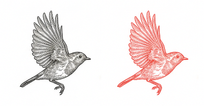

Si vous avez en main une image colorée (clipart ou photo), il est possible d'utiliser `.hueRotation()` pour décaler toutes les couleurs de l'image le long du cercle chromatique.

```swift title="SwiftUI"
HStack {
  Image("ballon_plage")
    .resizable()
    .scaledToFit()
  Image("ballon_plage")
    .resizable()
    .scaledToFit()
    .hueRotation(.degrees(150))   // tester différentes valeurs jusqu'à l'obtention du rendu désiré
 }
```

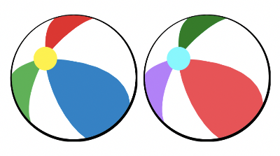

## La bibliothèque d'icônes SF Symbols

Apple a créé pour vous la bibliothèque d'icônes [SF Symbols](https://developer.apple.com/design/human-interface-guidelines/sf-symbols). Ces icônes ont été spécialement conçus pour s'intégrer parfaitement avec les [polices de la famille San Francisco](https://developer.apple.com/fonts/) utilisées par Apple.

### Ajouter un symbole dans une vue

Pour ajouter un de ces symboles à votre application SwiftUI :

```swift title="SwiftUI"
Image(systemName: "graduationcap")
```

Les icônes SF Symbols peuvent également être utilisés avec les contrôles [Label](../complements/quelques-vues-swiftui.md#label-la-combinaison-icone-et-texte).

Il est possible de modifier la couleur d'une icône. Ici, je change la couleur selon la valeur d'une variable booléenne.

```swift title="SwiftUI"
Image(systemName: "sun.max")
  .foregroundStyle(maVariableBooleenne ? Color.black : Color.gray)
```

Pour modifier la taille de l'icône :

```swift title="SwiftUI"
Image(systemName: "sun.max")
  .imageScale(.large)
```

ou encore :

```swift title="SwiftUI"
Image(systemName: "sun.max")
  .font(.title)
```

### Rechercher un symbole

Pour ajouter un symbole SF, il faut connaître son nom.

Voici quelques techniques pour voir la liste des symboles disponibles.

#### Application Symboles SF

La façon la plus efficace pour retrouver le symbole approprié dans la bibliothèque SF Symbols consiste à installer la dernière version de l'application Symboles SF.

Cette application est gratuite et peut être installée à partir du Web : <https://developer.apple.com/sf-symbols/>.

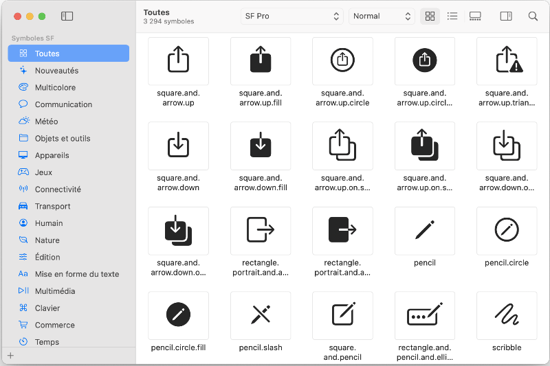

#### Bibliothèque d'objets dans Xcode

Les symboles peuvent également être consultés directement dans Xcode à partir de [la bibliothèque d'objets](travailler-dans-xcode.md#la-bibliotheque-dobjets-object-library).

Il suffit de cliquer sur le dernier icône (celui en forme d'étoile).

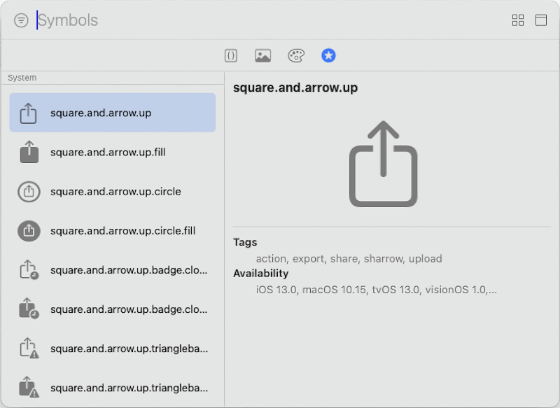

??? info "Pour plus d'information"

    « How to use SF Symbols in SwiftUI ». Simple Swift Guide. <https://www.simpleswiftguide.com/how-to-use-sf-symbols-in-swiftui/>

    « How to get custom colors and transparency with SF Symbols ». Hacking with Swift. <https://www.hackingwithswift.com/quick-start/swiftui/how-to-get-custom-colors-and-transparency-with-sf-symbols>

## Label : la combinaison icône et texte

Dans vos vues SwiftUI, il est facile d'intégrer une icône suivie d'un texte. Le contrôle [Label](https://developer.apple.com/documentation/swiftui/label) est conçu exactement pour celà.

Il est possible de travailler avec [la bibliothèque d'icônes SF Symbols](les-images-et-icones.md#la-bibliotheque-dicones-sf-symbols).

```swift title="SwiftUI"
Label("Ajouter", systemImage: "plus.circle")
```

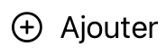

Il est également possible d'utiliser une [image que vous avez ajoutée dans votre projet](../complements/quelques-vues-swiftui.md#ajouter-une-image-dans-un-projet-swiftui).

```swift title="SwiftUI"
Label("Profil", image: "user")
```


