# Les listes

## List

Avec SwiftUI, la vue [List](https://developer.apple.com/documentation/swiftui/list) permet d’afficher des éléments les uns sous les autres et, selon les options choisies, de permettre leur sélection.

Elle gère automatiquement le défilement lorsque le contenu dépasse la hauteur de l’écran.

### Protocole Identifiable

Bien que ce ne soit pas obligatoire, la liste est plus facile à créer à partir d'un tableau dont les éléments répondent au protocole [Identifiable](https://developer.apple.com/documentation/swift/identifiable).

```swift title="Swift"
import SwiftUI

struct Item: Identifiable {
  var id: Int
  var code: String
  var titre: String
  var couleur: Color
}
```

Au besoin, la structure pourra comprendre un identifiant autogénéré à l'aide de [UUID()](https://developer.apple.com/documentation/foundation/uuid).

```swift title="Swift"
struct Item: Identifiable {
  var id: UUID = UUID()
  var code: String
  var titre: String
  var couleur: Color
}
```

Il est désormais possible d'utiliser un tableau de Item dans une liste :

```swift title="SwiftUI"
struct ContentView: View {
  private var items: [Item] = [
    Item(code: "abc", titre: "Item 1", couleur: .blue),
    Item(code: "def", titre: "Item 2", couleur: .red),
    Item(code: "ghi", titre: "Item 3", couleur: .green),
  ]

  var body: some View {
    List(items) {
      Text($0.titre)
    }
  }
}
```

Si vous préférez travailler avec un nom de variable plutôt qu'avec $0 :

```swift title="SwiftUI"
List(items) { item in
  Text(item.titre)
}
```

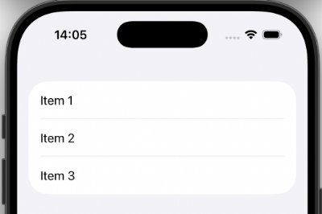

### Masquer le fond gris

On voit que par défaut, le fond de l'écran, derrière la liste, apparaît en gris. Cette apparence peut être changée à l'aide du modifieur [scrollContentBackground()](https://developer.apple.com/documentation/swiftui/view/scrollcontentbackground(_:)?changes=_4).

```swift title="SwiftUI"
List(items) { item in
  Text(item.titre)
}
.scrollContentBackground(.hidden)
```

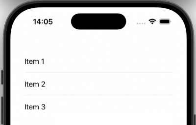

### Si les éléments ne répondent pas au protocole Identifiable

Dans le cas où les éléments de la liste ne répondent pas au protocole `Identifiable`, par exemple une liste de String, il faudra spécifier ce qui identifie chaque élément de façon unique.

Dans le cas le plus simple, on identifiera chaque élément à l'aide de `.self`. Ceci fonctionnera à condition que l'élément réponde au protocole [Hashable](https://developer.apple.com/documentation/swift/hashable). C'est le cas, par exemple, pour les entiers et les chaînes.

En plus d'être Hashable, les éléments devront être uniques sans quoi, SwiftUI aura un comportement erratique puisqu'il ne pourra pas identifier chaque élément.

```swift title="SwiftUI"
struct ContentView: View {
  private var donnees: [String] = ["a", "b", "c", "d", "e", "f", "g"]

  var body: some View {
    List(donnees, id: \.self) { donnee in
      Text(donnee)
    }
  }
 }
```

Dans le cas d'une structure, si [chaque propriété est un entier ou une chaîne](https://developer.apple.com/documentation/swift/hashable#:~:text=For%20structs%20whose%20stored%20properties%20are%20all%20Hashable), il suffit d'ajouter `: Hashable` à la déclaration de la structure.

Voici un exemple avec un tableau d'items :

```swift title="SwiftUI"
// la structure se conforme au protocole Hashable sans rien lui ajouter de plus puisque toutes ses propriétés
// se conforment également au protocole Hashable
struct Jeu: Hashable {
  var nom: String
  var niveau: Int
}
```

```swift title="SwiftUI"
struct ContentView: View {
  private var jeux: [Jeu] = [
    Jeu(nom: "Super Mario Bros.", niveau: 2),
    Jeu(nom: "The Legend of Zelda", niveau: 3),
    Jeu(nom: "Pac-Man", niveau: 2),
    Jeu(nom: "Tetris", niveau: 1)
  ]

  var body: some View {
    List(jeux, id: \.self) { jeu in
      Text(jeu.nom)
    }
  }
}
```

Dans des cas plus complexes, vous pouvez indiquer clairement quelle propriété permettra d'identifier l'élément de façon unique.

Par exemple, si on a une structure `Etudiant` qui contient une propriété `code` unique :

```swift title="SwiftUI"
struct Etudiant {
  var code: String   // le code devra être unique dans le tableau d'étudiants
  var prenom: String
  var nom: String
}
```

```swift title="SwiftUI"
struct ContentView: View {
  private var etudiants: [Etudiant] = [...]

  var body: some View {
    List(etudiants, id: \.code) { etudiant in
      Text(etudiant.prenom)
    }
  }
 }
```

### Affichage sophistiqué

Il est possible d'afficher l'information sous la forme qui vous convient.

```swift title="SwiftUI"
List(items) { item in
  HStack {
    Image(systemName: "paperclip")
    Text(item.code)
      .foregroundColor(item.couleur)
    Text("-")
    Text(item.titre)
      .foregroundColor(item.couleur)
  }
 }
```

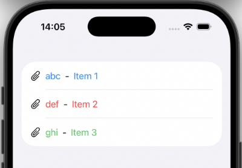

### Avec ForEach

Il est possible de combiner List et [ForEach](https://developer.apple.com/documentation/swiftui/foreach) afin de bénéficier de tous les aspects gérées automatiquement par List comme le défilement, le style natif ou encore la possibilité de sélection,  tout en bénéficiant de plus de souplesse pour générer l'affichage de chacun des éléments de la liste.

Voici un exemple qui permet d'afficher des sous-catégories :

```swift title="Swift"
private var itemsCategorie1: [Item] = [
  Item(code: "abc", titre: "Item 1", couleur: .blue),
  Item(code: "ghi", titre: "Item 3", couleur: .green),
 ]

private var itemsCategorie2: [Item] = [
  Item(code: "def", titre: "Item 2", couleur: .red),
  Item(code: "jkl", titre: "Item 4", couleur: .purple),
  Item(code: "mno", titre: "Item 5", couleur: .orange),
 ]
...

List {
  Section(header: Label("Catégorie 1", systemImage: "seal")) {
    ForEach(itemsCategorie1) { item in
      HStack {
        Text(item.code)
          .foregroundColor(item.couleur)
        Text("-")
        Text(item.titre)
          .foregroundColor(item.couleur)
      }
    }
  }

  Section(header: Label("Catégorie 2", systemImage: "cone")) {
    ForEach(itemsCategorie2) { item in
      HStack {
        Text(item.code)
          .foregroundColor(item.couleur)
        Text("-")
        Text(item.titre)
          .foregroundColor(item.couleur)
      }
    }
  }
 }
```

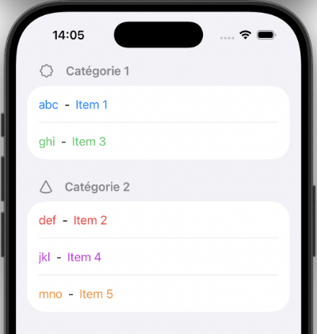

### Sélectionner un élément

La vue List est capable de gérer la sélection d'un élément.

Ici, ID doit être en lettres majuscules car il représente le type de données du paramètre id de la structure qui répond au protocole Identifiable.

```swift title="SwiftUI"
struct ContentView: View {
  private var items: [Item] = [
    Item(code: "abc", titre: "Item 1", couleur: .blue),
    Item(code: "def", titre: "Item 2", couleur: .red),
    Item(code: "ghi", titre: "Item 3", couleur: .green),
  ]
  @State private var selection: Item.ID?

  var body: some View {
    VStack {
      List(items, selection: $selection) { item in
        Text(item.titre)
      }

      if let selection,
        let itemSelectionne = items.first(where: { $0.id == selection }) {
        Text(itemSelectionne.titre)
      }
      else {
        Text("Aucune sélection")
      }
    }
  }
 }
```

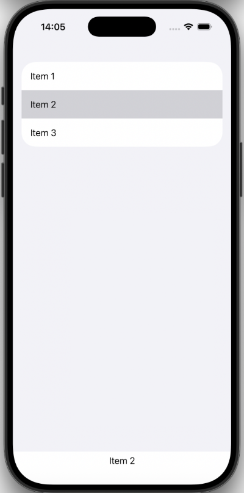

### Sélectionner plusieurs éléments

La sélection multiple est possible seulement si la liste est placée en mode édition.

```swift title="SwiftUI"
struct ContentView: View {
  private var items: [Item] = [
    Item(code: "abc", titre: "Item 1", couleur: .blue),
    Item(code: "def", titre: "Item 2", couleur: .red),
    Item(code: "ghi", titre: "Item 3", couleur: .green),
  ]
  @State private var selections: Set<Item.ID> = []

  var body: some View {
    VStack {
      List(items, selection: $selections) { item in
        Text(item.titre)
      }
      .environment(\.editMode, .constant(.active))

      Text("\(selections.count) items sélectionnés")
    }
  }
 }
```

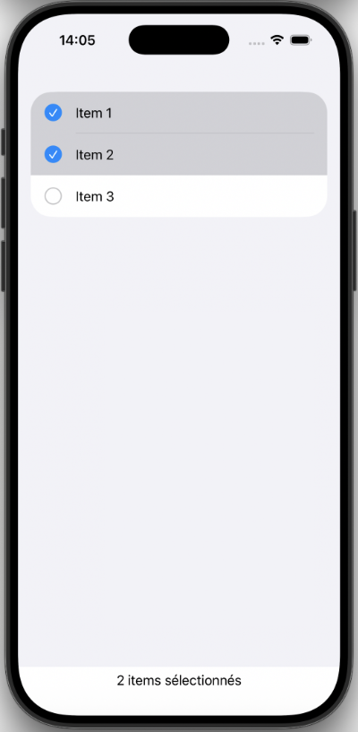

### Changer l'apparence de l'item sélectionné

Le modifieur [listRowBackground()](https://developer.apple.com/documentation/swiftui/view/listrowbackground(_:)) permet de mieux contrôler l'apparence de l'item sélectionné.

```swift title="SwiftUI"
@State private var selection: Item.ID?
...
List(items, selection: $selection) { item in
  Text(item.titre)
    .listRowBackground(item.id == selection
      ? Color.gray.opacity(0.1)
      : nil
    )
 }
```

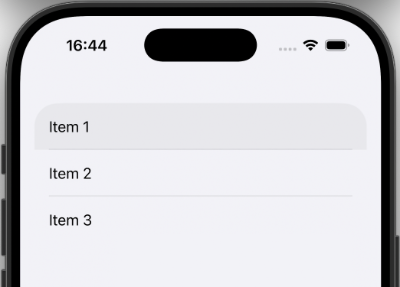

Dans le cas où le contenu de la liste n'est pas généré directement par List, il faudra ajouter un `.tag()` pour permettre à List de reconnaître les éléments lors de la sélection.

```swift title="SwiftUI"
List(selection: $selection) {
  ForEach(items) { item in
    HStack {
      Image(systemName: "paperclip")
      Text(item.code)
        .foregroundColor(item.couleur)
      Text("-")
      Text(item.titre)
        .foregroundColor(item.couleur)
    }
    .tag(item.id)
    .listRowBackground(item.id == selection
      ? Color.gray.opacity(0.1)
      : nil
    )
  }
 }
```

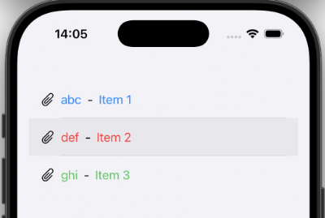

### Placer deux boutons sur une même ligne du List

Par défaut, dans une liste, SwiftUI étire la zone cliquable des boutons sur toute la largeur de l'écran. Un seul bouton par ligne est donc cliquable.

Ce comportement est pratique : il permet de cliquer n'importe où sur la ligne pour réaliser l'action du bouton.

Si vous avez besoin de plus d'un bouton par ligne, il faut limiter la taille des boutons à l'aide d'un style prédéfini (`.buttonStyle()`).

```swift title="SwiftUI"
struct LignePanier: Identifiable {
  var id: UUID = UUID()
  var produit: String
  var quantite: Int = 0
}
```

```swift title="SwiftUI"
struct ContentView: View {
  @State private var lignesPanier: [LignePanier] = [
    LignePanier(produit: "Produit 1"),
    LignePanier(produit: "Produit 2"),
    LignePanier(produit: "Produit 3"),
  ]

  var body: some View {
    List($lignesPanier){ $lignePanier in
      VStack {
        HStack {
          Text(lignePanier.produit)
          Spacer()
          Text("Quantité : \(lignePanier.quantite)")
        }

        HStack {
          Button(action: {
            lignePanier.quantite = lignePanier.quantite - 1
          }) {
            Text("-")
              .frame(maxWidth: .infinity)
              .padding()
              .foregroundColor(Color.primary)
              .background(Color.secondary .opacity(0.4))
              .cornerRadius(15.0)
          }
          .buttonStyle(.borderless)   // nécessaire avec deux boutons sur la même ligne

          Spacer().frame(width: 20)

          Button(action: {
           lignePanier.quantite = lignePanier.quantite + 1
          }) {
            Text("+")
              .frame(maxWidth: .infinity)
              .padding()
              .foregroundColor(Color.primary)
              .background(Color.secondary .opacity(0.4))
              .cornerRadius(15.0)
          }
          .buttonStyle(.borderless)    // nécessaire avec deux boutons sur la même ligne
        }
      }
    }
  }
}
```

Le visuel est très sommaire mais il permet d'illustrer l'importance de `.buttonStyle()` pour placer deux boutons côte-à-côte sur une ligne de la liste.

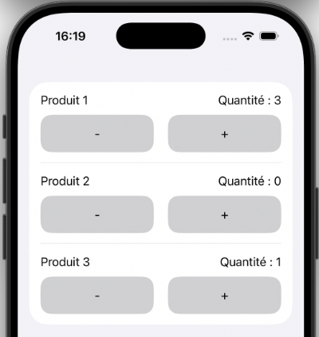

??? info "Pour plus d'information"

    « SwiftUI - Dynamic List & Identifiable ». Medium. <https://medium.com/flawless-app-stories/swiftui-dynamic-list-identifiable-73c56215f9ff>

    « What is the difference between List and ForEach in SwiftUI? ». Stack Overflow. <https://stackoverflow.com/questions/56535326/what-is-the-difference-between-list-and-foreach-in-swiftui>

    « Why does \.self work for ForEach? ». Hacking with Swift. <https://www.hackingwithswift.com/books/ios-swiftui/why-does-self-work-for-foreach>

    « How to conform to the Hashable protocol ». Hacking with Swift. <https://www.hackingwithswift.com/example-code/language/how-to-conform-to-the-hashable-protocol>

## ContentUnavailableView

Lorsque des informations ne peuvent être affichées, la vue [ContentUnavailableView](https://developer.apple.com/documentation/swiftui/contentunavailableview) est toute indiquée pour afficher un message avec une apparence uniformisée, le tout optimisé pour `VoiceOver`.

Différentes causes peuvent empêcher l'affichage d'informations, telles que :

- Liste vide
- Informations d'une API non disponibles
- Erreur réseau qui ne permet pas de s'authentifier
- Permission manquante

Le `ContentUnavailableView` est conçu pour s'afficher au centre de l'écran et occuper tout l'espace disponible. Si vous respectez cette prémisse, son utilisation est plutôt intuitive.

Voici quelques cas d'utilisation.

### ContentUnavailableView.search

Lors de l'affichage des résultats d'une recherche, SwiftUI a prévu un affichage standardisé.

Grâce à la propriété [.search](https://developer.apple.com/documentation/swiftui/contentunavailableview/search), une seule ligne de code suffit à afficher une vue avec icône, texte et description.

```swift title="SwiftUI"
NavigationStack {
  if !resultats.isEmpty {
    List(resultats) { resultat in
      DonneesResultat(resultat)
    }
  }
  else {
    ContentUnavailableView.search
  }
  .navigationTitle("Résultats de recherche")
}
```

Le message apparaîtra [dans la langue de localisation](la-localisation-traduction.md#application-swiftui-bilingue) déterminée par le croisement entre les langues supportées par l'application et la langue configurée sur l'appareil.

|  |  |
| --- | --- |
| en anglais | en français |
| Dans la langue par défaut (ici, l'anglais) | Si la langue de localisation est le français |

### Icône et message

`ContentUnavailableView` permet de personnaliser l'icône et le message à afficher.

Dans ce second exemple, on affiche un simple message sous une icône.

```swift title="SwiftUI"
ContentUnavailableView("Aucun favori", systemImage: "star.slash")
```

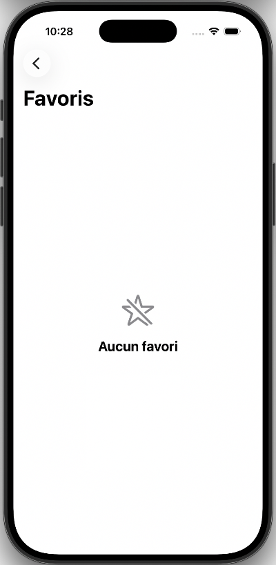

### Icône, message et description

Ce troisième exemple démontre qu'il est possible d'ajouter une description.

```swift title="SwiftUI"
ContentUnavailableView(
  "Aucun résultat pour « \(terme) »",
  systemImage: "magnifyingglass",
  description: Text("Essayez un autre filtre.")
 )
```

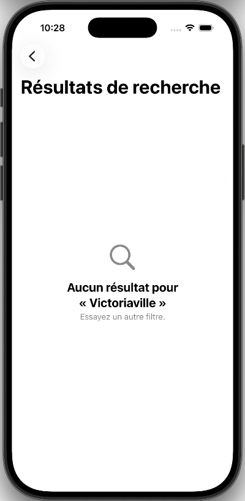

### Icône, message, description et action

Il est possible d'ajouter un bouton pour inciter l'usager à l'action.

Au besoin, ce pourrait également être un lien ou un menu.

```swift title="SwiftUI"
ContentUnavailableView {
  Label("Aucun item", systemImage: "square.grid.2x2")
} description: {
  Text("Vous pouvez ajouter un premier item.")
} actions: {
  Button("Ajouter") {
    // naviguer vers le formulaire d'ajout
  }
  .buttonStyle(.bordered)
}
```

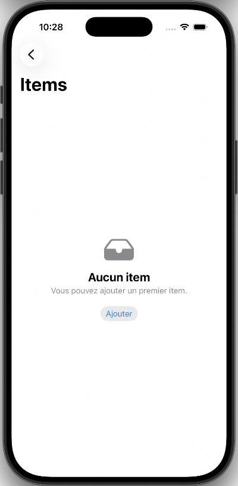

Voici un autre exemple intéressant.

```swift title="SwiftUI"
ContentUnavailableView {
  Label("Connexion impossible", systemImage: "wifi.slash")
 } description: {
  Text("Vérifiez votre connexion et réessayez.")
 } actions: {
  Button("Réessayer") {
    // retenter l'appel à l'API
  }
 }
```

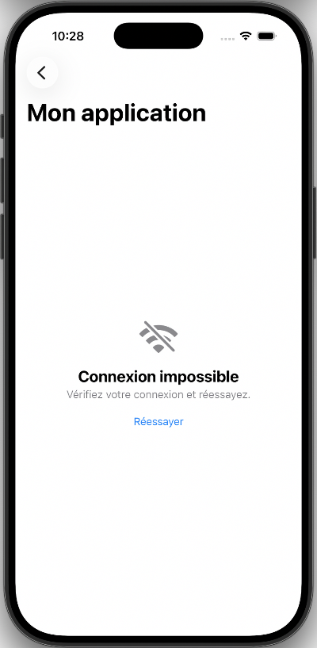

## Ajouter du texte ou un bouton en haut ou en bas d'un List

Lorsqu'une vue affiche des informations à l'aide d'un `List`, SwiftUI se charge de mettre tout le fond d'écran en grisé.

Si vous tentez d'ajouter une autre vue en haut ou en bas du `List`, par exemple un texte ou un bouton, le fond d'écran deviendra blanc sous la barre de navigation dans le haut de l'écran.

|  |  |
| --- | --- |
| List sans bouton | Problème avec bouton |
| List sans bouton | List avec bouton - fond blanc sous le titre |

Voici quelques techniques pour contourner ce problème.

### Barre d'outils

La barre d'outils est souvent l'endroit idéal pour placer un bouton.

```swift title="SwiftUI"
NavigationStack {
  List(items) { item in
    Text(item.titre)
  }
  .navigationTitle("Items")
  .toolbar(content: {
    ToolbarItem(placement: .topBarLeading, content: {
      Button("Ajouter") { ... }
    })
  })
}
```

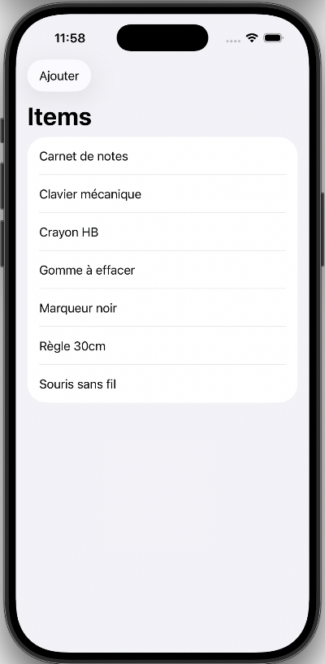

Cette solution ne convient cependant pas à l'affichage d'un texte.

### .safeAreaInset

Une autre solution, cette fois autant pour un bouton que pour un texte, consiste à utiliser [.safeAreaInset](https://developer.apple.com/documentation/swiftui/view/safeareainset(edge:alignment:spacing:content:)-6gwby). Cette méthode permet d'ajouter du contenu alentour d'une vue.

Le texte ou le bouton sera à position fixe même quand la liste défile.

```swift title="SwiftUI"
NavigationStack {
  List(items) { item in
    Text(item.titre)
  }
  .safeAreaInset(edge: .top) {
    VStack(spacing: 0) {
      Divider()
      Button("Ajouter") { ... }
        .frame(maxWidth: .infinity)
        .padding()
        .buttonStyle(.bordered)
    }
  }
  .navigationTitle("Items")
}
```

Le texte ou le bouton sera dans le haut de la liste avec `edge: .top` et dans le bas avec `edge: .bottom`.

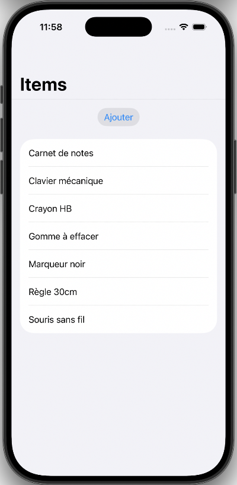 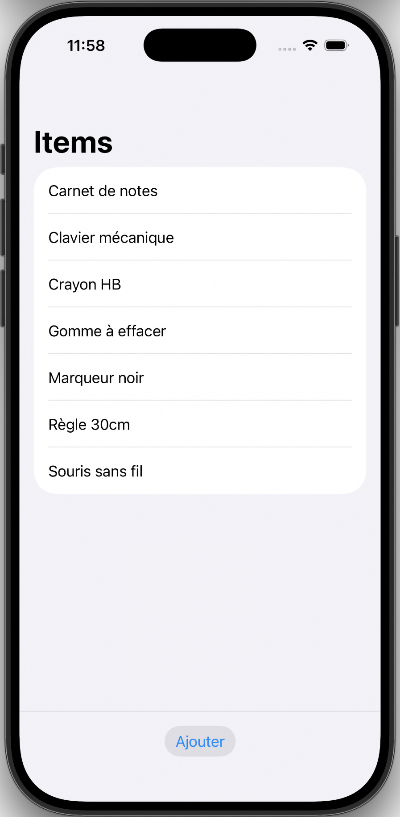

Pour éviter que la liste soit visible derrière le `safeAreaInset`, il suffit d'ajouter `.background(.ultraThinMaterial)` à la vue placée à l'intérieur du `safeAreaInset`.

### Section

Le texte ou le bouton pourra être intégré directement dans la liste à l'aide d'un `Section`.

Avec cette technique, le bouton défilera avec la liste.

```swift title="SwiftUI"
NavigationStack {
  List {
    Section {
      Button("Ajouter") { ... }
        .frame(maxWidth: .infinity)
    }
    ForEach(items) { item in
      Text(item.titre)
    }
  }
  .navigationTitle("Items")
}
```

En déplaçant le `Section` avant ou après le `ForEach`, le bouton sera avant ou après la liste.

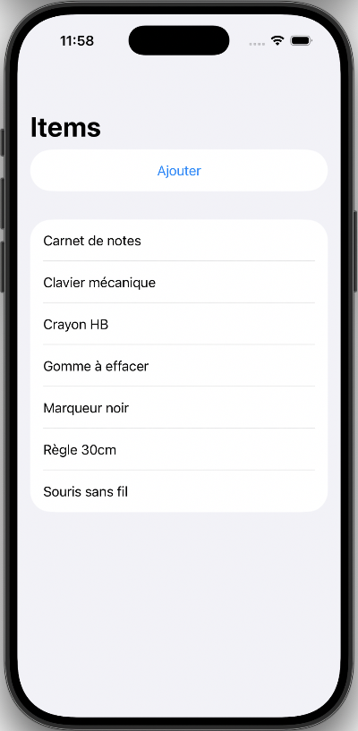 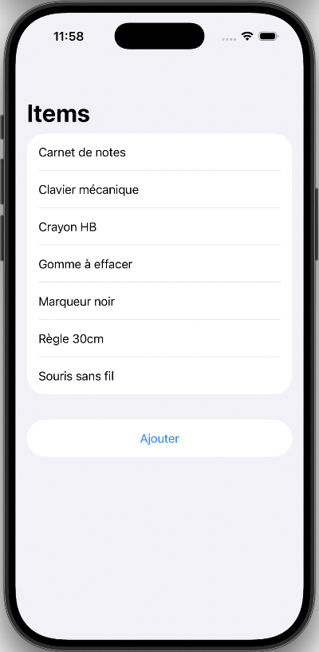
