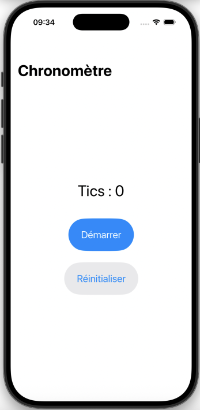
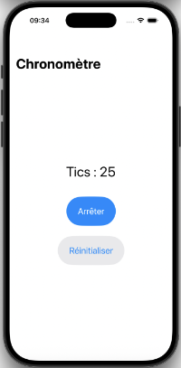

# Les minuteurs

## Timer

Une application SwiftUI peut lancer une action de façon répétée selon un intervalle donné, par exemple à l'aide d'un publisher basé sur Timer.

### Timer qui démarre automatiquement

Le Timer sera instancié comme suit :

```swift title="SwiftUI"
import Combine
...
let timer = Timer.publish(every: 1, on: .main, in: .common)
  .autoconnect()
```

Ceci indique qu'une action sera lancée à toutes les secondes sur le fil d'exécution principal et sur la boucle d'exécution principale.

Il est possible d'ajouter une [tolérance](https://developer.apple.com/documentation/foundation/timer/1415085-tolerance) afin de permettre à iOS d'optimiser l'utilisation de son énergie.

```swift title="SwiftUI"
let timer = Timer.publish(every: 1, tolerance: 0.5, on: .main, in: .common)
  .autoconnect()
```

L'action à réaliser sera précisée dans la méthode onReceive() attachée à la vue de votre choix, par exemple le VStack principal.

```swift title="SwiftUI"
VStack {
  ...
}
.onReceive(timer) { time in
  ...
}
```

Il est possible d'arrêter le Timer comme suit :

```swift title="SwiftUI"
timer.upstream.connect().cancel()
```

Attention : une fois la connexion annulée, ce publisher ne peut plus être reconnecté.

### Démarrer et arrêter le Timer manuellement

Si l'action doit être déclenchée seulement lors d'un clic sur un bouton, il faut conserver une référence à la connexion du timer.

```swift title="SwiftUI"
import Combine // requis pour Cancellable

struct ContentView: View {
  let timer = Timer.publish(every: 1, on: .main, in: .common)
  @State private var timerConnection: Cancellable? = nil
  ...
  var body: some View {
    VStack {
      ...
      Button(action: {
        ...
        timerConnection = timer.connect()
      }) {
        Text("Démarrer")
      }
    }
    .onReceive(timer) {time in
      // ...
    }
  }
}
```

Et pour arrêter le timer :

```swift title="SwiftUI"
timerConnection?.cancel()
```

Attention : une fois la connexion annulée, ce publisher ne peut plus être reconnecté.

### Application dans laquelle le Timer doit être arrêté puis redémarré

Un TimerPublisher connecté ne peut pas être reconnecté après avoir été annulé.

Je vous propose deux astuces pour une application qui a un tel besoin.

Pour la démonstration, j'ai créé une petite application de chronomètre.

   

#### Variable d'état qui contrôle l'exécution du onReceive

L'astuce consiste à démarrer le Timer automatiquement et à utiliser une variable d'état booléenne pour indiquer si l'action doit être réalisée ou non.

```swift title="SwiftUI"
import Combine

struct ContentView: View {
  static let intervalle = 0.1 // static pour permettre d'utiliser la constante lors de la déclaration d'une autre propriété
  @State private var tics = 0
  @State private var enCours = false

  let timer = Timer.publish(every: intervalle, on: .main, in: .common).autoconnect()

  var body: some View {
    NavigationStack {
      VStack(spacing: 25) {
        Text("Tics : \(tics)")
          .font(.largeTitle)
          .padding()
        Button(action: {
          enCours.toggle()
        }) {
          Text(enCours ? "Arrêter" : "Démarrer")
            .font(.title2)
            .padding()
        }
        .buttonStyle(.borderedProminent)

        Button(action: {
          enCours = false
          tics = 0
        }) {
          Text("Réinitialiser")
            .font(.title2)
            .padding()
        }
        .buttonStyle(.bordered)
      } // fin VStack
      .navigationTitle("Chronomètre")
      .onReceive(timer) {time in
        if enCours {
          tics = tics + 1
        }
      }
    }
  }
}
```

#### Recréation du Timer

Une autre technique consiste à recréer le Timer afin qu'il puisse redémarrer. Ceci n'est cependant pas la solution optimale du point de vue de la gestion des ressources.

Le Timer devra être une variable d'état pour permettre qu'on lui réassigne une valeur.

```swift title="SwiftUI"
import Combine

struct ContentView: View {
  static let intervalle = 0.1
  @State private var tics = 0
  @State private var enCours = false
  @State private var timer = Timer.publish(every: intervalle, on: .main, in: .common)
  @State private var timerConnection: Cancellable?

  var body: some View {
    NavigationStack {
      VStack(spacing: 25) {
        Text("Tics : \(tics)")
          .font(.largeTitle)
          .padding()
        Button(action: {
          if enCours {
            timerConnection?.cancel()
          }
          else {
            timerConnection?.cancel() // tue l'ancien timer s'il y a lieu
            timer = Timer.publish(every: ContentView.intervalle, on: .main, in: .common)
            timerConnection = timer.connect()
          }
          enCours.toggle()
        }) {
          Text(enCours ? "Arrêter" : "Démarrer")
            .font(.title2)
            .padding()
        }
        .buttonStyle(.borderedProminent)

        Button(action: {
          enCours = false
          timerConnection?.cancel()
          tics = 0
        }) {
          Text("Réinitialiser")
            .font(.title2)
            .padding()
        }
        .buttonStyle(.bordered)
      }
      .navigationTitle("Chronomètre")
      .onReceive(timer) {time in
        tics = tics + 1
      }
    }
  }
}
```

??? info "Pour plus d'information"

    « Triggering events repeatedly using a timer ». Hacking with Swift. <https://www.hackingwithswift.com/books/ios-swiftui/triggering-events-repeatedly-using-a-timer>

## DispatchQueue

La classe [DispatchQueue](https://developer.apple.com/documentation/dispatch/dispatchqueue) permet de lancer une opération une fois après un certain délai.

```swift title="SwiftUI"
if afficherMessage {
  Text(message)
    .onAppear {
      DispatchQueue.main.asyncAfter(deadline: .now() + 3) {
        afficherMessage = false
      }
    }
}
```
