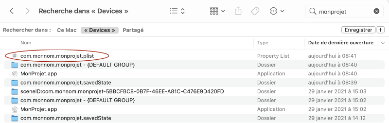
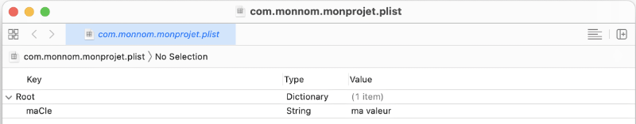

# Les préférences utilisateur

## @AppStorage

L'enregistrement d'informations dans un fichier plat est une façon simple et rapide de conserver des données de base sous forme de paires clé-valeur.

Les préférences utilisateurs sous SwiftUI sont spécifiquement conçues à cette fin.

Il n'y a pas de limite à la quantité de données qui peuvent être enregistrées dans les préférences utilisateur, sauf si vous programmez pour tvOS (limite de 1 Mo[1](https://developer.apple.com/documentation/foundation/userdefaults/sizelimitexceedednotification)).

Les préférences utilisateur doivent cependant être réservées à des données peu volumineuses puisqu'un volume de données trop élevé pourrait causer des problèmes de performance.

Pour créer une préférence utilisateur, la technique la plus simple consiste à travailler avec l'attribut [@AppStorage](https://developer.apple.com/documentation/swiftui/appstorage) (en anglais, on dit que c'est un **property wrapper**).

Cet attribut est en fait une « enveloppe » alentour de la classe [UserDefaults](../complements/preferences-utilisateur-avec-userdefaults.md).

Attention : les données enregistrées avec @AppStorage (ou avec UserDefaults) ne sont pas sécurisées. Elle ne doivent donc pas servir à stocker des informations sensibles.

Les variables @AppStorage sont semblable à celles déclarées avec [@State](https://developer.apple.com/documentation/swiftui/state)  : SwiftUI rafraîchira automatiquement la vue dès qu'un changement de valeur est détecté.

### Types de données acceptés

Les informations enregistrées avec @AppStorage sont enregistrées dans un fichier .plist (**property list**). Aussi, elles sont limitées à certains types de données.

Donc, lorsqu'une variable est déclarée avec l'attribut @AppStorage, elle doit être de l'un de ces types :

- String
- Int
- Bool
- Double
- URL
- Data

### Retrouver la valeur enregistrée pour une clé

Dès qu'une variable est déclarée avec @AppStorage, la valeur de la clé spécifiée est lue dans UserDefaults et est prête à être utilisée.

```swift title="SwiftUI"
struct ContentView: View {
    @AppStorage("maCle") var maValeur: String = "clé maCle inexistante"

    var body: some View {
        // si la clé existait, sa valeur sera affichée. Sinon, on verra la valeur qu'on lui a donné par défaut.
        Text(maValeur)
    }
}
```

### Enregistrer une paire clé-valeur

Puisque la variable a été déclarée avec @AppStorage, il suffit de lui assigner une valeur pour que l'information soit enregistrée [dans le fichier .plist des préférences utilisateur](les-preferences-utilisateur.md#ou-sont-enregistrees-les-preferences-utilisateur).

```swift title="SwiftUI"
Button("Cliquez ici", action: {
    maValeur = "Valeur initialisée par bouton"
 })
```

### Valeur utilisée dans plusieurs vues

Si une préférence utilisateur doit d'être utilisée dans plusieurs vues de l'application, il n'y a rien de plus simple : il suffit de redéclarer la préférence utilisateur dans chacune des vues qui en a besoin.

Ainsi, chaque vue aura sa propre variable qui sera liée à la préférence utilisateur.

```swift title="SwiftUI"
struct ContentView: View {
    @AppStorage("maCle") var maValeur: String = "clé maCle inexistante"
    var body: some View {
        ...
        Text(maValeur)
        ...
    }
}
```

La même déclaration sera faite dans chacune des vues qui a besoin de la préférence utilisateur.

```swift title="SwiftUI"
struct AutreVue: View {
    @AppStorage("maCle") var maValeur: String = "clé maCle inexistante"
    var body: some View {
        ...
        Text(maValeur)
        ...
    }
}
```

### Source

1. « sizeLimitExceededNotification ». Apple. <https://developer.apple.com/documentation/foundation/userdefaults/1617187-sizelimitexceedednotification>

## Où sont enregistrées les préférences utilisateur?

Lorsque vous enregistrez des préférences utilisateur à l'aide de [UserDefaults](../complements/preferences-utilisateur-avec-userdefaults.md) ou [@AppStorage](les-preferences-utilisateur.md#appstorage), les informations sont enregistrées dans un fichier .plist (**property list**).

Pendant le développement de votre application, le fichier .plist sera créé sur votre ordinateur dès que vous lancez l'application dans le simulateur de Xcode.

Pour consulter ce fichier, ouvrez le Finder puis rendez-vous dans le dossier `/Users/votrenom/Library/Developer/CoreSimulator/Devices`.

Pour accéder à ce chemin, vous devez configurer le Finder pour [afficher les dossiers cachés](travailler-avec-un-mac.md).

De là, effectuez une recherche (<kbd>⌘ Cmd</kbd>+<kbd>F</kbd> dans le Finder) pour trouver un fichier dont le nom correspond à l'identifiant unique de votre application (Bundle ID). Assurez-vous que le Finder soit configuré pour [limiter les recherches au dossier actuel et à ses sous dossiers](travailler-avec-un-mac.md).

Le chemin sera quelque chose du genre `/Users/votrenom/Library/Developer/CoreSimulator/Devices/7A17BF42-9EB2-4EA7-BDAA-7620AAB825A3/data/Containers/Data/Application/5F681DC8-ECAF-4134-AE8D-548183F0EDF6/Library/Preferences/com.monnom.monprojet.plist`.



Il est dangereux d'éditer le contenu de ce fichier, tel que spécifié dans la documentation officielle[1](https://developer.apple.com/documentation/foundation/userdefaults):

> Don’t try to access the preferences subsystem directly. Modifying preference property list files may result in loss of changes, delay of reflecting changes, and app crashes. To configure preferences, use the defaults command-line utility in macOS instead.

Néanmoins, une fois le fichier localisé, il est intéressanat de l'ouvrir dans Xcode afin de voir son contenu. Le plus simple est de faire glisser le fichier à partir du Finder vers l'icône de Xcode dans le Dock.



### Source

1. « UserDefaults ». Apple. <https://developer.apple.com/documentation/foundation/userdefaults>

??? info "Pour plus d'information"

    « Change macOS user preferences via command line ». pawelgrzybek.com. <https://pawelgrzybek.com/change-macos-user-preferences-via-command-line/>

    « How To Change Preferences From The Command Line On MacOS? ». Shell Tips!. <https://www.shell-tips.com/mac/defaults/>
