# Outils d'assistance au codage dans Xcode

## Complétion de code

La complétion de code consiste à afficher des éléments de syntaxe, par exemple les types disponibles selon le contexte.

La complétion de code apparaît dans un rectangle gris.

Lorsqu'elle est activée, la complétion de code apparaît au fur et à mesure que le développeur tape son code (option **Automatically**) ou lorsqu'il appuie sur la touche <kbd>Escape</kbd> (option **On Demand**).

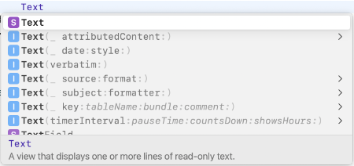   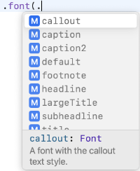

Pour activer la complétion de code :

- Rendez-vous dans le menu **Settings** puis sélectionnez l'onglet **Editing**.
- Cliquez sur **Completion**.
- Vis-à-vis l'option **Display code completions while typing**, choisissez **Automatically** ou **On Demand**.

## Prédictions de code

Les prédictions de code surviennent lorsque Xcode suggère du code après avoir analysé ce que le développeur est en train de coder. Il affiche alors en semi-transparence ce qu'il croit que le développeur pourrait vouloir écrire.

Il arrive que les prédictions complètent simplement une instruction. Dans d’autres situations, Xcode peut suggérer plusieurs lignes de code.

Les prédictions de code sont basées sur un modèle de langage local qui apprend des motifs fréquemment utilisés et qui prédit la suite probable du code.

Lorsqu'elles sont activées, les prédictions de code apparaissent au fur et à mesure que le développeur tape son code (option **Automatically**) ou lorsqu'il appuie sur les touches <kbd>⌃ Ctrl</kbd>+<kbd>⌥ Option</kbd>+<kbd>Espace</kbd> (option **On Demand**).

Le développeur doit appuyer sur <kbd>Tab</kbd> pour accepter la prédiction.

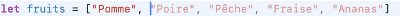   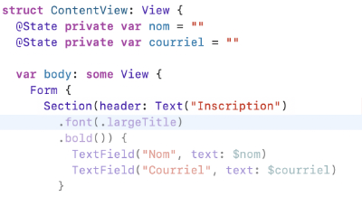

Pour activer les prédictions de code :

- Rendez-vous dans le menu **Settings** puis sélectionnez l'onglet **Editing**.
- Cliquez sur **Completion**.
- Vis-à-vis l'option **Display code predictions**, choisissez **Automatically** ou **On Demand**.

## Assistance au codage alimentée par l'IA

Depuis Xcode 26, sorti en 2025, il est possible de configurer une assistance au codage alimentée par l'IA (en anglais : **coding intelligence**). Il s'agit d'associer Xcode avec un outil d'intelligence artificielle générative.

Cet outil, à partir du contexte de l'application en cours de développement, peut générer du code, corriger des erreurs dans le code, optimiser du code, bref, tout ce qui peut être réalisé par une IA générative.

Pour que l'assistance au codage alimentée par l'IA soit disponible dans Xcode, vous devez utiliser macOS Tahoe ou ultérieur.

Attention : il est clairement indiqué[1](https://developer.apple.com/documentation/xcode/setting-up-coding-intelligence#:~:text=the%20product%20can%20share%20your%20project%20files%20and%20other%20information%20with%20their%20model) que lorsqu'un de ces produits est activé, il peut partager les fichiers de votre projet et d’autres informations avec son modèle lors du traitement de vos demandes.

> When you choose a third-party product and begin entering prompts in the coding assistant, the product can share your project files and other information with their model when processing your requests.

Assurez-vous que cet outil est autorisé avant de l'activer.

Pour configurer votre assistance au codage alimentée par l'IA :

- Dans Xcode, rendez-vous dans le menu **Settings** puis sélectionnez l'onglet **Intelligence**. Si l'onglet n'est pas présent, c'est probablement parce que vous utilisez une version de Xcode inférieure à 26 ou une version de macOS antérieure à Tahoe (version 26).

  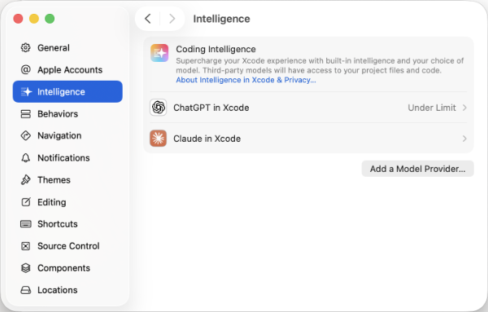
- Cliquez sur l'option désirée. Ici, je vais faire la démonstration avec ChatGPT.

  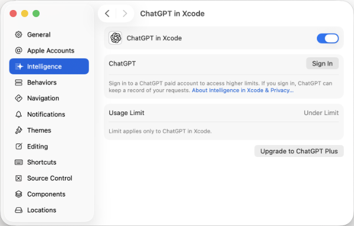
- Connectez-vous à votre compte ChatGPT.
- Et voilà!

Pour utiliser l'assistant au codage :

- Cliquez sur l'icône **Coding Assistant** dans la zone supérieure gauche.
- Posez vos questions et voyez comment l'assistant peut vous aider.

  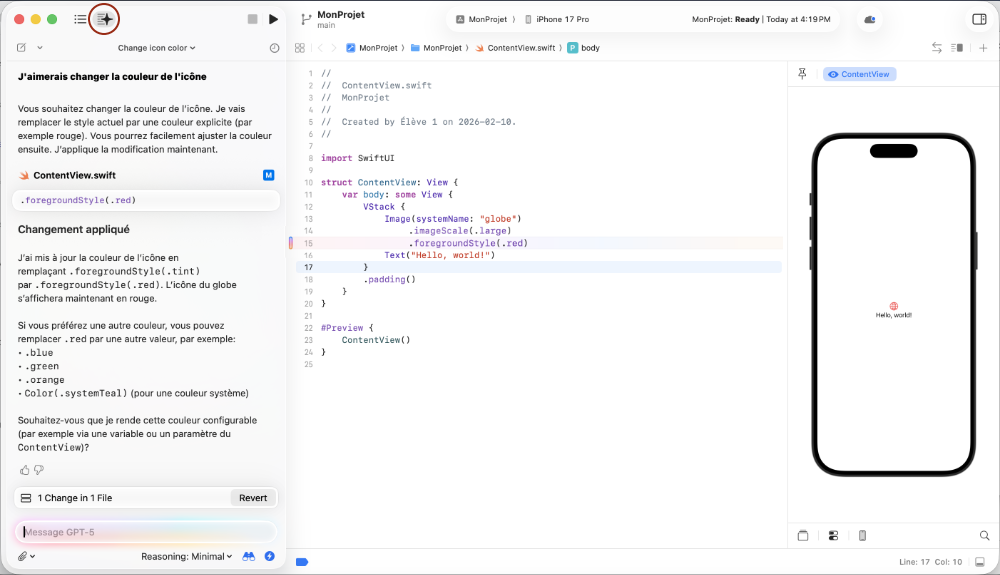

  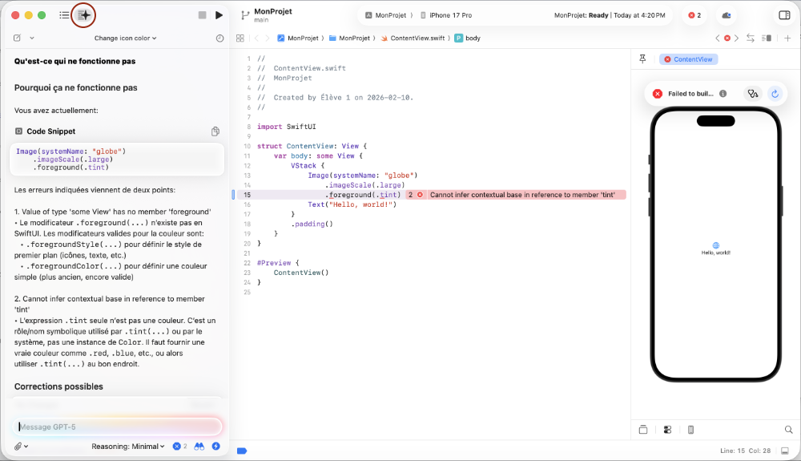
- L'assistant au codage peut aussi vous être utile quand votre code génère une erreur. Dans la boîte de dialogue qui donne les détails sur l'erreur, le bouton **Generate** permet d'utiliser l'IA pour corriger le code.

  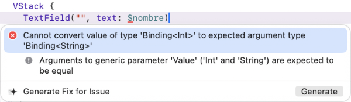

Notez que l'utilisation que vous faites de votre outil d'IA dans votre éditeur puisera dans vos limites d'utilisation imposées par cet outil.

### Source

1. « Setting up coding intelligence ». Apple Developer. [https://developer.apple.com/documentation/xcode/setting-up-coding-intelligence](https://developer.apple.com/documentation/xcode/setting-up-coding-intelligence#:~:text=the%20product%20can%20share%20your%20project%20files%20and%20other%20information%20with%20their%20model)

### Pour plus d'information

« Setting up coding intelligence ». Apple Developer. <https://developer.apple.com/documentation/xcode/setting-up-coding-intelligence>

## Désactiver les outils d'assistance au codage

Si vous devez coder dans un contexte où l'assistance au codage est interdite, voici comment configurer Xcode pour désactiver :

- l'assistance au codage alimentée par l'IA
- les prédictions de code
- la complétion de code

### Assistance au codage alimentée par l'IA

L'[assistance au codage alimentée par l'IA](outils-d-assistance-au-codage-dans-xcode.md#assistance-au-codage-alimentee-par-lia) consiste à configurer Xcode pour qu'il intègre un outil d'intelligence artificielle générative, par exemple ChatGPT ou Claude.AI.

Pour désactiver l'assistance au codage alimentée par l'IA :

- Dans Xcode, rendez-vous dans le menu **Settings** puis sélectionnez l'onglet **Intelligence**. Cet onglet est disponible seulement si vous utilisez Xcode 26 ou plus ainsi que macOS Tahoe ou plus récent.
- Cliquez sur l'outil auquel vous vous êtes connecté.
- Désactivez cet outil à l'aide du bouton à bascule.

  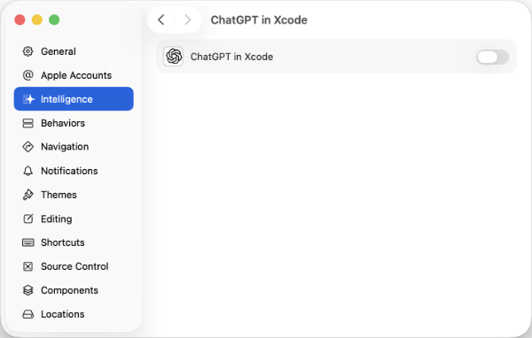

### Prédictions de code

Les [prédictions de code](outils-d-assistance-au-codage-dans-xcode.md#predictions-de-code) surviennent lorsque Xcode suggère du code après avoir analysé ce que le développeur est en train de coder. Il affiche alors en semi-transparence ce qu'il croit que le développeur pourrait vouloir écrire.

Pour désactiver les prédictions de code :

- Rendez-vous dans le menu **Settings** puis sélectionnez l'onglet **Editing**.
- Cliquez sur **Completion**.
- Vis-à-vis l'option **Display code predictions**, choisissez **Never**.

  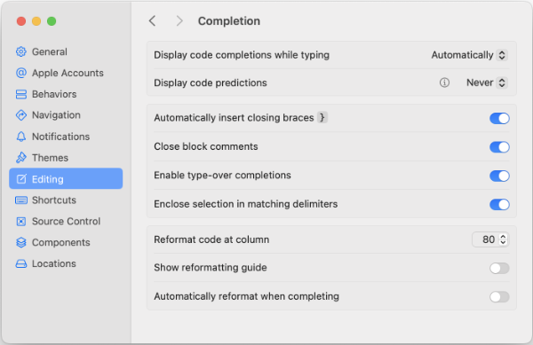

### Complétion de code

La [complétion de code](outils-d-assistance-au-codage-dans-xcode.md#completion-de-code) consiste à afficher dans un rectangle gris des éléments de syntaxe, par exemple les types disponibles selon le contexte.

Pour désactiver la complétion de code :

- Rendez-vous dans le menu **Settings** puis sélectionnez l'onglet **Editing**.
- Cliquez sur **Completion**.
- Vis-à-vis l'option **Display code completions while typing**, choisissez **Never**. Ceci désactivera par la même occasion l'option **Display code predictions**.

  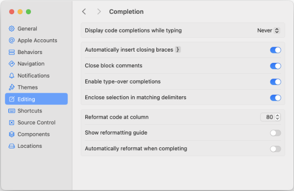
