# Position des éléments à l'écran

## Fonctionnement de base du système de position de SwiftUI

Dans une vue SwiftUI, à peu près tous les éléments graphiques, incluant les couleurs, sont eux aussi des vues.

Chaque vue est affichée dans un parent, le parent ultime étant l'écran ou plus précisément la zone sécuritaire de l'écran (**safe area**).

Quand vient le temps de placer un élément à l'écran, le parent et l'enfant sont sollicités[1](https://www.hackingwithswift.com/books/ios-swiftui/understanding-frames-and-coordinates-inside-geometryreader) :

- Le parent de cet élément suggère une taille et une position.
- L'enfant décide de l'espace et la position qu'il désire occuper en fonction de ce qui a été suggéré par le parent. Plusieurs modifieurs lui permettent de le faire, par exemple .`position()`, `.offset()`, `.frame()`, `.padding()`, etc.

Pour bien comprendre ce concept, je vous propose une petite démonstration :

```swift title="SwiftUI"
struct ContentView: View {
  var body: some View {
    VStack(spacing: 0) {
      Text("Hello, world!")
        .background(Color.yellow)
        .padding()

      Circle()
        .background(Color.orange)
        .foregroundColor(.green)
        .padding(50)

      Circle()
        .padding()
        .background(Color.pink)
        .foregroundColor(.blue)

      Text("Bye!")
        .padding()
        .background(Color.gray)
    }
  }
}
```

Les éléments sont positionnés l'un sous l'autre grâce au `VStack`.

J'ai ajouté `spacing: 0` au `VStack` pour assurer que tout l'espacement soit dû aux paddings que j'ai utilisés.

J'ai volontairement placé les paddings parfois directement sous l'élément, parfois après `background()`.

Dans Xcode, on peut configurer le canevas pour que des lignes bleues entourent l'espace qu'une vue occupe effectivement à l'écran quand on clique sur cette vue dans le code.

Ces quatre images montrent les lignes bleues quand on clique dans l'ordre sur le premier texte, sur le premier cercle, sur le second cercle puis sur le second texte.

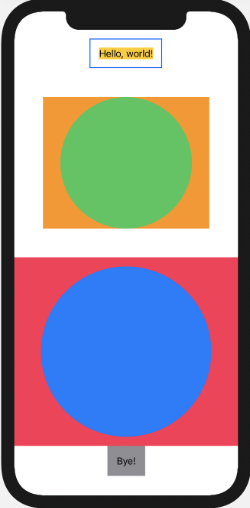 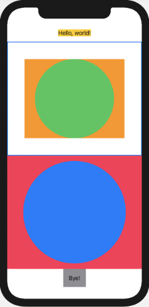 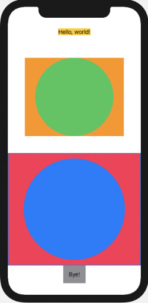 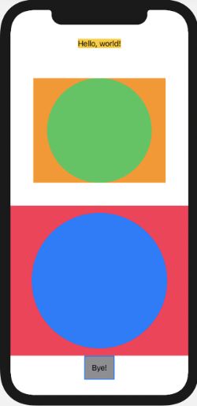

Le premier texte commence par recevoir une couleur de fond. Cette couleur, qui est une vue, occupe tout l'espace de son parent, le texte. Donc, la couleur ne déborde pas du texte.

Puisque le padding est appliqué après le `background()`, il y a une marge non colorée alentour de la couleur de fond.

La même chose se produit pour le premier cercle. La couleur de fond est appliquée directement au cercle donc elle remplit l'espace occupé par le cercle puis le padding ajoute une marge alentour de cet espace. J'ai forcé la marge à 50 pour que ce soit plus visible.

Avec le second cercle, on commence par appliquer le padding au cercle. La couleur de fond est appliquée à ce padding donc elle occupe tout l'espace du cercle et de sa marge.

Remarquez que le second cercle est plus gros que le premier et ce, même si les deux sont positionnés dans le même VStack et sans forcer leur taille. Ceci est dû au `padding(50)` appliqué au premier cercle. Le parent calcule la taille maximale du cercle par rapport à l'espace disponible et aux modifieurs qu'il utilise. Dans un tel cas, si le cercle avait voulu imposer sa taille à l'aide de `.frame(width: 390)`, le cercle aurait gardé la même taille puisque l'espace ne le permet pas.

Pour terminer, la couleur de fond couvre le texte et sa marge puisque le padding a été appliqué avant le `background()`.

### Source

1. « Understanding frames and coordinates inside GeometryReader ». Hacking with Swift. <https://www.hackingwithswift.com/books/ios-swiftui/understanding-frames-and-coordinates-inside-geometryreader>

## Modifieur .padding()

Le modifieur [.padding()](https://developer.apple.com/documentation/swiftui/view/padding(_:_:)) permet d'ajouter de l'espace alentour d'une vue.

Ce modifieur est très utilisé. Il fait d'ailleurs partie de la vue générée par défaut dans un nouveau projet SwiftUI afin d'assurer qu'aucun texte ne soit collé directement au bord de l'écran.

### Côté où l'espacement doit être ajouté

Lorsqu'il est utilisé sans paramètre, le modifieur `.padding()` ajoute un espacement égal de chaque côté de la vue.

```swift title="SwiftUI"
Text("Hello, world!")
  .padding()
  .background(Color.yellow)
```

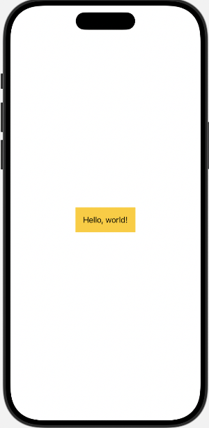

Il est possible de préciser le ou les côtés où l'espacement doit être ajouté. Les [paramètres disponibles](https://developer.apple.com/documentation/swiftui/edge/set) à cet effet sont :

- `.all` (valeur par défaut)
- .`top`
- `.bottom`
- `.leading` (espacement placé avant la vue, normalement à sa gauche)
- `.trailing` (espacement placé après la vue, normalement à sa droite)
- `.horizontal` (de chaque côté horizontal, normalement à gauche et à droite)
- `.vertical` (de chaque côté vertical, normalement en haut et en bas)

```swift title="SwiftUI"
Text("Hello, world!")
  .padding(.leading)
  .background(Color.yellow)
```

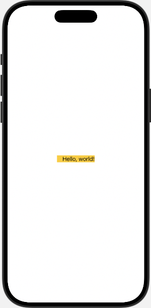

Si vous désirez ajouter un espacement partout sauf en bas :

```swift title="SwiftUI"
Text("Hello, world!")
  .padding(.horizontal)
  .padding(.top)
  .background(Color.yellow)
```

Cette syntaxe est équivalente :

```swift title="SwiftUI"
Text("Hello, world!")
  .padding([.horizontal, .top])
  .background(Color.yellow)
```

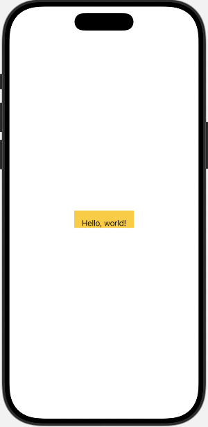

### Taille de l'espacement

La taille de l'espacement est calculée en points.

Par défaut, SwiftUI utilise une taille qui tient compte du périphérique utilisé.

Vous avec la possibilité de spécifier la taille désirée à l'aide d'un nombre ou d'une variable de type GCFloat.

```swift title="SwiftUI"
Text("Hello, world!")
  .padding(100)
  .background(Color.yellow)
```

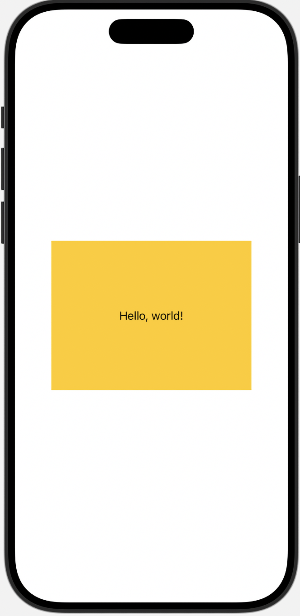

```swift title="SwiftUI"
Text("Hello, world!")
  .padding(.leading, 50)
  .background(Color.yellow)
```

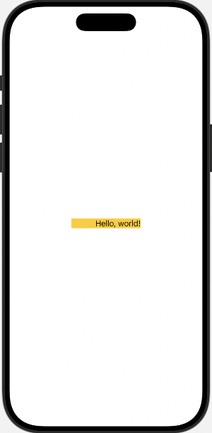

```swift title="SwiftUI"
Text("Hello, world!")
  .padding(.horizontal, 100)
  .padding(.vertical, 30)
  .backgound(Color.yellow)
```

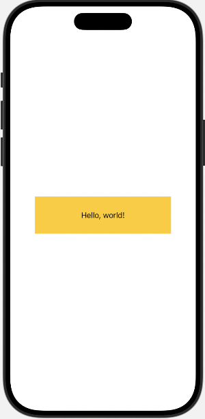

```swift title="SwiftUI"
Text("Hello, world!")
   .padding([.horizontal, .top], 75)
  .backgound(Color.yellow)
```

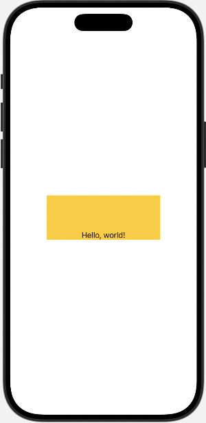

La dimension des espacements peut également être fournie à l'aide d'un paramètre de type [EdgeInsets](https://developer.apple.com/documentation/swiftui/edgeinsets) :

```swift title="SwiftUI"
Text("Hello, world!")
  .padding(EdgeInsets(top: 10, leading: 20, bottom: 30, trailing: 40))
  .backgound(Color.yellow)
```

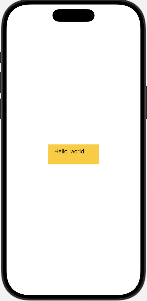

## Tenir compte de la taille de l'écran avec GeometryReader

Les vues de votre application mobile doivent pouvoir s'adapter à la taille de l'écran afin d'être agréables à utiliser autant sur un petit téléphone que sur un grand.

### Taille fixe

Si un rectangle est créé avec une taille fixe, il prendra une plus grosse proportion de l'écran sur un iPhone 13 mini (5,4 po de diamètre) que sur un iPhone 13 Pro Max (6,7 po de diamètre).

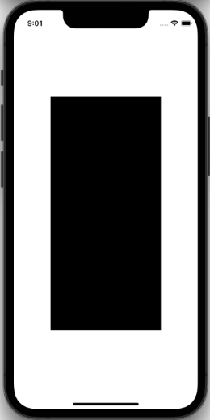 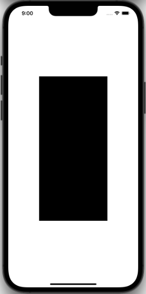

### GeometryReader

La structure [GeometryReader](https://developer.apple.com/documentation/swiftui/geometryreader) permet d’obtenir les dimensions réellement disponibles pour une vue dans l’interface.

Il s’agit de l’espace que la vue parente réserve à la vue enfant lors de la mise en page.

Lorsque `GeometryReader` est appliqué au niveau de la vue la plus englobante de l'interface, cet espace correspond à la zone protégée, c'est-à-dire la zone dans laquelle il est sécuritaire d'afficher du contenu.

La variable `geometry`, fournie par la fonction anonyme, est de type [GeometryProxy](https://developer.apple.com/documentation/swiftui/geometryproxy). Elle permet d'accéder aux dimensions de la zone.

Je vous fais la démonstration avec un rectangle qui utilise presque tout l'espace disponible.

```swift title="SwiftUI"
var body: some View {
  GeometryReader { geometry in
    NavigationStack {
      Rectangle().frame(
        width: geometry.size.width * 0.85,
        height: geometry.size.height * 0.85
      )
      .navigationTitle("GeometryReader")
    }
  }
 }
```

Peu importe la taille de l'écran, le rectangle occupera 85% de la zone protégée.

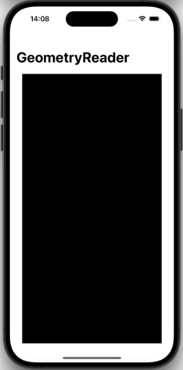

#### Taille réservée pour la barre de navigation du haut et du bas de l'écran

La valeur obtenue par `geometry.size.height` inclut l'espace réservé pour les barres de navigation du haut et du bas. Donc, dans l'exemple précédent, si on n'avait pas demandé à utiliser 85% de cette valeur, la barre de navigation aurait été complètement cachée.

Le `GeometryReader` permet de connaître précisément la taille réservée pour la barre de navigation du haut et pour celle du bas.

```swift title="SwiftUI"
let hauteurBarreNavigationHaut = geometry.safeAreaInsets.top
let hauteurBarreNavigationBas = geometry.safeAreaInsets.bottom
```

#### GeometryReader et variables d'état

Si une application a besoin d'initialiser une variable d'état à partir  du `GeometryReader`, il faut utiliser une petite astuce. En effet, les variables d'état sont déclarées en dehors du `body` donc elles ne peuvent pas utiliser le `GeometryReader` pour obtenir leur valeur initiale.

On se tournera alors sur la méthode [onAppear()](constructeur-et-onappear.md#onappear) pour contourner le problème.

Il faudra donner une valeur initiale quelconque à la variable d'état et écraser cette valeur dès que l'écran apparaît.

Important : il faut appliquer `onAppear()` sur une vue placée à l'intérieur du `GeometryReader`.

```swift title="SwiftUI"
struct ContentView: View {
  @State private var maVariable: CGFloat = 0.0

  var body: some View {
    GeometryReader { geometry in
      NavigationStack {
        VStack {
          ...
          Text("Valeur: \(maVariable)")
        }
        .navigationTitle("Le titre")
      }
      .onAppear(perform: {
        maVariable = geometry.size.height
      })
    }
  }
}
```

### Taille par rapport à l'écran entier

Avant iOS 26, il était possible de travailler avec `UIScreen.main` pour retrouver les dimensions de l'écran entier.

Cette fonctionnalité est maintenant obsolète.

Avec ceci, on obtenait un rectangle qui occupait la moitié de la taille de l'écran.

```swift title="SwiftUI"
Rectangle()
  .frame(
    width:UIScreen.main.bounds.width / 2,
    height:UIScreen.main.bounds.height / 2
  )
```

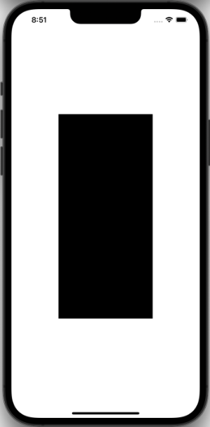

### Pour plus d'information

« Layout ». Apple. <https://developer.apple.com/design/human-interface-guidelines/layout>

« Understanding frames and coordinates inside GeometryReader ». Hacking with Swift. <https://www.hackingwithswift.com/books/ios-swiftui/understanding-frames-and-coordinates-inside-geometryreader>
