# Quelques vues SwiftUI

## Text

La structure [Text](https://developer.apple.com/documentation/swiftui/text) est beaucoup utilisée dans les différents écrans d'une application SwiftUI.

Elle permet, comme son nom le suggère, d'afficher un texte à l'écran.

### Texte simple

Dans sa forme la plus simple, la structure `Text` affichera un texte composé de quelques mots.

```swift title="SwiftUI"
Text("Hello world!")
```

### Texte multilignes

Pour afficher un texte sur plusieurs lignes, il suffit d'ajouter un modifieur pour limiter l'espace occupé par le texte, par exemple le modifieur `.frame()`.

```swift title="SwiftUI"
Text("J'étudie en informatique au cégep de Victoriaville.")
  .frame(width: 100)
```

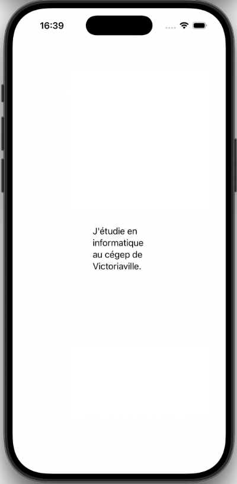

### Taille du texte

#### Types dynamiques

SwiftUI vous permet de spécifier la taille du texte à l'aide de types dynamiques. Il s'agit de valeurs prédéfinies dans la structure [Font](https://developer.apple.com/documentation/swiftui/font).

```swift title="SwiftUI"
Text("Bravo!")
  .font(.largeTitle)
```

**Il est fortement conseillé d'utiliser les types dynamiques**  plutôt que des tailles fixes. Les types dynamiques permettent à l’application de s’adapter automatiquement au réglage de taille de police choisi par l’usager sur son appareil.

La taille des différents types dynamiques est spécifiée ici : <https://developer.apple.com/design/human-interface-guidelines/typography#iOS-iPadOS-Dynamic-Type-sizes>.

Voici un aperçu des différents types dynamiques.

Le dernier texte sur l'image utilise une taille fixe, tel que démontré [dans la section plus bas](quelques-vues-swiftui.md#text).

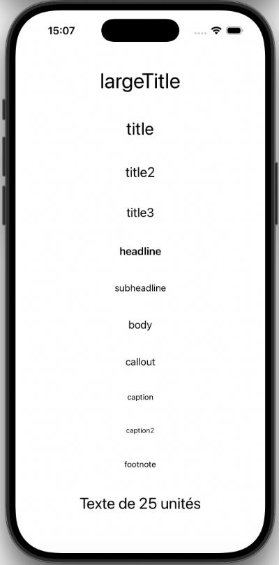

Notez que l'usager peut modifier le réglage de taille de police sur son iPhone à partir du menu **Réglages** / **Accessibiilté** / **Affichage et taille du texte** / **Police plus grande**.

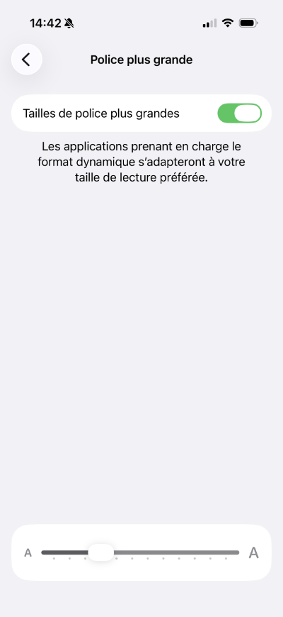

#### Taille fixe

Lorsque le contexte l'exige, il est possible de forcer une taille en unités.

```swift title="SwiftUI"
Text("Texte de 25 unités")
  .font(.system(size: 25.0))
```

### Markdown

Le texte à afficher peut utiliser le langage de balisage Markdown, que SwiftUI saura interpréter.

On déclarera d'abord le texte à l'aide d'un [AttributedString()](https://developer.apple.com/documentation/foundation/attributedstring).

```swift title="SwiftUI"
let monTexte = try! AttributedString(
  markdown: "Caractères _italiques_ **gras** ~~barrés~~")

var body: some View {
  Text(monTexte)
}
```

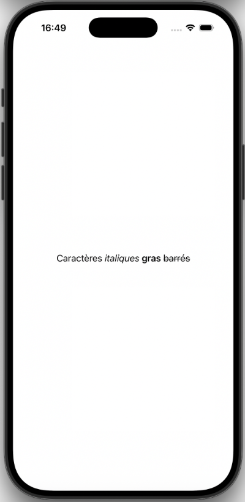

### Émoticones

En bonus, vous pouvez utiliser un Text pour afficher des émoticônes. macOS permet d'ailleurs de faire apparaître une fenêtre d'émoticônes en appuyant sur les touches<kbd>⌃ Ctrl</kbd>+<kbd>⌘ Cmd</kbd>+<kbd>Espace</kbd>.

```swift title="SwiftUI"
Text("Il fait soleil 😎")
```

### Date ajustée selon la localisation de l'appareil mobile

Si vous avez en main une instance de [Date](https://developer.apple.com/documentation/foundation/date), il est possible de la convertir en chaîne directement dans un `Text` grâce au paramètre [style](https://developer.apple.com/documentation/swiftui/text/init(_:style:)).

```swift title="SwiftUI"
Text(Date.now, style: .date)
```

Selon les configurations de l'appareil mobile, ceci afficher une date du genre 11 avril 2026 ou April 11, 2026.

??? info "Pour plus d'information"

    « Getting Started with SwiftUI and Working with Text ». App Coda. <https://www.appcoda.com/learnswiftui/swiftui-text.html>

    « Typography - Supporting Dynamic Type ». Apple Developer. <https://developer.apple.com/design/human-interface-guidelines/typography#Supporting-Dynamic-Type>

## Button

### Apparence du bouton

Un bouton peut prendre n'importe quelle apparence.

Je vous présente ici quelques exemples.

Dans les premiers exemples, le bouton ne fait rien. Je vous montre [plus bas](quelques-vues-swiftui.md#button) comment spécifier l'action qu'il doit réaliser.

#### Texte cliquable

Au plus simple, le bouton sera un texte cliquable.

```swift title="SwiftUI"
Button("Cliquez ici") {
  // traitement ici
}
```

Vous verrez souvent une syntaxe qui utilise un libellé pour identifier certains paramètres.

```swift title="SwiftUI"
Button("Cliquez ici", action: {
  // traitement ici
})
```

Le même résultat peut être obtenu avec ceci :

```swift title="SwiftUI"
Button(action: {
  // traitement ici
}) {
  Text("Cliquez ici")
}
```

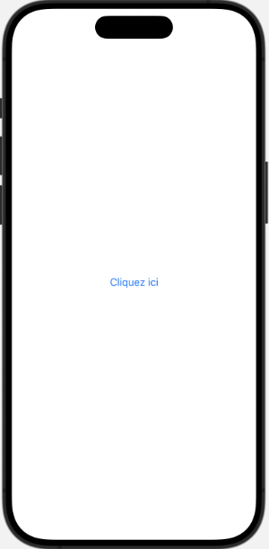

#### Style prédéfini

Il existe quelques styles prédéfinis qui permettent d'obtenir rapidement un bouton plus intéressant.

```swift title="SwiftUI"
Button(action: {
  // traitement ici
 }) {
  Text("Cliquez ici")
 }
 .buttonStyle(.bordered)
```

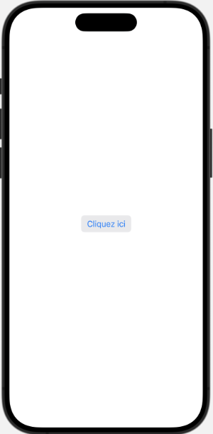

Parfois, on utilisera le style prédéfini `.borderless`, qui n'affecte pas l'apparence. Ceci permettra notamment de placer plusieurs boutons côte-à-côte dans un List.

Sans cette précaution, SwiftUI ne saurait pas sur quel bouton l'usager a cliqué puisque dans un List, la zone cliquable d'un bouton est étirée sur toute la largeur de l'écran.

```swift title="SwiftUI"
List(items) { item in
  ...
  Button(action: {
    ...
  }) {
    Image(systemName: "pencil.line")
  }
  .buttonStyle(.borderless)
  Button(action: {
    ...
  }) {
    Image(systemName: "trash")
  }
  .buttonStyle(.borderless)
}
```

#### Rôle

Le bouton peut avoir un rôle qui aura un impact sur son apparence.

Dans certains contextes, le rôle influencera même la position du bouton par rapport aux autres boutons afin d'assurer une meilleure cohésion entre les applications.

Voici un exemple de bouton avec le rôle [.destructive](https://developer.apple.com/documentation/swiftui/buttonrole/destructive), qui devrait être utilisé lorsque le bouton permet de supprimer des données ou d'effectuer une opération irréversible.

```swift title="SwiftUI"
Button(
  role: .destructive,
  action: {
    // traitement ici
 }) {
  Text("Cliquez ici")
 }
 .buttonStyle(.bordered)
```

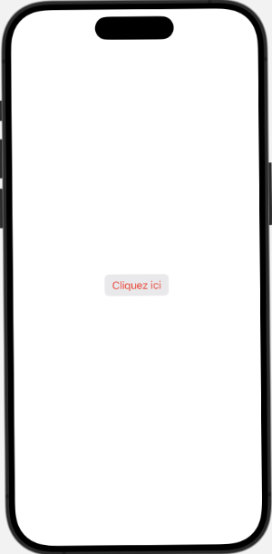

#### Modifieurs

Il est possible d'ajouter des modifieurs pour donner au texte l'apparence de notre choix.

```swift title="SwiftUI"
Button(action: {
  // traitement ici
}) {
  Text("Cliquez ici")
    .padding()
    .foregroundColor(Color.white)
    .background(Color.orange)
    .cornerRadius(15.0)
 }
```

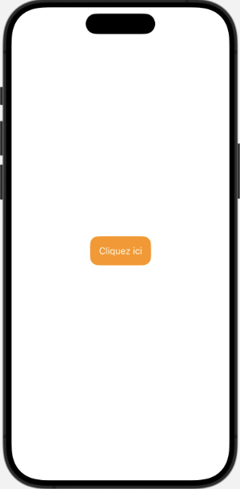

##### Emplacement des modifieurs

Dans la majorité des cas, il faut appliquer les modifieurs à ce qui définit l'apparence du bouton (ici : `Text()`).

```swift title="SwiftUI"
Button(action: {
  // traitement ici
 }) {
  Text("Cliquez ici")
    .padding(50)
    .foregroundColor(Color.white)
    .background(Color.orange)
    .cornerRadius(15.0)
 }
```

Si vous appliquez les modifieurs au bouton, il pourrait arriver que le bouton ne soit pas entièrement cliquable.

Dans cet exemple, puisque le bouton comprend un gros padding, seule la partie centrale du bouton pourra être cliquée.

```swift title="SwiftUI"
Button(action: {
  // traitement ici
 }) {
  Text("Cliquez ici")
 }
 .padding(50)
 .foregroundColor(Color.white)
 .background(Color.orange)
 .cornerRadius(15.0)
```

Ces deux syntaxes sont équivalementes et causent le même problème.

```swift title="SwiftUI"
Button("Cliquez ici", action: {
  // traitement ici
})
.padding(50)
.foregroundColor(Color.white)
.background(Color.orange)
.cornerRadius(15.0)
```

Par contre, certains modifieurs devront impérativement être appliqués au bouton, par exemple si vous désirez modifier la position par programmation.

```swift title="SwiftUI"
Button(action: {
  // traitement ici
}) {
  Text("Cliquez ici")
    .padding(50)
    .foregroundColor(Color.white)
    .background(Color.orange)
    .cornerRadius(15.0)
 }
.position(positionX, positionY)
```

Autre exemple avec un ombrage :

```swift title="SwiftUI"
Button(action: {
  // traitement ici
}) {
  Text("Cliquez ici")
    .padding()
    .frame(height: 100)
    .foregroundColor(Color.white)
    .font(.title)
    .background(Color.red)
    .cornerRadius(15.0)
    .shadow(color: Color.gray, radius: 2, x: CGFloat(2), y: CGFloat(2))
 }
```

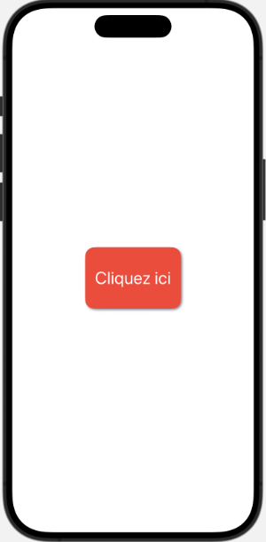

Autre exemple avec un dégradé :

```swift title="SwiftUI"
Button(action: {
  // traitement ici
}) {
  Text("Cliquez ici")
    .padding()
    .foregroundColor(.black)
    .background(LinearGradient(gradient: Gradient(colors: [.white, .gray]), startPoint: .top, endPoint: .bottom))
    .border(Color(red: 0.9, green: 0.9, blue: 0.9), width: 1)
 }
```

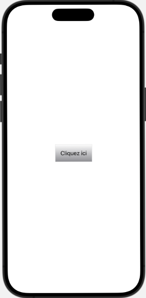

#### Image cliquable

Le bouton peut aussi être sous forme d'[image](quelques-vues-swiftui.md#ajouter-une-image-dans-un-projet-swiftui).

Ici, j'ai choisi de placer du texte par-dessus l'image et d'utiliser des modifieurs pour obtenir un résultat plus esthétique. Bon, on s'en reparlera pour l'esthétisme, ça parait que je ne suis pas graphiste ;-)

```swift title="SwiftUI"
Button(action: {
  // traitement ici
}) {
  ZStack {
    Image("texture")
      .frame(width: 140, height: 45)
      .cornerRadius(10)
    Text("Cliquez ici")
      .fontWeight(.bold)
      .foregroundColor(.white)
      .shadow(color: Color.black, radius: 5)
  }
}
```

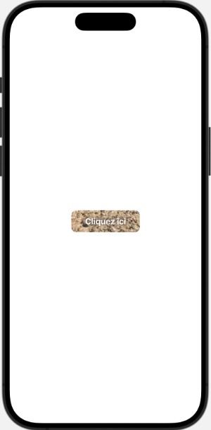

### Action du bouton

L'action du bouton peut être spécifiée dans une fonction anonyme ou encore dans une [fonction nommée](les-fonctions.md#declarer-une-fonction-swift).

```swift title="SwiftUI"
Button("Cliquez ici", action: {
  if reponse == reponseValide {
    ...
  }
})
```

ou

```swift title="SwiftUI"
Button("Cliquez ici", action: {traiterReponse()})
```

Lorsque le traitement consiste à appeler une seule fonction et que cette fonction ne reçoit pas de paramètre, il est possible de laisser tomber les accolades de l'action ainsi que les parenthèses de la fonction.

```swift title="SwiftUI"
Button("Cliquez ici", action: traiterReponse)
```

### Bouton inactif

Un bouton peut être désactivé à l'aide du modifieur `.disabled()`.

Ce modifieur prend en paramètre une condition qui, si elle est évaluée à true, rendra le bouton inactif.

```swift title="SwiftUI"
@State private var desactiverBouton: Bool = false
...
Button(action: {
  // traitement ici
}) {
  Text("Cliquez ici")
}
.buttonStyle(.bordered)
.disabled(desactiverBouton)
```

|  |  |
| --- | --- |
| Sans disabled | Avec disabled |
| Bouton activé | Bouton désactivé |

??? info "Pour plus d'information"

    « Button ». Apple. <https://developer.apple.com/documentation/swiftui/button>

    « Mastering SwiftUI Buttons: How to Create and Customise Button ». SwiftyPlace. <https://www.swiftyplace.com/blog/mastering-swiftui-buttons-a-comprehensive-guide-to-creating-and-customizing-buttons>

## Link

La structure [Link](https://developer.apple.com/documentation/swiftui/link) permet d'afficher un lien.

On doit préciser le texte du lien puis, dans la propriété destination, l'URL.

Une des particularités de la structure [URL](https://developer.apple.com/documentation/foundation/url), c'est que son constructeur, lorsqu'il reçoit en paramètre une chaîne qui représente l'URL, peut retourner nil (sa signature est `init?(string: String)`). Ceci oblige le développeur à vérifier si l'URL a bien été fourni, particulièrement lorsque les informations proviennent de variables.

### URL codé en dur

Lorsque l'URL est codé en dur, nous savons qu'il a été fourni. Il est donc acceptable d'ajouter un point d'exclamation à la fin ([**implicitly unwrapped optional**](https://swiftsenpai.com/swift/making-sense-of-swift-operators/)).

```swift title="SwiftUI"
Link("Source de l'image : Open Clipart",
  destination: URL(string: "https://openclipart.org/detail/4074/small-funny-angry-monster")!
)
```

### URL dans une variable

Si l'URL provient d'une variable, par exemple s'il est saisi par l'usager ou s'il est tiré d'une base de données, il n'est pas sécuritaire d'utiliser le point d'exclamation. Si on le faisait et que l'URL était nil, on obtiendrait le message « Fatal error: Unexpectedly found nil while unwrapping an Optional value » lors de l'exécution de l'application.

Il existe une technique plus sécuritaire pour effectuer ce travail : tester si la chaîne n'est pas à nil avant d'utiliser le point d'exclamation.

```swift title="SwiftUI"
if adresse != nil {
  Link("Pour plus d'information", destination: URL(string: adresse)!)
 }
```

### Lien sur une image

Plutôt que de fournir un texte sur lequel on cliquera, il est possible d'utiliser une image, un Label ou même un assemblage dans un [contrôle d'empilement](quelques-vues-swiftui.md#les-controles-dempilement-vstack-hstack-zstack).

```swift title="SwiftUI"
Link(destination: URL(string: "https://mobile1.profinfo.ca")!) {
  VStack {
    Image("logo-mobile1")
    Text("Mobile1")
  }
}
```

## Color

La structure [Color](https://developer.apple.com/documentation/swiftui/color) permet de représenter une couleur.

Dans la mesure du possible, évitez de coder en dur les couleurs dans votre code. Ceci rend plus difficile la gestion des modes Apparence Claire vs Apparence Sombre.

### Couleurs prédéfinies

La structure Color propose des propriétés de classe pour définir des couleurs standard :

- Color.black
- Color.blue
- Color.gray
- Color.green
- Color.orange
- Color.pink
- Color.purple
- Color.red
- Color.white
- Color.yellow


Les couleurs peuvent être utilisées dans des méthodes qui attendent en paramètre une structure Color.

```swift title="SwiftUI"
Text("Texte rouge")
  .foregroundColor(.red)
```

### Rôles ou statuts

La structure Color propose également des propriétés de classe pour choisir une couleur par son statut ou son rôle plutôt que par son nom :

- [Color.accentColor](https://developer.apple.com/documentation/swiftui/color/accentcolor) (par défaut : bleu)
- [Color.clear](https://developer.apple.com/documentation/swiftui/color/clear) (blanc en mode Apparence Claire ou noir en mode Apparence Sombre)
- [Color.primary](https://developer.apple.com/documentation/swiftui/color/primary) (noir en mode Apparence Claire ou blanc en mode Apparence Sombre)
- [Color.secondary](https://developer.apple.com/documentation/swiftui/color/secondary) (noir avec transparence en mode Apparence Claire ou blanc avec transparence en mode Apparence Sombre))


## Message popup avec .alert()

La méthode [alert()](https://developer.apple.com/documentation/swiftui/view/alert(_:ispresented:presenting:actions:message:)-8584l) permet d'afficher un du texte dans une boîte flottante (**popup**).

Son principe est le suivant : on appelle la méthode en fournissant notamment une valeur au paramètre `isPresented`. La valeur de ce paramètre doit provenir d'une variable avec liaison, donc précédée par un signe $. Ce peut être par exemple une variable déclarée avec l'attribut `@State`.

Le popup s'affichera seulement quand ce paramètre prendra la valeur true.

### Alerte avec bouton OK

Par défaut, le texte de l'alerte s'affichera dans une boîte avec un bouton OK qui permet de la refermer.

```swift title="SwiftUI"
struct ContentView: View {
  @State private var afficherAlerte: Bool = false

  var body: some View {
    Button("Commander") {
      afficherAlerte = true
    }
    .alert("Votre commande a été enregistrée!", isPresented: $afficherAlerte) {
    }
  }
}
```

ou, si votre bouton utilise cette autre syntaxe :

```swift title="SwiftUI"
Button(action: {
  afficherAlerte = true
}) {
  Text("Commander")
}
.alert("Votre commande a été enregistrée!", isPresented: $afficherAlerte) {
}
```


Attention : la [Structure Alert](https://developer.apple.com/documentation/swiftui/alert) ne doit plus être utilisée. Elle est obsolète depuis iOS 13.0 et macOS 10.15.

```swift title="SwiftUI"
Button("Test") {
  afficherAlerte = true
}
.alert(isPresented: $afficherAlerte) {
  Alert(title: Text("Bonjour!"))
}
```

### Alerte avec bouton personnalisé

Il est possible de changer le texte du bouton principal en définissant un bouton dont le rôle est `.cancel`.

```swift title="SwiftUI"
Button("Faire livrer") {
  afficherAlerte = true
}
.alert("Des frais de livraison seront ajoutés à votre facture.", isPresented: $afficherAlerte) {
  Button("Je comprends", role: .cancel) {
  }
}
```


### Alerte avec code à exécuter

Au besoin, vous pouvez ajouter du code qui sera exécuté lors du clic sur le bouton.

```swift title="SwiftUI"
Button(action: {
  ...
  if ... {
    termine = true
  }
}) {
  Text("Jouer")
}
.alert("Partie terminée!", isPresented: $termine) {
  Button("OK", role: .cancel) {
    reinitialiserPartie()
  }
}
```

### Alerte avec message plus substantiel

Le paramètre `message` permet d'afficher plus d'information.  
Remarquez dans cet extrait de code comment le message est séparé en plusieurs lignes grâce à l'utilisation de """.

```swift title="SwiftUI"
Button("Synchroniser") {
   ...
 }
.alert("Synchronisation terminée", isPresented: $afficherPopup) {
 } message: {
  Text("""
  Ajouts : \(ajouts)
  Modifications : \(modifications)
  Suppressions : \(suppressions)
  """)
 }
```


### Alerte qui pose une question

L'alerte peut contenir autant de boutons que désiré, ce qui ouvre la porte à une foule de possibilités, par exemple poser une question.

**Notez cependant que généralement, [.confirmationDialog](quelques-vues-swiftui.md#demander-une-confirmation-avec-confirmationdialog) est plus approprié pour demander une confirmation.**

Lorsqu'une alerte est utilisée pour poser une question, il est important de montrer clairement à l'usager qu'il peut accepter (ex : bouton OK ou Oui) ou refuser (ex : bouton Annuler ou Non) ce qui lui est demandé.

Notez que sur iOS, le bouton .cancel sera toujours situé à gauche, peu importe dans quel ordre vous avez placé les boutons.

```swift title="SwiftUI"
Button("Supprimer") {
  afficherAlerte = true
}
.alert("Désirez-vous vraiment supprimer l'item ABC?", isPresented: $afficherAlerte) {
  Button("Oui") {
    // code pour effectuer le traitement
  }
  Button("Non", role: .cancel) {
  }
}
```


### Alerte qui saisit de l'information

Depuis iOS 16, la méthode .alert() permet de saisir de l'information, par exemple à l'aide d'un [TextField](les-formulaires-swiftui.md#textfield).

Il n'est pas possible de construire une vue complexe mais l'ajout de quelques TextFields est accepté.

Si vous avez besoin d'un texte supplémentaire, vous pouvez utiliser la syntaxe avec un message.

```swift title="SwiftUI"
.alert("Partie terminée!", isPresented: $afficherAlerte) {
  TextField("", text: $nom)
  Button("Enregistrer") {
    // code pour effectuer le traitement
  }
  Button("Ne pas enregistrer", role: .cancel) {
  }
 }
 message: {
  Text("Entrez votre nom.")
 }
```


### Alerte attachée à autre chose qu'un bouton

L'exemple classique consiste à utiliser .alert() avec un bouton comme dans les exemples plus haut.

Mais sachez que l'alerte n'est pas obligée d'être rattachée directement au bouton qui déclenche son affichage. L'alerte peut être rattachée à une autre vue, par exemple un VStack.

```swift title="SwiftUI"
VStack {
  ...
  Button(action: {
    if ... {
      texte = "Réussi"
    }
    else {
      texte = "Raté"
    }
    afficherAlerte = true
  }) {
    Text("Tester")
  }
}
 .alert(texte, isPresented: $afficherAlerte) {
 }
```

??? info "Pour plus d'information"

    « Alerts ». Apple developer. <https://developer.apple.com/design/human-interface-guidelines/alerts>

    « alert(_:isPresented:presenting:actions:message:) ». Apple. <https://developer.apple.com/documentation/swiftui/view/alert(_:ispresented:presenting:actions:message:)-8584l>

    « iOS 15 Alerts in SwiftUI ». YouTube - Stewart Lynch . <https://www.youtube.com/watch?v=NC_c7WfSRTk>

## Demander une confirmation avec .confirmationDialog()

La méthode [confirmationDialog()](https://developer.apple.com/documentation/swiftui/view/confirmationdialog(_:ispresented:titlevisibility:presenting:actions:)-9ibgk) permet d'afficher une boîte de confirmation sous forme de popup, pour permettre à l'usager d'accepter ou de refuser une proposition.

### confirmationDialog vs alert

Le fonctionnement de `confirmationDialog` ressemble à celui de [alert](quelques-vues-swiftui.md#message-popup-avec-alert) : une variable d'état contrôle si le popup doit être affiché ou non et on peut définir quels boutons seront affichés et quelles actions ils déclencheront.

Voici comment choisir entre une alerte et une boîte de confirmation :

- L'alerte, qui apparaît au centre de l'écran, sera généralement utilisée pour afficher un message à l'usager ou lui demander de prendre action.
- La boîte de confirmation, quant à elle, apparaît normalement vis-à-vis la vue qui a déclenché son affichage. Elle est utilisée pour demander à l'usager de confirmer une action qu'il a réalisée, par exemple un clic sur une icône de suppression.

### Fonctionnement du confirmationDialog

La boîte de confirmation est constituée d'un message suivi d'au moins un bouton, qui permet de réaliser l'action.

Depuis iOS 26, il n'y a plus de bouton d'annulation par défaut. De plus, si un bouton a le rôle `.cancel`, il ne sera pas affiché. Un bouton `.cancel` est requis seulement lorsqu'il y a des actions à réaliser lorsque l'usager clique en dehors de la boîte de confirmation.

Je vous propose une technique qui permet d'afficher un bouton d'annulation. Cette technique permet de gérer à la fois le clic sur le bouton d’annulation et la fermeture du dialogue lorsqu’on clique à l’extérieur.

Remarquez l'utilisation d'une vue enfant qui définit chaque élément de la liste. Ceci est essentiel pour que chaque ligne possède son propre état, ce qui permet à SwiftUI d'afficher le popup vis-à-vis la ligne sur laquelle l'usager a cliqué.

Remarquez également comment la vue enfant réussit à modifier la liste, qui est définie dans la vue parent. La vue enfant ne modifie pas directement la liste. Elle reçoit en paramètre une fonction qui permet de modifier la liste.

Notez que si la liste avait été tirée d'une base de données SwiftData, il n'aurait pas été obligatoire de passer une fonction en paramètre pour la modifier. En effet, la vue enfant peut accéder aux données via `@Environment(\.modelContext)` et toute modification effectuée via le modelContext est automatiquement reflétée partout dans l'application.

Toutefois, passer une fonction en paramètre pour modifier la liste demeure une bonne pratique puisque ça permet de garder la vue enfant indépendante de la source des données qui pourrait être, par exemple, un tableau en mémoire, une base de données, un appel réseau. La logique métier se trouve centralisée dans la vue parent, ce permet une séparation propre entre l'interface et la logique.

```swift title="Fichier ContentView.swift"
struct ContentView: View {

  @State private var items: [Item] = [
    Item(id: 1, code: "ST-001", titre: "Crayon HB"),
    Item(id: 2, code: "RL-010", titre: "Règle 30cm"),
    Item(id: 3, code: "MS-202", titre: "Souris sans fil"),
    Item(id: 4, code: "KB-105", titre: "Clavier mécanique"),
    Item(id: 5, code: "NT-330", titre: "Carnet de notes"),
    Item(id: 6, code: "ER-005", titre: "Gomme à effacer"),
    Item(id: 7, code: "MK-772", titre: "Marqueur noir")
  ]

  var body: some View {
    NavigationStack {
      List(items) { item in
        // vue enfant obligatoire pour que le popup s'affiche au bon endroit
        UnItem(item: item) {
          items.removeAll { $0.id == item.id }   // ceci est le code de la fonction qui est passée en paramètre à la vue enfant
          ...   // autres opérations au besoin
        }
      }
      .toolbar(content: {
        ToolbarItem(placement: .principal, content: {
          Text("Fournitures scolaires")
        })
      })
    }
  }
}
```

```swift title="Fichier UnItem.swift"
struct UnItem: View {
  let item: Item
  let onDelete: () -> Void   // ce code est défini dans la vue parent

  @State private var afficherPopup: Bool = false

  var body: some View {
    HStack(spacing: 4) {
      Image(systemName: "tag")
        .padding(10)
        .frame(width: 70)
      VStack(alignment: .leading) {
        Text(item.code)
        Text(item.titre)
      }

      Spacer()

      Button(role: .destructive, action: {
        afficherPopup = true
      }) {
        Image(systemName: "trash")
          .padding(.trailing)
      }
      .buttonStyle(.borderless)
      .confirmationDialog("Supprimer l'item \(item.titre)?", isPresented: $afficherPopup, titleVisibility: .visible) {
        Button("Supprimer", role: .destructive) {
          onDelete()
          print("Item \(item.code) supprimé.")
        }

        // depuis iOS 26 : on ajoute un bouton d'annulation qui n'a pas le rôle .cancel
        Button("Annuler") {
          print("Bouton Annuler cliqué")
          nettoyage()
        }

        // depuis iOS 26 : ce bouton ne sera jamais affiché mais il permet de dire quoi faire quand on clique en dehors du popup
        Button("", role: .cancel) {
          print("Clic en dehors du popup")
          nettoyage()
        }
      }
    } // fin HStack
  }

  func nettoyage() {
    print("Opération nettoyage")
  }
}
```


### Et si le bouton qui appelle le confirmationDialog n'est pas dans une liste?

Le bouton qui permet d'afficher le `confirmationDialog` pourrait être placé en dehors d'une liste, par exemple dans le bas d'une vue de détail.

Puisque la vue de détail est une vue enfant, elle a déjà son propre état. Elle peut donc contenir le `confirmationDialog` ainsi que tout le code qui l'entoure.

Si le `confirmationDialog` mène à une suppression, une fois la suppression réalisée, il faudra penser à utiliser [dismiss()](les-applications-multivues.md) pour refermer la vue de détail.

Remarquez qu'ici encore, le `confirmationDialog` a été attaché directement au bouton pour qu'il apparaisse vis-à-vis ce dernier.

```swift title="Fichier DetailsItem.swift"
struct DetailsItem: View {
  let item: Item
  let onDelete: () -> Void   // ce code est défini dans la vue parent

  @State private var afficherPopup: Bool = false
  ...

  var body: some View {
    VStack {
      ...
      Button(role: .destructive, action: {
        afficherPopup = true
      }) {
        Label("Supprimer l'item", systemImage: "trash")
        ...
      }
      .confirmationDialog("Supprimer l'item \(item.titre)?", isPresented: $afficherPopup, titleVisibility: .visible) {
        Button("Supprimer", role: .destructive) {
          onDelete()
          dismiss()
        }
        Button("Annuler") { nettoyage() }
        Button("", role: .cancel) { nettoyage() }
      }
    }
    ...
  }
  ...
}
```


## Ajouter une image dans un projet SwiftUI

Aux yeux de votre application, une image est une ressource (en anglais : **asset**).

### Ajouter l'image au projet

Pour utiliser une image dans une application SwiftUI, il faut d'abord l'ajouter dans Assets.xcassets :

- Dans Xcode, cliquez sur `Assets.xcassets` dans la zone de gauche.
- À partir du Finder, faites glisser l'image dans la zone centrale qui liste les ressources du projet (au départ, elle ne contient que AccentColor et AppIcon).

  ou
- Dans Xcode, cliquez sur `Assets.xcassets` dans la zone de gauche.
- Cliquez sur le + au bas de la zone centrale qui liste les ressources du projet, sélectionnez **Import** puis retrouvez dans vos dossiers l'image désirée.

  

### Nom de l'image

Par défaut, le nom de l'image correspond au nom de son fichier sans son extension, ce qui peut poser problème.

Ce nom est important puisqu'il sera utilisé dans le code. Souvent, il faudra renommer les images.

Le nom doit être unique dans le projet.  
Par convention, on utilisera la-casse-kebab.

### Utiliser une image

Pour ajouter l'image dans une vue :

```swift title="SwiftUI"
Image("nom-image")
    .resizable()
    .scaledToFit()
```

## Label : la combinaison icône et texte

Dans vos vues SwiftUI, il est facile d'intégrer une icône suivie d'un texte. Le contrôle [Label](https://developer.apple.com/documentation/swiftui/label) est conçu exactement pour celà.

Il est possible de travailler avec [la bibliothèque d'icônes SF Symbols](les-images-et-icones.md#la-bibliotheque-dicones-sf-symbols).

```swift title="SwiftUI"
Label("Ajouter", systemImage: "plus.circle")
```


Il est également possible d'utiliser une [image que vous avez ajoutée dans votre projet](quelques-vues-swiftui.md#ajouter-une-image-dans-un-projet-swiftui).

```swift title="SwiftUI"
Label("Profil", image: "user")
```


## Les espaceurs (Spacer)

La structure [Spacer()](https://developer.apple.com/documentation/swiftui/spacer) permet d'ajouter un espaceur (en anglais **spacer**) afin d'ajouter de l'espace automatiquement avant, après ou entre des vues afin de remplir l'écran.

Il s'utilisent à l'intérieur d'un `HStack` ou d'un `VStack`.

```swift title="SwiftUI"
VStack {
    Text("Hello, world!")
        .padding()
    Spacer()
    Link("Notes de cours",
        destination: URL(string: "https://mobile1.profinfo.ca")!)
        .padding()
}
```

Dans cet exemple, les modifieurs `padding()` assurent que le contrôle ne soit pas collé au bord de l'écran et le `Spacer()` ajoute l'espace requis entre les deux vues pour remplir l'écran en hauteur.


Il est possible d'appliquer des modifieurs à un `Spacer()` pour contrôler sa taille et son apparence.

```swift title="SwiftUI"
VStack {
  Text("Hello, world!")
    .padding()
  Spacer()
    .frame(height: 25)
  Link("Mobile1",
      destination: URL(string: "https://mobile1.profinfo.ca")!)
    .padding()
}
```


## Les contrôles d'empilement (VStack, HStack, ZStack)

Si une vue contient plusieurs vues, par exemple deux vues de type Text, elles doivent être placées dans une vue invisible qu'on appellera **contrôle d'empilement** (**stack**).

Les contrôles d'empilement dictent comment les vues seront positionnées l'une par rapport à l'autre.

Il en existe trois principaux :

- VStack (l'une sous l'autre)
- HStack (l'une à côté de l'autre)
- ZStack (l'une par-dessus l'autre, par exemple une image par-dessus une zone rectangulaire)

```swift title="SwiftUI"
VStack {
    Text("Hello, world!")
        .padding()
    Link("Mobile1",
        destination: URL(string: "https://mobile1.profinfo.ca")!)
 }
```


### Paramètres des contrôles d'empilement

Les contrôles d'empilement peuvent recevoir des paramètres pour ajuster leur apparence.

Par exemple, on pourrait forcer un espacement entre les éléments d'un VStack.

```swift title="SwiftUI"
VStack(spacing: 20) {
  ...
}
```

ou aligner à gauche les éléments empilés :

```swift title="SwiftUI"
VStack(alignment: .leading) {
  ...
}
```

??? info "Pour plus d'information"

    « Plan Your Layout Hierarchy ». Apple. <https://developer.apple.com/documentation/swiftui/building-layouts-with-stack-views>

    « Working with Stacks in SwiftUI ». Learn app making. <https://learnappmaking.com/stacks-vstack-hstack-swiftui-how-to/>

    « Adjusting the space between views ». Apple. <https://developer.apple.com/tutorials/swiftui-concepts/adjusting-the-space-between-views>

    « SwiftUI Tutorial: Layout Tools ». Karin Prater. <https://karinprater.medium.com/swiftui-tutorial-layout-tools-211b9663befe>

## List

Avec SwiftUI, la vue [List](https://developer.apple.com/documentation/swiftui/list) permet d’afficher des éléments les uns sous les autres et, selon les options choisies, de permettre leur sélection.

Elle gère automatiquement le défilement lorsque le contenu dépasse la hauteur de l’écran.

### Protocole Identifiable

Bien que ce ne soit pas obligatoire, la liste est plus facile à créer à partir d'un tableau dont les éléments répondent au protocole [Identifiable](https://developer.apple.com/documentation/swift/identifiable).

```swift title="Swift"
import SwiftUI

struct Item: Identifiable {
  var id: Int
  var code: String
  var titre: String
  var couleur: Color
}
```

Au besoin, la structure pourra comprendre un identifiant autogénéré à l'aide de [UUID()](https://developer.apple.com/documentation/foundation/uuid).

```swift title="Swift"
struct Item: Identifiable {
  var id: UUID = UUID()
  var code: String
  var titre: String
  var couleur: Color
}
```

Il est désormais possible d'utiliser un tableau de Item dans une liste :

```swift title="SwiftUI"
struct ContentView: View {
  private var items: [Item] = [
    Item(code: "abc", titre: "Item 1", couleur: .blue),
    Item(code: "def", titre: "Item 2", couleur: .red),
    Item(code: "ghi", titre: "Item 3", couleur: .green),
  ]

  var body: some View {
    List(items) {
      Text($0.titre)
    }
  }
}
```

Si vous préférez travailler avec un nom de variable plutôt qu'avec $0 :

```swift title="SwiftUI"
List(items) { item in
  Text(item.titre)
}
```


### Masquer le fond gris

On voit que par défaut, le fond de l'écran, derrière la liste, apparaît en gris. Cette apparence peut être changée à l'aide du modifieur [scrollContentBackground()](https://developer.apple.com/documentation/swiftui/view/scrollcontentbackground(_:)?changes=_4).

```swift title="SwiftUI"
List(items) { item in
  Text(item.titre)
}
.scrollContentBackground(.hidden)
```


### Si les éléments ne répondent pas au protocole Identifiable

Dans le cas où les éléments de la liste ne répondent pas au protocole `Identifiable`, par exemple une liste de String, il faudra spécifier ce qui identifie chaque élément de façon unique.

Dans le cas le plus simple, on identifiera chaque élément à l'aide de `.self`. Ceci fonctionnera à condition que l'élément réponde au protocole [Hashable](https://developer.apple.com/documentation/swift/hashable). C'est le cas, par exemple, pour les entiers et les chaînes.

En plus d'être Hashable, les éléments devront être uniques sans quoi, SwiftUI aura un comportement erratique puisqu'il ne pourra pas identifier chaque élément.

```swift title="SwiftUI"
struct ContentView: View {
  private var donnees: [String] = ["a", "b", "c", "d", "e", "f", "g"]

  var body: some View {
    List(donnees, id: \.self) { donnee in
      Text(donnee)
    }
  }
 }
```

Dans le cas d'une structure, si [chaque propriété est un entier ou une chaîne](https://developer.apple.com/documentation/swift/hashable#:~:text=For%20structs%20whose%20stored%20properties%20are%20all%20Hashable), il suffit d'ajouter `: Hashable` à la déclaration de la structure.

Voici un exemple avec un tableau d'items :

```swift title="SwiftUI"
// la structure se conforme au protocole Hashable sans rien lui ajouter de plus puisque toutes ses propriétés
// se conforment également au protocole Hashable
struct Jeu: Hashable {
  var nom: String
  var niveau: Int
}
```

```swift title="SwiftUI"
struct ContentView: View {
  private var jeux: [Jeu] = [
    Jeu(nom: "Super Mario Bros.", niveau: 2),
    Jeu(nom: "The Legend of Zelda", niveau: 3),
    Jeu(nom: "Pac-Man", niveau: 2),
    Jeu(nom: "Tetris", niveau: 1)
  ]

  var body: some View {
    List(jeux, id: \.self) { jeu in
      Text(jeu.nom)
    }
  }
}
```

Dans des cas plus complexes, vous pouvez indiquer clairement quelle propriété permettra d'identifier l'élément de façon unique.

Par exemple, si on a une structure `Etudiant` qui contient une propriété `code` unique :

```swift title="SwiftUI"
struct Etudiant {
  var code: String   // le code devra être unique dans le tableau d'étudiants
  var prenom: String
  var nom: String
}
```

```swift title="SwiftUI"
struct ContentView: View {
  private var etudiants: [Etudiant] = [...]

  var body: some View {
    List(etudiants, id: \.code) { etudiant in
      Text(etudiant.prenom)
    }
  }
 }
```

### Affichage sophistiqué

Il est possible d'afficher l'information sous la forme qui vous convient.

```swift title="SwiftUI"
List(items) { item in
  HStack {
    Image(systemName: "paperclip")
    Text(item.code)
      .foregroundColor(item.couleur)
    Text("-")
    Text(item.titre)
      .foregroundColor(item.couleur)
  }
 }
```


### Avec ForEach

Il est possible de combiner List et [ForEach](https://developer.apple.com/documentation/swiftui/foreach) afin de bénéficier de tous les aspects gérées automatiquement par List comme le défilement, le style natif ou encore la possibilité de sélection,  tout en bénéficiant de plus de souplesse pour générer l'affichage de chacun des éléments de la liste.

Voici un exemple qui permet d'afficher des sous-catégories :

```swift title="Swift"
private var itemsCategorie1: [Item] = [
  Item(code: "abc", titre: "Item 1", couleur: .blue),
  Item(code: "ghi", titre: "Item 3", couleur: .green),
 ]

private var itemsCategorie2: [Item] = [
  Item(code: "def", titre: "Item 2", couleur: .red),
  Item(code: "jkl", titre: "Item 4", couleur: .purple),
  Item(code: "mno", titre: "Item 5", couleur: .orange),
 ]
...

List {
  Section(header: Label("Catégorie 1", systemImage: "seal")) {
    ForEach(itemsCategorie1) { item in
      HStack {
        Text(item.code)
          .foregroundColor(item.couleur)
        Text("-")
        Text(item.titre)
          .foregroundColor(item.couleur)
      }
    }
  }

  Section(header: Label("Catégorie 2", systemImage: "cone")) {
    ForEach(itemsCategorie2) { item in
      HStack {
        Text(item.code)
          .foregroundColor(item.couleur)
        Text("-")
        Text(item.titre)
          .foregroundColor(item.couleur)
      }
    }
  }
 }
```


### Sélectionner un élément

La vue List est capable de gérer la sélection d'un élément.

Ici, ID doit être en lettres majuscules car il représente le type de données du paramètre id de la structure qui répond au protocole Identifiable.

```swift title="SwiftUI"
struct ContentView: View {
  private var items: [Item] = [
    Item(code: "abc", titre: "Item 1", couleur: .blue),
    Item(code: "def", titre: "Item 2", couleur: .red),
    Item(code: "ghi", titre: "Item 3", couleur: .green),
  ]
  @State private var selection: Item.ID?

  var body: some View {
    VStack {
      List(items, selection: $selection) { item in
        Text(item.titre)
      }

      if let selection,
        let itemSelectionne = items.first(where: { $0.id == selection }) {
        Text(itemSelectionne.titre)
      }
      else {
        Text("Aucune sélection")
      }
    }
  }
 }
```


### Sélectionner plusieurs éléments

La sélection multiple est possible seulement si la liste est placée en mode édition.

```swift title="SwiftUI"
struct ContentView: View {
  private var items: [Item] = [
    Item(code: "abc", titre: "Item 1", couleur: .blue),
    Item(code: "def", titre: "Item 2", couleur: .red),
    Item(code: "ghi", titre: "Item 3", couleur: .green),
  ]
  @State private var selections: Set<Item.ID> = []

  var body: some View {
    VStack {
      List(items, selection: $selections) { item in
        Text(item.titre)
      }
      .environment(\.editMode, .constant(.active))

      Text("\(selections.count) items sélectionnés")
    }
  }
 }
```


### Changer l'apparence de l'item sélectionné

Le modifieur [listRowBackground()](https://developer.apple.com/documentation/swiftui/view/listrowbackground(_:)) permet de mieux contrôler l'apparence de l'item sélectionné.

```swift title="SwiftUI"
@State private var selection: Item.ID?
...
List(items, selection: $selection) { item in
  Text(item.titre)
    .listRowBackground(item.id == selection
      ? Color.gray.opacity(0.1)
      : nil
    )
 }
```


Dans le cas où le contenu de la liste n'est pas généré directement par List, il faudra ajouter un `.tag()` pour permettre à List de reconnaître les éléments lors de la sélection.

```swift title="SwiftUI"
List(selection: $selection) {
  ForEach(items) { item in
    HStack {
      Image(systemName: "paperclip")
      Text(item.code)
        .foregroundColor(item.couleur)
      Text("-")
      Text(item.titre)
        .foregroundColor(item.couleur)
    }
    .tag(item.id)
    .listRowBackground(item.id == selection
      ? Color.gray.opacity(0.1)
      : nil
    )
  }
 }
```


### Placer deux boutons sur une même ligne du List

Par défaut, dans une liste, SwiftUI étire la zone cliquable des boutons sur toute la largeur de l'écran. Un seul bouton par ligne est donc cliquable.

Ce comportement est pratique : il permet de cliquer n'importe où sur la ligne pour réaliser l'action du bouton.

Si vous avez besoin de plus d'un bouton par ligne, il faut limiter la taille des boutons à l'aide d'un style prédéfini (`.buttonStyle()`).

```swift title="SwiftUI"
struct LignePanier: Identifiable {
  var id: UUID = UUID()
  var produit: String
  var quantite: Int = 0
}
```

```swift title="SwiftUI"
struct ContentView: View {
  @State private var lignesPanier: [LignePanier] = [
    LignePanier(produit: "Produit 1"),
    LignePanier(produit: "Produit 2"),
    LignePanier(produit: "Produit 3"),
  ]

  var body: some View {
    List($lignesPanier){ $lignePanier in
      VStack {
        HStack {
          Text(lignePanier.produit)
          Spacer()
          Text("Quantité : \(lignePanier.quantite)")
        }

        HStack {
          Button(action: {
            lignePanier.quantite = lignePanier.quantite - 1
          }) {
            Text("-")
              .frame(maxWidth: .infinity)
              .padding()
              .foregroundColor(Color.primary)
              .background(Color.secondary .opacity(0.4))
              .cornerRadius(15.0)
          }
          .buttonStyle(.borderless)   // nécessaire avec deux boutons sur la même ligne

          Spacer().frame(width: 20)

          Button(action: {
           lignePanier.quantite = lignePanier.quantite + 1
          }) {
            Text("+")
              .frame(maxWidth: .infinity)
              .padding()
              .foregroundColor(Color.primary)
              .background(Color.secondary .opacity(0.4))
              .cornerRadius(15.0)
          }
          .buttonStyle(.borderless)    // nécessaire avec deux boutons sur la même ligne
        }
      }
    }
  }
}
```

Le visuel est très sommaire mais il permet d'illustrer l'importance de `.buttonStyle()` pour placer deux boutons côte-à-côte sur une ligne de la liste.


??? info "Pour plus d'information"

    « SwiftUI - Dynamic List & Identifiable ». Medium. <https://medium.com/flawless-app-stories/swiftui-dynamic-list-identifiable-73c56215f9ff>

    « What is the difference between List and ForEach in SwiftUI? ». Stack Overflow. <https://stackoverflow.com/questions/56535326/what-is-the-difference-between-list-and-foreach-in-swiftui>

    « Why does \.self work for ForEach? ». Hacking with Swift. <https://www.hackingwithswift.com/books/ios-swiftui/why-does-self-work-for-foreach>

    « How to conform to the Hashable protocol ». Hacking with Swift. <https://www.hackingwithswift.com/example-code/language/how-to-conform-to-the-hashable-protocol>

## Grid et LazyVGrid

SwiftUI propose quelques vues qui permettent de placer des vues en lignes et en colonnes.

### Grid

La vue [Grid](https://developer.apple.com/documentation/swiftui/grid) permet de placer des vues en lignes et en colonnes.

Le principe ressemble un peu à un tableau HTML : on définit des lignes avec `GridRow` (l'équivalent de `<tr>`) dans lesquelles on définit des vues (chaque vue est l'équivalent d'un `<td>`).

```swift title="SwiftUI"
Grid {
  GridRow {
    Text("Ligne 1, colonne 1")
    Text("Ligne 1, colonne 2")
  }
  GridRow {
    Text("Ligne 2, colonne 1")
    Text("Ligne 2, colonne 2")
  }
 }
```

Voici un exemple qui montre ce qui se passe de façon plus graphique.

```swift title="SwiftUI"
Grid {
  GridRow {
    Text("Ligne 1, colonne 1")
      .padding(20)
      .background(Color.blue)
    Text("Ligne 1, colonne 2")
      .padding(20)
      .background(Color.blue)
  }
  GridRow {
    Text("Ligne 2, colonne 1")
      .padding(20)
      .background(Color.blue)
    Text("Ligne 2, colonne 2")
      .padding(20)
      .background(Color.blue)
  }
 }
```


Il est possible de spécifier certains paramètres pour mieux contrôler l'apparence du Grid.

```swift title="SwiftUI"
Grid(horizontalSpacing: 5, verticalSpacing: 25) {
  ...
}
```


### LazyVGrid

La vue [LazyVGrid](https://developer.apple.com/documentation/swiftui/lazyvgrid) permet elle aussi de placer des vues en lignes et en colonnes.

Sa particularité : elle est plus efficace pour gérer une grande quantité d'informations à afficher.

De plus, elle permet de changer de ligne automatiquement quand les vues remplissent l'écran en largeur.

```swift title="SwiftUI"
LazyVGrid(columns: [
  GridItem(.flexible()),
  GridItem(.flexible())   // on aura deux colonnes
 ], spacing: 25) {
   ForEach(items) {item in
      // vue qui affiche un item
      // ...
   }
}
```

??? info "Pour plus d'information"

    « How to position views in a grid using LazyVGrid and LazyHGrid ». Hacking with Swift. <https://www.hackingwithswift.com/quick-start/swiftui/how-to-position-views-in-a-grid-using-lazyvgrid-and-lazyhgrid>

## ContentUnavailableView

Lorsque des informations ne peuvent être affichées, la vue [ContentUnavailableView](https://developer.apple.com/documentation/swiftui/contentunavailableview) est toute indiquée pour afficher un message avec une apparence uniformisée, le tout optimisé pour `VoiceOver`.

Différentes causes peuvent empêcher l'affichage d'informations, telles que :

- Liste vide
- Informations d'une API non disponibles
- Erreur réseau qui ne permet pas de s'authentifier
- Permission manquante

Le `ContentUnavailableView` est conçu pour s'afficher au centre de l'écran et occuper tout l'espace disponible. Si vous respectez cette prémisse, son utilisation est plutôt intuitive.

Voici quelques cas d'utilisation.

### ContentUnavailableView.search

Lors de l'affichage des résultats d'une recherche, SwiftUI a prévu un affichage standardisé.

Grâce à la propriété [.search](https://developer.apple.com/documentation/swiftui/contentunavailableview/search), une seule ligne de code suffit à afficher une vue avec icône, texte et description.

```swift title="SwiftUI"
NavigationStack {
  if !resultats.isEmpty {
    List(resultats) { resultat in
      DonneesResultat(resultat)
    }
  }
  else {
    ContentUnavailableView.search
  }
  .navigationTitle("Résultats de recherche")
}
```

Le message apparaîtra [dans la langue de localisation](la-localisation-traduction.md#application-swiftui-bilingue) déterminée par le croisement entre les langues supportées par l'application et la langue configurée sur l'appareil.

|  |  |
| --- | --- |
| en anglais | en français |
| Dans la langue par défaut (ici, l'anglais) | Si la langue de localisation est le français |

### Icône et message

`ContentUnavailableView` permet de personnaliser l'icône et le message à afficher.

Dans ce second exemple, on affiche un simple message sous une icône.

```swift title="SwiftUI"
ContentUnavailableView("Aucun favori", systemImage: "star.slash")
```


### Icône, message et description

Ce troisième exemple démontre qu'il est possible d'ajouter une description.

```swift title="SwiftUI"
ContentUnavailableView(
  "Aucun résultat pour « \(terme) »",
  systemImage: "magnifyingglass",
  description: Text("Essayez un autre filtre.")
 )
```


### Icône, message, description et action

Il est possible d'ajouter un bouton pour inciter l'usager à l'action.

Au besoin, ce pourrait également être un lien ou un menu.

```swift title="SwiftUI"
ContentUnavailableView {
  Label("Aucun item", systemImage: "square.grid.2x2")
} description: {
  Text("Vous pouvez ajouter un premier item.")
} actions: {
  Button("Ajouter") {
    // naviguer vers le formulaire d'ajout
  }
  .buttonStyle(.bordered)
}
```


Voici un autre exemple intéressant.

```swift title="SwiftUI"
ContentUnavailableView {
  Label("Connexion impossible", systemImage: "wifi.slash")
 } description: {
  Text("Vérifiez votre connexion et réessayez.")
 } actions: {
  Button("Réessayer") {
    // retenter l'appel à l'API
  }
 }
```


