# Saisie de texte

## TextField

La vue [TextField](https://developer.apple.com/documentation/swiftui/textfield) permet de saisir du texte.

Le premier paramètre de `TextField` permet de spécifier le libellé. Sous iOS, ce libellé sera inscrit dans la boîte de saisie, comme un filigrane (en anglais : **watermark** ou **placeholder**). Ce n'est que sous macOS qu'il est placé comme les libellés qu'on a l'habitude de voir dans un formulaire Web, c'est-à-dire à gauche de la case de saisie.

Le second paramètre est le nom de la variable dans laquelle la valeur saisie sera stockée. Ce doit être une variable avec liaison (**binding**), donc précédée par un signe $, afin que la valeur entrée dans le `TextField` modifie cette variable et vice-versa. Ce peut être par exemple une variable déclarée avec l'attribut `@State`.

```swift title="SwiftUI"
struct ContentView: View {
  @State private var nom: String = ""

  var body: some View {
    ...
    TextField("Nom", text: $nom)
    ...
  }
}
```


### Modifieur textFieldStyle()

Vous l'avez sans doute remarqué, par défaut, l'apparence n'est pas très intéressante.

Le modifieur `textFieldStyle()` permet d'ajuster l'apparence du TextField.

```swift title="SwiftUI"
TextField("Nom", text: $nom)
  .textFieldStyle(.roundedBorder)
  .padding()
```

J'ai ajouté un modifieur `padding()` afin que le `TextField` ne soit pas collé sur les bords de l'écran.

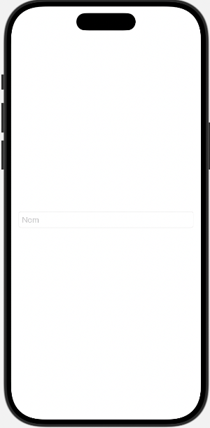

### Bordure personnalisée

Plutôt qu'une bordure grise, il est possible de définir une bordure personnalisée selon nos besoins.

La technique consiste à utiliser le modifieur [overlay](https://developer.apple.com/documentation/swiftui/view/overlay(alignment:content:)) qui permet de définir une vue à placer par-dessus le `TextField`.

```swift title="SwiftUI"
TextField("Nom", text: $nom)
  .padding(7)
  .overlay {
    RoundedRectangle(cornerRadius: 5)
      .stroke(Color.accentColor, lineWidth: 2)
  }
  .padding()
```

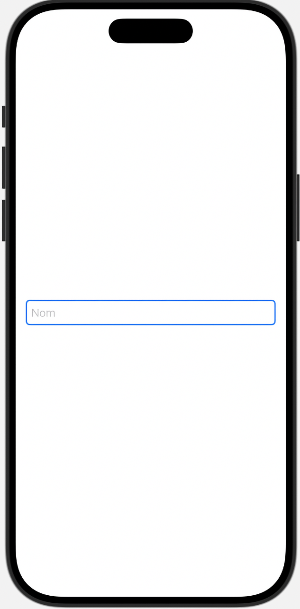

### Placer le TextField dans un Form

Bien que ceci ne soit pas obligatoire, il est possible de placer le `TextField` dans une structure [Form](https://developer.apple.com/documentation/swiftui/form) afin d'améliorer le visuel.

Remarquez que lorsqu'on utilise un `Form`, l'apparence est agréable même sans modifieur.

```swift title="SwiftUI"
Form {
  TextField("Nom", text: $nom)
 }
```

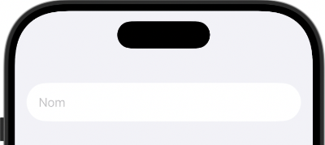

### Libellé

Il faut toujours avoir un libellé autre que le filigrane.

En effet, l'utilisation d'un filigrane comme seul libellé n'est pas ergonomique puisqu'une fois le formulaire rempli, on ne verra plus ce qui était attendu dans chacune des cases.

Ceci serait problématique par exemple dans un formulaire qui doit saisir un prénom et un nom de famille. Devait-on entrer le nom de famille en premier ou le prénom?

D'ailleurs, on voit dans les applications de Apple qu'il y a généralement autre chose que le filigrane pour identifier une case de saisie, tel qu'illustré dans cette vue dans les réglages.

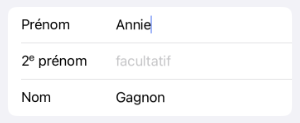

Afin de s'assurer que l'application soit ergonomique, il est possible de forcer l'affichage d'un libellé en utilisant des sections.

Remarquez qu'ici, je n'ai rien spécifié comme filigrane. J'aurais pu utiliser un filigrane pour donner de l'information complémentaire sur ce qui est attendu, par exemple le format d'un numéro de téléphone ou encore le fait que l'information soit requise ou non.

```swift title="SwiftUI"
Form {
  Section(header: Text("Nom")) {
    TextField("", text: $nom)
  }
  Section(header: Text("Âge")) {
    TextField("", text: $ageString)
      .keyboardType(.numberPad)
  }
}
```

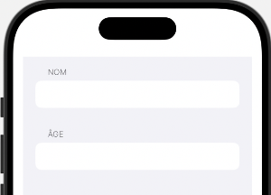

Autre technique : définir le libellé à l'aide d'un `Text` placé à gauche du `TextField`.

```swift title="SwiftUI"
Form {
  HStack {
    Text("Nom")
    TextField("", text: $nom)
  }

  HStack {
    Text("Âge")
    TextField("", text: $ageString)
      .keyboardType(.numberPad)
  }
}
```

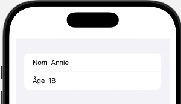

Afin de reproduire l'apparence des réglages du iPhone, il suffit d'ajouter une largeur aux libellés et de préciser qu'ils doivent être alignés à gauche.

```swift title="SwiftUI"
let largeurLibelles = 60.0
...

Form {
  HStack {
    Text("Nom")
      .frame(width: largeurLibelles, alignment: .leading)
    TextField("", text: $nom)
  }

  HStack {
    Text("Âge")
      .frame(width: largeurLibelles, alignment: .leading)
    TextField("", text: $ageString)
      .keyboardType(.numberPad)
  }
 }
```

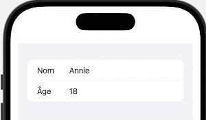

### Libellé flottant

Pour une apparence plus sophistiquée, vous pouvez vous tourner vers des libellés flottants, c'est-à-dire que le libellé apparaît comme un filigrane au départ et qu'il se déplace en haut de la valeur saisie dès qu'on commence à entrer du texte.

Contrairement à Google avec [Material Design](https://m3.material.io/components/text-fields/overview), Apple a choisi de ne pas fournir de vue qui permet de générer un libellé flottant. C'est que ce type d'utilisation [est controversé](https://medium.com/simple-human/floating-labels-are-a-bad-idea-82edb64220f6) bien que plusieurs arguments des détracteurs [soient discutables](https://medium.com/bymds/are-float-labels-really-that-problematic-after-all-da7ffe7d5417).

Si vous souhaitez utiliser des libellés flottants, vous devrez ajouter un peu de code à votre application.

Vous pouvez par exemple baser votre travail sur ceci : <https://github.com/kishanraja/FloatingLabelTextFieldSwiftUI>

ou sur ceci : <https://levelup.gitconnected.com/swiftui-floating-label-text-field-af04c2eb1a2b>

### Alignement du texte

Il est possible de modifier l'alignement du filigrane, et par le fait même du texte qui sera entré dans le `TextField`.

Ceci est réalisé à l'aide du modifieur [multilineTextAlignment()](https://developer.apple.com/documentation/swiftui/view/multilinetextalignment(_:)).

```swift title="SwiftUI"
Form {
  TextField("Nom", text: $nom)
    .multilineTextAlignment(.trailing)
 }
```

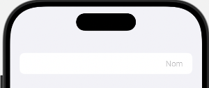

### Bouton pour traiter le formulaire

Voir la fiche « [Bouton pour traiter le formulaire](les-formulaires-swiftui.md#bouton-pour-traiter-le-formulaire_1) » .

### Configurer le clavier

Voir la fiche « [Configurer le clavier du téléphone](les-formulaires-swiftui.md#configurer-le-clavier-du-telephone) ».

### Quelques autres modifieurs

- [.autocorrectionDisabled()](https://developer.apple.com/documentation/swiftui/view/autocorrectiondisabled(_:))
- [.multilineTextAlignment()](https://developer.apple.com/documentation/swiftui/view/multilinetextalignment(_:))
- [.textInputAutocapitalization()](https://developer.apple.com/documentation/swiftui/view/textinputautocapitalization(_:))

### Réagir au changement

Il est possible de commander une action dès que l'usager tape du texte dans le TextField grâce à la méthode [onChange()](reagir-a-un-changement.md).

```swift title="SwiftUI"
TextField("Code:", text: $code)
  .onChange(of: code) { ancienneValeur, nouvelleValeur in
    ...
  }
```

### Pour plus d'information

« TextField in SwiftUI ». Swift with Majid. <https://swiftwithmajid.com/2020/02/26/textfield-in-swiftui/>

« TextField in SwiftUI ». Stefan Blos. <https://stefanblos.com/posts/textfield-in-swiftui/>

« Custom TextField in SwiftUI ». The Happy Programmer. <https://thehappyprogrammer.com/custom-textfield-in-swiftui>

« SwiftUI Form tutorial for beginners ». Programming with Swift. <https://programmingwithswift.com/swiftui-form-beginners-guide/>

## Configurer le clavier du téléphone

Par défaut, dès que l'usager clique dans un TextField, un clavier apparaît au bas de l'écran.

Sur le simulateur, pour obtenir ce comportement, vous devez aller dans le menu **I/O** / **Keyboard** et décocher l'option **Connect Hardware Keyboard**.

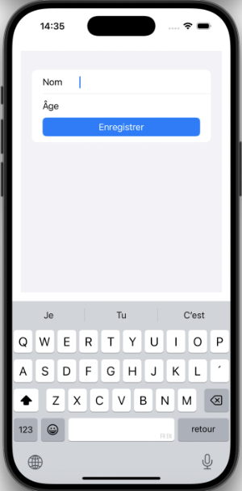

Le modifieur [.keyboardType()](https://developer.apple.com/documentation/swiftui/view/keyboardtype(_:)) permet de spécifier le type de clavier à utiliser. Ceci permettra d'offrir à l'usager un clavier adapté au genre d'information qu'il doit entrer.

Par exemple, lorsqu'on saisit un nombre, il serait judicieux d'afficher le clavier numérique.

```swift title="SwiftUI"
TextField("", text: $ageString)
  .keyboardType(.numberPad)
```

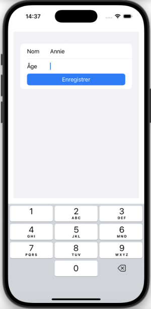

Il existe des claviers spécialisés pour différents besoins.

Je vous présente un peu plus bas un aperçu des touches offertes par chacun.

### Icône pour changer la langue du clavier

Au bas du clavier numérique, vous retrouverez souvent une icône de globe.

Un clic sur cette icône permet de basculer entre deux langues configurées sur le téléphone ou dans le simulateur. S'il y a plus de deux langues, un clic prolongé permettra de sélectionner parmi ces langues.

Les caractères présentés sur le clavier numérique seront différents selon la langue choisie.

C'est l'usager qui détermine les langues disponibles et non le développeur.

Pour ajouter une langue sur le téléphone ou dans le simulateur :

- Cliquez sur l'icône **Réglages**.
- Sélectionnez l'option **Général** / **Langue et région**.
- Cliquez sur **Ajouter une langue** puis sélectionnez la langue désirée.

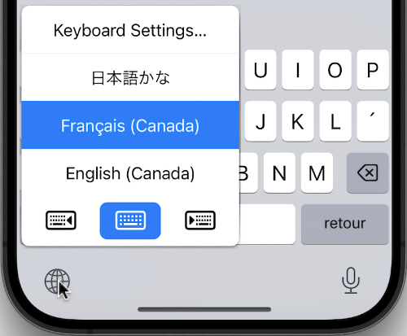

### Aperçu des configurations de clavier disponibles

#### .default

C'est le clavier qui apparaît si vous ne spécifiez pas de type de clavier ou encore si vous spécifiez le style .default.

Il est illustré ici avec les lettres majuscules, avec les lettres minuscules, avec les chiffres puis avec les caractères spéciaux.

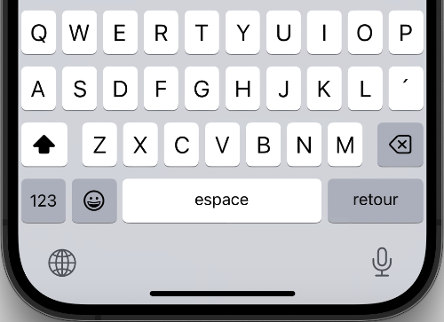 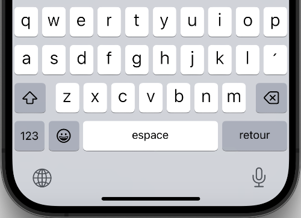

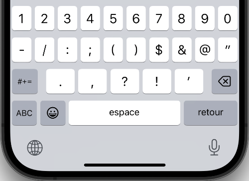 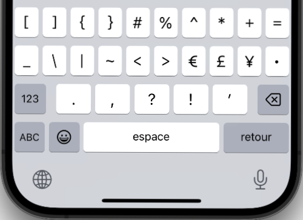

#### .numberPad

Ce clavier a été pensé pour faciliter l'entrée de nombres.

Fait à noter : les touches offrent des chiffres seulement, pas de point décimal ni de possibilité pour nombres négatifs.

Si le téléphone est configuré pour travailler dans une langue dans laquelle les caractères numériques sont différents, le clavier affichera les caractères dans la langue configurée.

Dans cet exemple, on voit que le clavier peut afficher des caractères arabes.

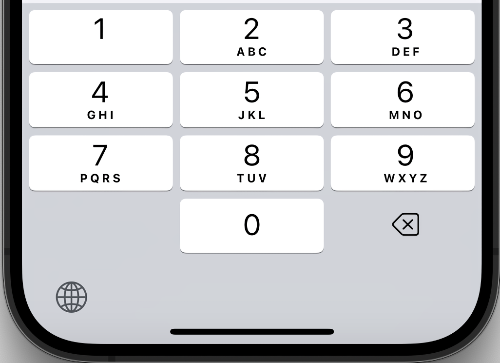 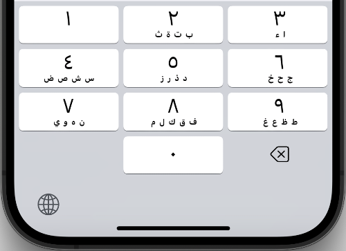

#### .decimalPad

Même chose que .numberPad sauf qu'il y a une touche pour ajouter un point décimal.

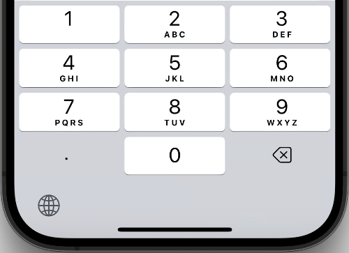

#### .numbersAndPonctuation

Des touches ont été ajoutées à celles des chiffres afin faciliter l'entrée de certains caractères.

C'est le clavier à utiliser si vous avez besoin de permettre les nombres négatifs.

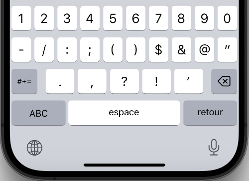

#### .phonePad

Ce clavier est optimisé pour entrer des numéros de téléphone. Il est comme .numberPad sauf qu'une touche permet de basculer vers un clavier qui facilite l'entrée des caractères +, * et #.

Dans le cas où votre application permettrait par exemple d'entrer un numéro qui serait composé par l'application, il y a même les touches `wait` et `pause` qui peuvent être utilisées.

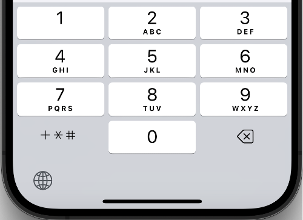 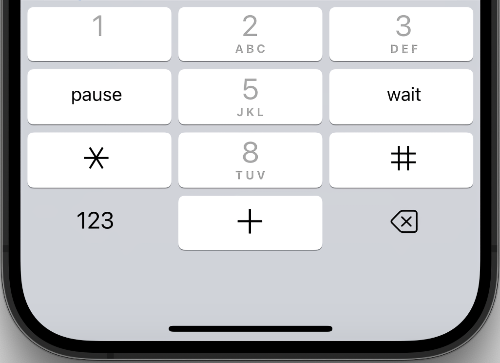

#### .namePhonePad

Ce clavier a été pensé pour les fois où l'usager doit entrer soit du texte, soit un numéro.

Quand il présente des lettres, le clavier est identique au clavier .default. C'est quand on clique sur la touche 123 pour passer en mode numérique qu'il est différent puisqu'il ne présente que des chiffres.

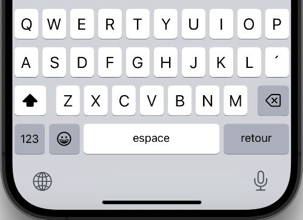 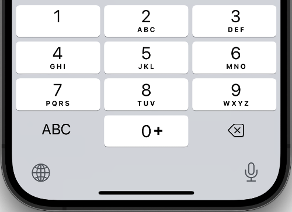

#### .alphabet

Comme .default sauf qu'il n'y a pas de touche pour les émoticones.

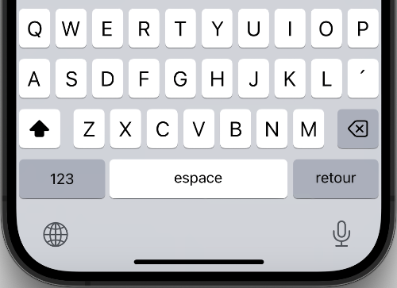

#### .asciiCapable

Comme .alphabet sauf que si on clique sur l'icône de globe pour modifier la localisation, seules les langues dont les lettres sont représentés par des caractères de la charte ASCII de base seront disponibles.


#### .asciiCapableNumberPad

Même chose que .numberPad sauf que les chiffres sont toujours représentés par des caractères de la charte ASCII de base.

Même si plusieurs langues sont configurées sur le téléphone, il n'y a pas d'icône de globe qui permet de changer de langue, par exemple pour afficher des chiffres arabes.

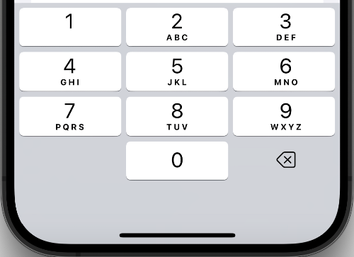

#### .twitter

Comme .default sauf qu'on a ajouté des touches pour faciliter l'entrée du @ et du #.

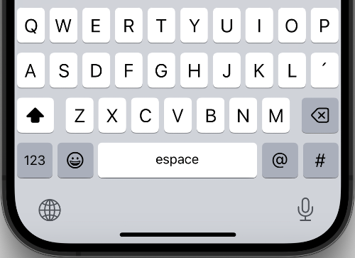

#### .URL

Comme .default sauf qu'on a ajouté des touches pour faciliter l'entrée de la barre oblique et des caractères « .com ».

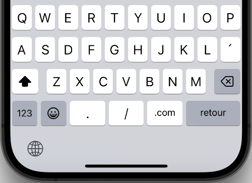

#### .emailAddress

Comme .default sauf qu'il y a une touche pour faciliter l'entrée du @ et du point.

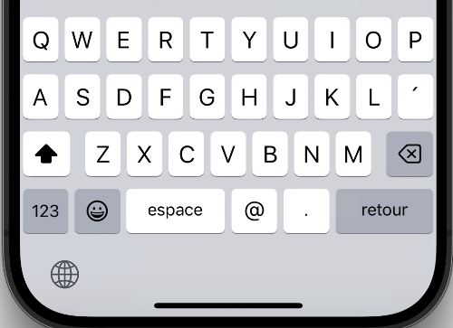

#### .webSearch

Comme .default sauf qu'il y a une touche pour faciliter l'entrée du point.

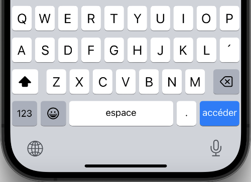

## Bouton pour traiter le formulaire

Il n'est pas toujours requis d'ajouter un bouton pour traiter les données saisies dans un formulaire SwiftUI.

Les informations pourraient être traitées à différents moments, par exemple :

- Au fur et à mesure que les informations sont modifiées (ex : [.onChange()](reagir-a-un-changement.md));
- Lorsque l'usager clique sur le bouton de retour dans une [vue affichée via NavigationLink](les-applications-multivues.md);
- Sur-le-champ, lorsqu'il s'agit de valeurs tirées de la base de données à l'aide de [SwiftData](crud-avec-swiftdata.md#operations-crud-avec-swiftdata-ajouter-modifier-ou-supprimer-des-donnees).

Si vous souhaitez tout de même ajouter un bouton à un formulaire, sachez qu'il n'est pas requis que le bouton soit placé à l'intérieur du `Form`. Il n'est d'ailleurs pas nécessaire d'utiliser un `Form`.

Voici quelques exemples de boutons situés au bas d'une série de `TextField`, avec et sans `Form`.

Dans ce premier exemple, remarquez l'ajout d'un `VStack` qui entoure le dernier `TextField` et le bouton. Ce `VStack` assure qu'il n'y aura pas de ligne grise juste avant le bouton puisqu'il n'y a une ligne grise qu'entre les enfants directs du `Form`.

```swift title="SwiftUI"
Form {
  HStack {
    Text("Prénom")
      .frame(width: largeurLibelles, alignment: .leading)
    TextField("", text: $prenom)
  }

  // VStack pour éviter une ligne grise entre le dernier TextField et le bouton
  VStack {
    HStack {
      Text("Nom de famille")
        .frame(width: largeurLibelles, alignment: .leading)
      TextField("", text: $nomFamille)
    }

    Button(action: {
      // traitement ici
    }) {
      Text("Enregistrer")
        .frame(maxWidth: .infinity)
    }
    .buttonStyle(.borderedProminent)
  }
}
```

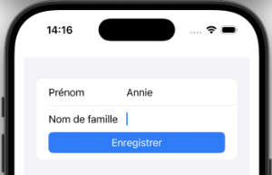

 Ici, on utilise l'approche avec des sections pour les libellés.

```swift title="SwiftUI"
Form {
  Section(header: Text("Prénom")) {
    TextField("", text: $prenom)
  }
  .listSectionSpacing(8)

  Section(header: Text("Nom de famille")) {
    TextField("", text: $nomFamille)
  }

  Button(action: {
    // traitement ici
  }) {
    Text("Enregistrer")
      .frame(maxWidth: .infinity)   // sans ceci, le texte du bouton serait aligné à gauche
  }
}
```

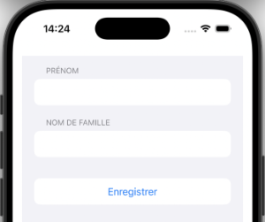

Voici un exemple sans `Form`.

```swift title="SwiftUI"
VStack(alignment: .leading) {
  Text("Prénom")
  TextField("", text: $prenom)
    .textFieldStyle(.roundedBorder)
    .padding(.bottom, 20)

  Text("Nom de famille")
  TextField("", text: $nomFamille)
    .textFieldStyle(.roundedBorder)
    .padding(.bottom, 20)

  Button(action: {
    // traitement ici
  }) {
    Text("Enregistrer")
      .frame(maxWidth: .infinity)
  }
  .buttonStyle(.bordered)
}
 .padding()
 Spacer()
```

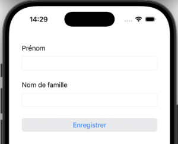
