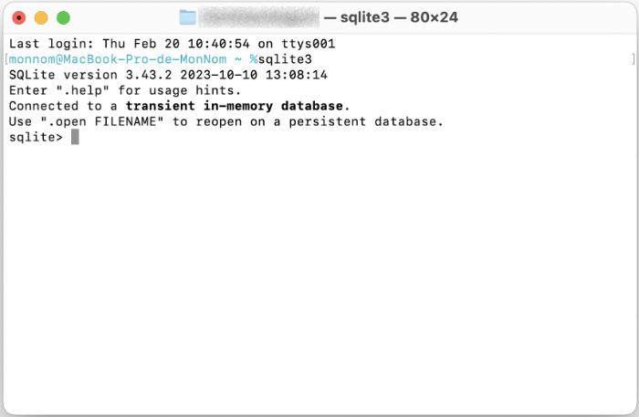
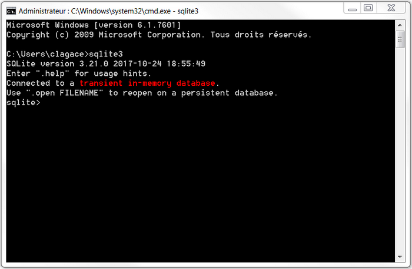

# SQLite

## Qu'est-ce que SQLite ?

SQLite est un SGBD relationnel léger conçu spécifiquement pour le stockage local de données. Il ne nécessite pas l'installation d'un serveur de base de données.

SQLite fonctionne dans différents environnements, notamment Linux, Windows, macOS, Android et iOS.

Ce petit SGBD, créé en 2000 par D. Richard Hipp, est à code source ouvert. La version actuelle, SQLite 3.X, a été publiée en 2004.

Selon [Wikipédia](https://fr.wikipedia.org/wiki/SQLite) :

> SQLite est le moteur de base de données le plus utilisé au monde, grâce à son utilisation dans de nombreux logiciels grand public comme Firefox, Skype, Google Gears, dans certains produits d'Apple, d'Adobe et de McAfee et dans les bibliothèques standards de nombreux langages comme PHP ou Python. De par son extrême légèreté (moins de 300 Ko), il est également très populaire sur les systèmes embarqués, notamment sur la plupart des smartphones modernes : l'iPhone ainsi que les systèmes d'exploitation mobiles Symbian et Android l'utilisent comme base de données embarquée. Au total, on peut dénombrer plus d'un milliard de copies connues et déclarées de la bibliothèque.

Saviez-vous que Google Chrome utilise SQLite pour stocker les cookies?

Si vous voulez voir les données brutes de ces cookies sur votre ordinateur, rendez-vous dans le dossier C:\Users\votrenom\AppData\Local\Google\Chrome\User Data\Default (Windows) ou /Users/votrenom/Library/Application Support/Google/Chrome/Default (Mac).

Le fichier se nomme Cookies.

Vous pourrez l'ouvrir à la ligne de commande SQLite ou dans votre éditeur graphique SQLite préféré.

### Forces et limitations

Moins puissant que d'autres SGBDR comme MySQL ou MS SQL, SQLite supporte néanmoins de nombreuses fonctionnalités :

- jointures internes et externes
- requêtes imbriquées
- transactions
- contraintes d'intégrité référentielle
- fonctions d'aggrégation
- etc.

Parmi ses limites, notons :

- ne supporte que quatre types de données : INTEGER, REAL, TEXT, BLOB (dans les faits, les types de données sont dynamiques et tout est stocké à l'interne en tant que texte), mais est-ce que c'est vraiment une limite ?
- ne supporte pas les jointures externes vers la droite (RIGHT OUTER JOIN)
- ne supporte pas les procédures et fonctions stockées
- possibilités de modification d'une table avec ALTER TABLE limitées
- gestion des droits d'accès aux données limitée aux droits conférés par le système d'exploitation au fichier de la base de données
- etc.

### Dans quels types d'applications est-ce que je peux utiliser SQLite ?

Si vous développez une **application native**, par exemple une application mobile, une application embarquée ou une application de bureau, SQLite est un choix intéressant pour stocker des données localement.

Il n'est cependant pas adapté pour les applications Web car la plupart des navigateurs ne le supportent plus depuis 2010.

### Où sont stockées les données ?

Une base de données SQLite est en fait un simple fichier dans lequel les informations sont encodées de façon particulière. Toutes les tables et leurs données sont stockées dans ce même fichier.

Les bases de données SQLite sont locales, c'est-à-dire que leurs fichiers sont enregistrés sur le poste de l'usager ou sur son appareil mobile.

Si la base de données est utilisée par une application native, son fichier sera généralement stocké au même endroit que l'application, à moins que le développeur en ait décidé autrement.

### Pour plus d'information

« SQLite ». Wikipédia. <https://fr.wikipedia.org/wiki/SQLite>

« Appropriate Uses For SQLite ». SQLite. <https://sqlite.org/whentouse.html>

« SQLite Tutorial ». SQLite Tutorial. <http://www.sqlitetutorial.net/>

« Distinctive Features Of SQLite ». SQLite. <https://www.sqlite.org/different.html>

« Limits In SQLite ». SQLite. <https://sqlite.org/limits.html>

« SQL Features That SQLite Does Not Implement ». SQLite. <https://www.sqlite.org/omitted.html>

## Installation de SQLite

Pour travailler avec une base de données [SQLite](sqlite.md#quest-ce-que-sqlite), il n'y a aucun serveur à installer. Tout se déroule localement.

Il faut par contre que le service et les outils pour SQLite soient installés afin que le système d'exploitation sache comment interagir avec une base de données SQLite.

### Installation sous macOS

Sous Mac, SQLite est installé de base.

Pour le vérifier :

- Ouvrez le Terminal.
  - Lancez la commande `sqlite3` :

    ```text title="Terminal"
    sqlite3
    ```

    Vous obtiendrez l'invite SQLite.

    

    Notez que le message « Connected to a transient in-memory database » indique qu'aucune base de données n'est ouverte alors les opérations seront effectuées en mémoire vive et seront perdues lors de la fermeture de la ligne de commande.

    Pour travailler avec une vraie base de données, il faudra soit créer une nouvelle base de données, soit ouvrir une base de données existante.

    Mais pour l'instant, nous pouvons travailler en mémoire vive pour effectuer ces vérifications.
- Pour voir si SQLite fonctionne, entrez la commande suivante :

  ```sql title="Ligne de commande SQLite"
  .database
  ```

  SQLite devrait répondre qu'il est présentement branché sur une base de données nommée `main` (il s'agit de la base de données en mémoire vive).
- Pour sortir de SQLite, entrez la commande suivante :

  ```sql title="Ligne de commande SQLite"
  .exit
  ```

### Installation sous Windows

Pour installer SQLite sous Windows :

- Rendez-vous sur la page de téléchargement de SQLite (<https://www.sqlite.org/download.html>) puis, dans la section **Precompiled Binaries for Windows**, téléchargez les DLL pour votre système ainsi que les outils pour la ligne de commande (bundle of command-line tools).
- Créez un dossier nommé `sqlite` sous C: puis décompressez les fichiers directement dans ce dossier. Le dossier contiendra différents fichiers dont `sqlite3.exe`.
- Ajoutez `C:\sqlite` à votre variable d'environnement PATH :
  - D'abord, refermez vos fenêtres de commande car elles ont été ouvertes avec leur propre copie des variables d'environnement.
  - Appuyez sur les touches <kbd>Windows</kbd> + <kbd>X</kbd> pour accéder au menu Power User.
  - Sélectionnez l'option **Système**.
  - L'onglet **À propos** de sera sélectionné par défaut. Rendez-vous plus bas dans cette page et choisissez **Paramètres système avancés**.
  - Cliquez sur **Variables d'environnement**.
  - Dans la section **Variables système**, cliquez sur la variable `Path` puis sur **Modifier**.
  - Cliquez sur **Nouveau** puis ajoutez la chaîne `C:\sqlite`.
- Ouvrez une fenêtre de commande puis lancez la commande `sqlite3`. Vous obtiendrez l'invite `sqlite>`

  

  Notez que le message « Connected to a transient in-memory database » indique qu'aucune base de données n'est ouverte alors les opérations seront effectuées en mémoire vive et seront perdues lors de la fermeture de la ligne de commande.

  Pour travailler avec une vraie base de données, il faudra soit créer une nouvelle base de données, soit ouvrir une base de données existante.

  Mais pour l'instant, nous pouvons travailler en mémoire vive pour effectuer ces vérifications.
- Pour voir si SQLite fonctionne, entrez la commande suivante :

  ```sql title="Ligne de commande SQLite"
  .database
  ```

  SQLite devrait répondre qu'il est présentement branché sur une base de données nommée `main` (il s'agit de la base de données en mémoire vive).
- Pour sortir de SQLite, entrez la commande suivante :

  ```sql title="Ligne de commande SQLite"
  .exit
  ```

### Pour plus d'information

« SQLite - Installation ». Tutorial points. <https://www.tutorialspoint.com/sqlite/sqlite_installation.htm>
