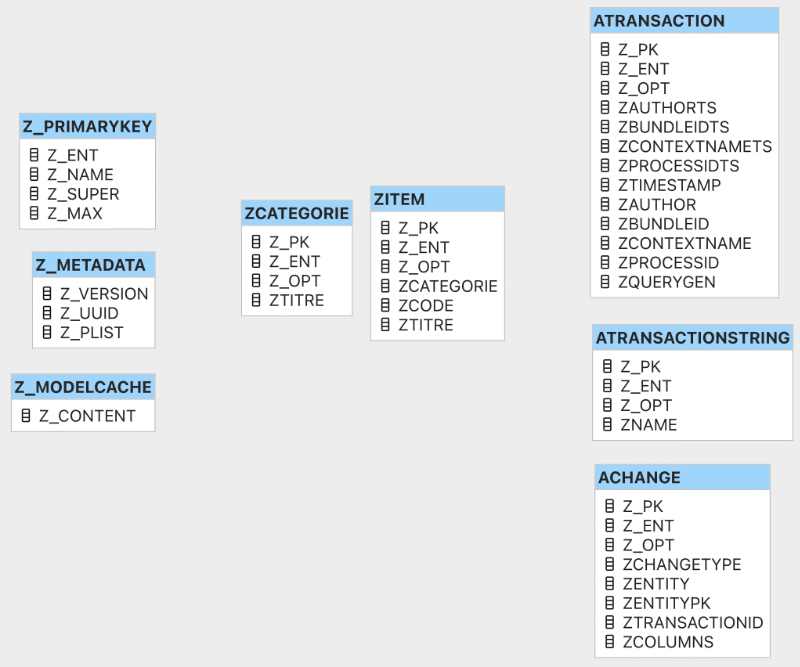
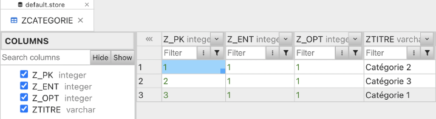
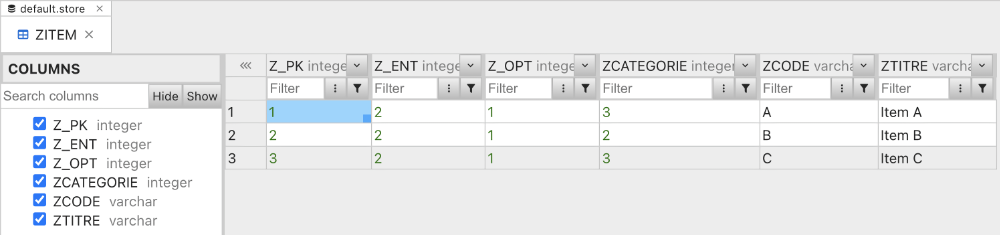

# SwiftData

## Qu'est-ce que SwiftData

[SwiftData](https://developer.apple.com/documentation/swiftdata) est un ORM (**Object Relational Mapper**), c'est-à-dire une couche d'abstraction entre l'application et la base de données.

Il est basé sur [CoreData](https://developer.apple.com/documentation/coredata), un ORM plus mature et plus complet mais aussi plus complexe à mettre en oeuvre.

Physiquement, SwiftData travaille par défaut avec une base de données SQLite.

SwiftData a vu le jour avec iOS 17 en 2023. Il ne peut donc pas être utilisé pour développer des applications qui roulent sur une version antérieure de iOS. Parmi les téléphones qui ne peuvent pas être mis à jour vers iOS 17, notons iPhone 8, iPhone 8 Plus et iPhone X. Notez que iPhoneXr peut rouler iOS 17.

Si vous devez développer des applications qui roulent sur une version antérieure de iOS, vous pouvez vous tourner vers CoreData ou encore utiliser [le squelette que je vous propose afin d'interagir directement avec une base de données SQLite](interagir-avec-sqlite-sans-orm.md#ouverture-de-la-base-de-donnees-sqlite).

Si vous désirez vous lancer avec SwiftData, poursuivez la lecture de ce chapitre!

??? info "Pour plus d'information"

    « SwiftData ». Apple. <https://developer.apple.com/xcode/swiftdata/>

    « Framework SwiftData ». Apple. <https://developer.apple.com/documentation/swiftdata>

    « SwiftData by Example ». Hacking with Swift. <https://www.hackingwithswift.com/quick-start/swiftdata/>

    « What is SwiftData? ». Hacking with Swift. <https://www.hackingwithswift.com/quick-start/swiftdata/what-is-swiftdata>

    « Meet SwiftData ». Apple. <https://developer.apple.com/videos/play/wwdc2023/10187/>

## Emplacement de la base de données SwiftData

Par défaut, lorsqu'une application pour iPhone utilise une base de données gérée par SwiftData, la base de données SQLite générée sur le simulateur est placée dans un dossier dont le nom est au format :

`/Users/monnom/Library/Developer/CoreSimulator/Devices/[UDID]/data/Containers/Data/Application/[app GUID]/Library/Application Support/default.store`

### Outil de débogage et de développement

Pourquoi un développeur a-t-il besoin de savoir où est la base de données?

Premièrement, ceci lui donne un outil de débogage supplémentaire.

En effet, SwiftData se charge de créer la base de données et d'y [insérer les données initiales](swiftdata.md#inserer-des-donnees-initiales-dans-la-base-de-donnees) que vous aurez codées. Tout est réalisé automatiquement pour vous.

Vous aurez besoin d'accéder à la base de données seulement lorsque vous désirez vous assurer que les données sont correctement enregistrées par votre application.

Ainsi, avant de vous plonger dans votre code pour déterminer pourquoi une donnée n'est pas correctement affichée, vous pouvez vérifier si les informations affichées correspondent à celles enregistrées dans la base de données.

Autre utilisation possible : il est parfois nécessaire de supprimer une base de données afin que SwiftData puisse la recréer, par exemple après avoir modifié sa structure pendant la phase de développement.

Il serait possible de supprimer la base de données à l'aide du menu du simulateur : **Device** / **Erase All Content And Settings**. Le problème avec cette approche est que toutes les configurations du simulateur (langue, clavier physique, etc.) seront également supprimées. Le prochain lancement de l'application dans le simulateur sera passablement plus long.

Puisque vous connaissez l'emplacement de la base de données, il est beaucoup plus efficace de la supprimer directement.

### Pourquoi trois fichiers?

En plus du fichier `default.store`, on retrouvera deux autres fichiers dans le même dossier : `default.store-shm` et `default.store-wal`.

Ces fichiers supplémentaires sont des [fichiers temporaires utilisés par SQLite](https://www.sqlite.org/tempfiles.html).

Si vous devez copier la base de données, il faut copier les trois fichiers pour que les données soient correctement représentées.

### UDID et app GUID

Dans le chemin de la base de données, [UDID], acronyme pour **Unique Device ID**, représente [l'identifiant du simulateur](le-systeme-de-fichiers-de-ios.md#udid-et-app-guid) utilisé.

[app GUID] représente [l'identifiant unique de l'application](le-systeme-de-fichiers-de-ios.md#udid-et-app-guid).

Le nom du dossier réel pourrait ressembler à ceci :

`/Users/monnom/Library/Developer/CoreSimulator/Devices/BBC44596-3E5E-473B-944E-C5F0EE11C4A5/data/Containers/Data/Application/7CABA34E-2DC9-4553-8639-3E38967E5769/Library/Application Support`

### Techniques pour retrouver facilement la base de données

Si vous avez besoin de retrouver physiquement la base de données, je vous propose quelques techniques pour y arriver : « [Retrouver un fichier dans le simulateur](les-fichiers-modifies-sur-un-appareil-mobile-ou-sur-le-simulateur.md) ».

### Base de données interne

SwiftData crée parfois une seconde base de données `default.store` dans un dossier au format `/Users/monnom/Library/Developer/CoreSimulator/Devices/[UDID]/data/Library/Application Support` (notez la fin du chemin qui est différente, notamment par l'absence du [app GUID]).

Cette base de données fait partie de l'implémentation interne de SwiftData. Elle ne contient pas les tables liées à vos modèles.

## Structure d'une base de données SwiftData

Lorsqu'on définit un ou plusieurs [modèles décorés avec la macro @Model](swiftdata.md#adapter-le-modele-et-lapplication-pour-swiftdata), SwiftData se charge automatiquement de créer une table pour chacun des modèles.

Par défaut, il crée ces tables dans une base de données SQLite nommée `default.store` (en fait, la BD est composée de [trois fichiers](swiftdata.md#emplacement-de-la-base-de-donnees-swiftdata)). La base de données est enregistrée [dans le dossier Application Support du Data Container](le-systeme-de-fichiers-de-ios.md#les-dossiers-de-lapplication-sous-ios).

Lorsque l'application est lancée dans le simulateur, on peut retrouver le chemin précis de la base de données à l'aide d'une des techniques présentées sur la fiche « [Retrouver un fichier dans le simulateur](les-fichiers-modifies-sur-un-appareil-mobile-ou-sur-le-simulateur.md) ».

La structure interne de la base de données diffère de celle que nous définissons dans les modèles SwiftData car SwiftData ajoute des tables et des colonnes pour gérer l’intégrité et la persistance.

Remarquez que SwiftData se charge de créer les clés étrangères requises mais il ne crée pas de contraintes d'intégrité référentielle dans la base de données car il gère lui-même l'intégrité des données via son modèle objet.

Ici, j'ai utilisé [DbGate](editeur-visuel-sqlite-dbgate.md#installation-de-dbgate) pour visualiser le contenu de la base de données.



Le nom des tables correspondant aux modèles débute par Z et ne contient pas de barre de soulignement. On voit ici qu'il s'agit des tables ZCATEGORIE et ZITEM.





Les champs de ces tables sont également différents de ce qui a été défini par le modèle.

Les champs en provenance du modèle débutent par Z sans barre de soulignement.

Parmi les autres champs, notons :

- Le champ Z_PK est la clé primaire.
- Le champ Z_ENT fait référence à l'identifiant de la table que l'on retrouve dans Z_PRIMARYKEY.
- Le champ Z_OPT indique le nombre de modifications qui ont été apportées aux données de l'enregistrement.

??? info "Pour plus d'information"

    « How Core Data Saves Data in SQLite ». Fatbobman's blog. <https://fatbobman.com/en/posts/tables_and_fields_of_coredata/>

## Adapter le modèle et l'application pour SwiftData

Lorsque vous travaillez avec SwiftData, [le modèle](le-modele.md#gerer-les-donnees-de-lapplication-en-memoire-initialiser-un-tableau-dinstances) doit être défini dans une classe spéciale.

Lorsque l'application sera lancée, SwiftData créera automatiquement la base de données avec les tables qui correspondent aux modèles listés dans le [modelContainer](swiftdata.md#adapter-le-modele-et-lapplication-pour-swiftdata).

Voici un exemple d'un modèle SwiftData :

```swift title="Fichier Models/Item.swift"
import Foundation
import SwiftData

@Model
final class Item {
  var code: String
  var titre: String
  var dateAjout: Date

  init(code: String = "", titre: String = "", dateAjout: Date = Date()) {
    self.code = code
    self.titre = titre
    self.dateAjout = dateAjout
  }
}
```

Remarquez l'utilisation du type [Date](les-dates.md#initialiser-une-date-avec-swift) pour stocker une date, même si les dates en SQLite sont stockées sous forme de texte.

SwiftData fera le nécessaire pour faire la conversion entre ces deux formats.

### Ajustement du modèle

Si vous avez déjà codé un modèle, vous devez apporter quelques ajustements pour qu'il se conforme aux exigences de SwiftData.

- ajouter l'instruction `import SwiftData`
- modifier le mot-clé `struct` pour `class`
- ajouter la [macro](https://developer.apple.com/documentation/Swift/applying-macros) `@Model` juste avant la définition de la classe
- définir au moins un constructeur puisque les classes n'ont pas de constructeur par défaut
- vous n'avez pas besoin de spécifier l'attribut `id` ni de répondre au protocole `Identifiable`, tout cela est géré automatiquement par SwiftData.

- ceci est optionnel mais permet d'améliorer légèrement les performances : marquer la classe avec `final`

```swift title="Fichier Models/Item.swift"
import Foundation
import SwiftData

@Model
final class Item: Identifiable {
  var id: Int
  var code: String
  var titre: String
  var dateAjout: Date

  // le constructeur est requis dans une classe
  init(code: String = "", titre: String = "", dateAjout: Date = Date()) {
    self.code = code
    self.titre = titre
    self.dateAjout = dateAjout
  }
}
```

La macro `@Model` semble anodine, mais elle joue un rôle important.

Elle crée litéralement beaucoup de code pour vous afin que le modèle interagisse avec une table de la base de données.

Si vous êtes curieux de voir le code ajouté, vous pouvez faire un clic droit sur le mot `@Model` puis choisir **Expand Macro**.

Ne vous laissez pas impressionner par le code ajouté, il peut demeurer caché (clic droit / **Hide Macro Expansion**) et vous pourrez tout de même travailler efficacement avec SwiftData.

### Lister les modèles dans le modelContainer

Dans le fichier de l'application (fichier dont le nom est au format `MonProjetApp.swift`), vous devez spécifier quels modèles doivent être utilisés par SwiftData :

- ajoutez l'instruction `import SwiftData`
- ajoutez ceci à `WindowGroup` : `.modelContainer(for: Item.self)` (remplacer `Item` par le nom de votre modèle)

```swift title="Fichier MonProjetApp.swift"
import SwiftUI
import SwiftData

@main
struct MonProjetApp: App {
  var body: some Scene {
    WindowGroup {
      ContentView()
    }
    .modelContainer(for: Item.self)
  }
}
```

#### Application avec plusieurs tables

Lorsqu'une application utilise plusieurs tables, donc plusieurs modèles, il y a deux figures de cas :

- Si l'un des modèles a une relation avec l'autre modèle, par exemple un Item a une propriété de type Categorie, il n'est pas nécessaire de faire référence à Categorie car SwiftData retrouvera cette information tout seul.
- Si rien ne relie deux modèles, il suffit de les faire suivre comme suit :

  ```swift title="Fichier MonProjetApp.swift"
  import SwiftUI
  import SwiftData

  @main
  struct MonProjetApp: App {
    var body: some Scene {
      WindowGroup {
        ContentView()
      }
      .modelContainer(for: [Item.self, Usager.self])
    }
  }
  ```

#### Application avec données initiales

Dans le cas où l'application se charge [d'insérer des données initiales dans la base de données](swiftdata.md#inserer-des-donnees-initiales-dans-la-base-de-donnees), l'approche est légèrement différente.

On fera tout de même appel à `.modelContainer` mais plutôt que de lui passer les modèles en paramètre, on fera appel au conteneur qui est responsable de l'insertion des données (ici, il s'appelle `preloadAppContainer`).

```swift title="Fichier MonProjetApp.swift"
import SwiftUI
import SwiftData

@main
struct MonProjetApp: App {
  var body: some Scene {
    WindowGroup {
      ContentView()
    }
    .modelContainer(preloadAppContainer)
  }
}
```

??? info "Pour plus d'information"

    « Defining a data model with SwiftData ». Hacking with Swift. <https://www.hackingwithswift.com/quick-start/swiftdata/defining-a-data-model-with-swiftdata>

    « Why are SwiftData models created as classes? ». Hacking with Swift. <https://www.hackingwithswift.com/quick-start/swiftdata/why-are-swiftdata-models-created-as-classes>

## Définir des relations entre les tables

SwiftData est capable de gérer les relations entre deux tables.

Il se charge de créer les clés étrangères requises mais il ne crée pas de contraintes d'intégrité référentielle dans la base de données car il gère lui-même l'intégrité des données via son modèle objet.

Pour que le tout fonctionne, il faut apporter des ajustements aux modèles des tables parent et enfant.

### Modèle de la table parent

Dans une relation de 1 à plusieurs, la table parent est celle qui peut exister sans l'autre. Autrement dit, c'est celle qui, dans le système de gestion de bases de données, n'a pas de clé étrangère vers l'autre.

Avec une table parent, on peut dire : « un (table parent) peut avoir un ou plusieurs (table enfant) ».

Dans l'exemple d'une table items et d'une table categories, c'est items qui a une clé étrangère vers categories. Donc, categories est la table parent. On peut dire « une catégorie peut avoir un ou plusieurs items ».

Le modèle de la table parent aura une référence au modèle de la table enfant. Dans le contexte d'une relation de un à plusieurs, il s'agira d'un tableau.

Pour que SwiftData puisse établir la relation, il faut initialiser le tableau dès sa déclaration.

```swift title="Fichier Models/Categorie.swift"
@Model
final class Categorie {
  var titre: String
  var items: [Item] = []

  // Ce constructeur avec paramètre pour la liste d'items est requis si on veut insérer des données initiales.
  // Puisque le paramètre a une valeur par défaut, il sera tout de même possible de créer une catégorie qui ne contient aucun item.
  init(titre: String = "", items: [Item] = []) {
    self.titre = titre
    self.items = items
  }
}
```

### Modèle de la table enfant

Dans une relation de 1 à plusieurs, la table enfant est celle qui dépend de l'autre. Autrement dit, c'est celle qui, dans le système de gestion de bases de données, a une clé étrangère vers l'autre.

Avec une table enfant, on peut dire : « un (table enfant) est associé à un (table parent) ».

Dans l'exemple d'une table items et d'une table categories, on peut dire « un item est associé à une catégorie ».

Le modèle de la table enfant doit avoir une référence au modèle de la table parent.

Pour que SwiftData puisse faire correctement le lien entre la table parent et la table enfant, cette propriété doit être un optionnel, c'est-à-dire qu'elle peut avoir la valeur nil, tel qu'indiqué par le point d'interrogation.

```swift title="Fichier Models/Item.swift"
@Model
final class Item {
  var code: String
  var titre: String
  var categorie: Categorie?

  // Ce constructeur sans paramètre pour la clé étrangère est requis si on veut insérer des données initiales.
  init(code: String = "", titre: String = "") {
    self.code = code
    self.titre = titre
  }

  init(code: String = "", titre: String = "", categorie: Categorie) {
    self.code = code
    self.titre = titre
    self.categorie = categorie
  }
}
```

### ModelContainer

Puisqu'il y a une relation entre les deux modèles, le ModelContainer n'a besoin que du nom d'une des classes. Il sera capable de retrouver l'autre par lui-même.

```swift title="Fichier MonProjetApp.swift"
@main
struct MonProjetApp: App {
  var body: some Scene {
    WindowGroup {
      ContentView()
    }
    .modelContainer(for: Item.self)
  }
}
```

### Relation explicite avec la macro @Relationship

Il est conseillé d'ajouter la macro [@Relationship](https://developer.apple.com/documentation/swiftdata/relationship(_:deleterule:minimummodelcount:maximummodelcount:originalname:inverse:hashmodifier:)) **dans la table parent** afin de rendre la relation explicite.

De plus, ceci permettre d'indiquer clairement ce qui se passera avec les enregistrements de la table enfant si un enregistrement de la table parent est supprimé.

La macro sera placée sur la même ligne ou au-dessus du tableau d'items.

Dans cet exemple, si on détruit une catégorie, tous les items de cette catégorie se verront attribuer la valeur nil dans la propriété categorie.

```swift title="Fichier Models/Categorie.swift"
@Model
final class Categorie {
  var titre: String
  @Relationship(deleteRule: .nullify, inverse: \Item.categorie)
  var items: [Item] = []
  ...
}
```

Dans cet exemple, si on détruit une catégorie, tous les items de cette catégorie seront également supprimés

```swift title="Fichier Models/Categorie.swift"
@Model
final class Categorie {
  var titre: String
  @Relationship(deleteRule: .cascade, inverse: \Item.categorie)
  var items: [Item] = []
  ...
}
```

### Anciennes précautions

Dans les premières versions de SwiftData, il fallait prendre des précautions supplémentaires pour que les relations entre les tables soient correctement gérées.

Les précautions qui suivent ne sont plus nécessaires, bien qu'elles ne nuisent pas au bon fonctionnement de l'application.

Dans le modèle de la table parent, la référence au modèle de la table enfant devait pouvoir prendre la valeur nil.

```swift title="SwiftUI"
@Model
final class Categorie {
  var titre: String
  var items: [Item]? = []   // aujourd'hui, le tableau n'a plus besoin d'être un optionnel
  ...
}
```

Dans le modèle de la table parent, le tableau de modèles de la table enfant devait être assigné en dernier pour que la relation soit correctement établie entre les tables.

```swift title="Swift"
@Model
final class Categorie {
  var titre: String
  var items: [Item]? = []

  init(titre: String = "", items: [Item] = []) {
    self.titre = titre
    self.items = items   // cette ligne n'a plus besoin d'être exécutée en dernier
  }
}
```

??? info "Pour plus d'information"

    « Defining data relationships with enumerations and model classes ». Apple. <https://developer.apple.com/documentation/swiftdata/defining-data-relationships-with-enumerations-and-model-classes/>

    « The Ultimate Guide to Building SwiftData Applications - Relationships ». AzamSharp. <https://azamsharp.com/2023/07/04/the-ultimate-swift-data-guide.html#relationships>

    « Inferred vs explicit relationships ». Hacking with Swift. <https://www.hackingwithswift.com/quick-start/swiftdata/inferred-vs-explicit-relationships>

## Insérer des données initiales dans la base de données

Quand on travaille avec SwiftData, il n'est pas nécessaire de créer physiquement la base de données ni d'y insérer manuellement les données initiales.

SwiftData se chargera de tout cela en fonction des modèles définis et des opérations qui y seront faites.

### Informer l'application qu'elle doit utiliser un ModelContainer

Une technique intéressante pour insérer des données initiales dans une base de données SwiftData consiste à définir un nouveau conteneur qui contiendra le code à exécuter.

Il faut alors apporter une modification importante au fichier de l'application dont le nom est au format `MonProjetApp.swift`.

Le modifieur `.modelContainer()` recevra le nouveau conteneur plutôt que le modèle de données.

```swift title="Fichier MonProjetApp.swift"
import SwiftUI
import SwiftData

@main
struct MonProjetApp: App {
  var body: some Scene {
    WindowGroup {
      ContentView()
    }
    .modelContainer(preloadAppContainer)
  }
}
```

### Insérer des données dans une seule table

Voici un extrait de code qui permet d'insérer des données initiales dans une table de la base de données.

Cet extrait sera placé dans le nouveau fichier, que j'ai choisi d'appeler `PreloadAppContainer.swift`, placé au même endroit que `ContentView.swift`.

```swift title="Fichier PreloadAppContainer.swift"
// Inspiré de https://www.andrewcbancroft.com/blog/ios-development/data-persistence/pre-populate-swiftdata-persistent-store/

import SwiftData

@MainActor
let preloadAppContainer: ModelContainer = {
  let container: ModelContainer
  do {
    container = try ModelContainer(for: Item.self)
  } catch {
    print("Impossible de créer le ModelContainer : \(error)")
    fatalError("Impossible de créer le conteneur.")   // ceci fait planter l'application
  }

  // Vérifier s'il y a déjà des données
  let descriptor: FetchDescriptor<Item>
  do {
    descriptor = FetchDescriptor<Item>()
    let nombre = try container.mainContext.fetchCount(descriptor)

    // Si le nombre n'est pas 0, arrêter le traitement
    guard nombre == 0 else { return container }
  } catch {
    print("Impossible de vérifier le nombre initial d'enregistrements : \(error)")
    return container   // quelque chose s'est mal passé, inutile de poursuivre
  }

  print("Insertion des données initiales.")
  let donneesInitiales = [
    Item(code: "A", titre: "Item A"),
    Item(code: "B", titre: "Item B"),
    Item(code: "C", titre: "Item C")
  ]

  for donnee in donneesInitiales {
    container.mainContext.insert(donnee)
  }

  do {
    try container.mainContext.save()
  } catch {
    print("Erreur lors de l'insertion des données : \(error)")
  }

  // cette opération n'est pas critique alors c'est ok de faire un try?
  if let nombreAjouts = try? container.mainContext.fetchCount(descriptor) {
    print("\(nombreAjouts) enregistrements ajoutés.")
  }

  return container

}() // Les parenthèses forcent le code à s'exécuter immédiatement
```

### Insérer des données dans des tables liées

Prenons comme exemple une application dans laquelle un item appartient à une catégorie et une catégorie peut avoir plusieurs items. On a donc une [relation de un à plusieurs](swiftdata.md#definir-des-relations-entre-les-tables) entre les catégories et les items.

Le modèle de la table enfant (ici : Item) doit avoir un [constructeur qui ne requiert pas de paramètre pour la clé étrangère](swiftdata.md#definir-des-relations-entre-les-tables) (ici : la catégorie).

Le modèle de la table parent (ici : Categorie) doit avoir un constructeur qui permet de définir les données liées dans la table enfant (ici : le tableau d'items). Au besoin, le constructeur pourrait définir un tableau vide s'il n'est lié à aucune donnée de la table enfant.

Avec cette structure en place, les données de la table parent sont le point de départ. Pour chacune, on pourra définir un tableau de données de la table enfant.

Le plus intéressant, c'est que SwiftData saura enregistrer l'identifiant de la catégorie dans la table des items même si on a plutôt défini les items dans l'objet Categorie.

```swift title="Fichier PreloadAppContainer.swift"
// Inspiré de https://www.andrewcbancroft.com/blog/ios-development/data-persistence/pre-populate-swiftdata-persistent-store/

import SwiftData

@MainActor
let preloadAppContainer: ModelContainer = {
  let container: ModelContainer
  do {
    container = try ModelContainer(for: Categorie.self)   // retrouvera la table des items tout seul car les tables sont liées
  } catch {
    print("Impossible de créer le ModelContainer : \(error)")
    fatalError("Impossible de créer le conteneur.")   // ceci fait planter l'application
  }

  // Vérifier s'il y a déjà des données
  let descriptor: FetchDescriptor<Categorie>
  do {
    descriptor = FetchDescriptor<Categorie>()
    let nombre = try container.mainContext.fetchCount(descriptor)

    // Si le nombre n'est pas 0, arrêter le traitement
    guard nombre == 0 else { return container }
  } catch {
    print("Impossible de vérifier le nombre initial d'enregistrements : \(error)")
    return container   // quelque chose s'est mal passé, inutile de poursuivre
  }

  print("Insertion des données initiales.")

  // on part de la table parent (Categorie) et, pour chaque enregistrement, on définit la liste des enfants (Item)
  let donneesInitiales = [
    Categorie(
      titre: "Catégorie 1",
      items: [
        Item(code: "A", titre: "Item A"),
        Item(code: "C", titre: "Item C")
      ]
    ),
    Categorie(
      titre: "Catégorie 2"
    ),
    Categorie(
      titre: "Catégorie 3",
      items: [
        Item(code: "B", titre: "Item B")
      ]
    )
  ]

  for donnee in donneesInitiales {
    container.mainContext.insert(donnee)
  }

  do {
    try container.mainContext.save()
  } catch {
    print("Erreur lors de l'insertion des données : \(error)")
  }

  // cette opération n'est pas critique alors c'est ok de faire un try?
  if let nombreAjouts = try? container.mainContext.fetchCount(descriptor) {
    print("\(nombreAjouts) enregistrements ajoutés dans la table parent.")
  }

  return container

}() // Les parenthèses forcent le code à s'exécuter immédiatement
```

### Insérer des données dans des tables non liées

Dans le cas où l'application a besoin de travailler avec des tables qui ne sont pas liées entre elles, par exemple Item et Configuration, l'approche est légèrement différente.

```swift title="Fichier PreloadAppContainer.swift"
// Inspiré de https://www.andrewcbancroft.com/blog/ios-development/data-persistence/pre-populate-swiftdata-persistent-store/ import Foundation

import SwiftData

@MainActor
let preloadAppContainer: ModelContainer = {
  let schema = Schema([Item.self, Configuration.self])
  let container : ModelContainer

  do {
    container = try ModelContainer(for: schema, configurations: [])
  } catch {
    print("Impossible de créer le ModelContainer : \(error)")
    fatalError("Impossible de créer le conteneur.") // ceci fait planter l'application
  }

  // Vérifier s'il y a déjà des données
  let descriptor: FetchDescriptor<Item>
  do {
    descriptor = FetchDescriptor<Item>()
    let nombre = try container.mainContext.fetchCount(descriptor)

    // Si le nombre n'est pas 0, arrêter le traitement
    guard nombre == 0 else { return container }
  } catch {
    print("Impossible de vérifier le nombre initial d'enregistrements : \(error)")
    return container // quelque chose s'est mal passé, inutile de poursuivre
  }

  print("Insertion des données initiales.")

  let donneesInitialesItems = [
    Item(code: "A", titre: "Item A"),
    Item(code: "B", titre: "Item B"),
    Item(code: "C", titre: "Item C")
  ]

  for donnee in donneesInitialesItems {
    container.mainContext.insert(donnee)
  }
  do {
    try container.mainContext.save()
  } catch {
    print("Erreur lors de l'insertion des items : \(error)")
  }

  if let nombreAjoutsItems = try? container.mainContext.fetchCount(descriptor) {
    print("\(nombreAjoutsItems) enregistrements ajoutés dans la table des items.")
  }

  // on fait une boucle distincte pour la seconde table puisque les tables ne sont pas liées
  let donneesInitialesConfigurations = [
    Configuration(cle: "courriel", valeur: "admin@mondomaine.com"),
    Configuration(cle: "delaicapteur", valeur: "0.01")
  ]

  for donnee in donneesInitialesConfigurations {
    container.mainContext.insert(donnee)
  }

  do {
    try container.mainContext.save()
  } catch {
    print("Erreur lors de l'insertion des configurations : \(error)")
  }

  let descriptorConfiguration = FetchDescriptor<Configuration>()
  if let nombreAjoutsConfigurations = try? container.mainContext.fetchCount(descriptorConfiguration) {
    print("\(nombreAjoutsConfigurations) enregistrements ajoutés dans la table des configuration.")
  }

  return container

}() // Les parenthèses forcent le code à s'exécuter immédiatement
```

### Technique à éviter : insérer des données dans le onAppear()

Il pourrait être tentant d'utiliser le `onAppear()` de la vue principale pour insérer des données initiales.

```swift title="SwiftUI"
struct ContentView: View {
  @Query(sort: \Item.code) var items: [Item]
  @Environment(\.modelContext) var modelContext

  var body: some View {
    VStack {
      ...
    }
    .onAppear {
      insererDonneesInitiales()
    }
  }

  func insererDonneesInitiales() {
    if items.isEmpty {
      modelContext.insert(Item(code: "A", titre: "Item A"))
      modelContext.insert(Item(code: "B", titre: "Item B"))
      modelContext.insert(Item(code: "C", titre: "Item C"))
      try? modelContext.save()
    }
  }
 }
```

Il est cependant préférable d'insérer les données initiales à l'aide du `ModelContext` car le code sera exécuté une seule fois au début de l'application alors qu'avec le `onAppear()`, le code peut être exécuté plusieurs fois, ce qui forcera l'application à vérifier la présence de données à chaque fois.

De plus, avec l'approche du `preloadAppContainer`, le code pourra être utilisé pour [voir les données initiales dans le canevas](swiftdata.md#donnees-swiftdata-affichees-dans-le-canevas-preview).

??? info "Pour plus d'information"

    « Pre-populate a SwiftData Persistent Store ». Andrew Bankroft. <https://www.andrewcbancroft.com/blog/ios-development/data-persistence/pre-populate-swiftdata-persistent-store/>

    « How to pre-load an app with JSON ». Hacking with Swift. <https://www.hackingwithswift.com/quick-start/swiftdata/how-to-pre-load-an-app-with-json>

    « How to pre-populate an app with an existing SwiftData database ». Hacking with Swift. <https://www.hackingwithswift.com/quick-start/swiftdata/how-to-pre-populate-an-app-with-an-existing-swiftdata-database>

## Requêtes pour retrouver les données de la base de données (@Query)

Une fois que votre [modèle a été adapté pour SwiftData](swiftdata.md#adapter-le-modele-et-lapplication-pour-swiftdata), il est tout simple d'effectuer une requête pour afficher les données dans votre application.

Notez que la création de la base de données et de ses tables à partir des modèles est prise en charge par SwiftData.

Notez également que les données peuvent avoir été insérées par l'une de ces techniques :

- [insérées initialement à l'aide du ModelContainer](swiftdata.md#inserer-des-donnees-initiales-dans-la-base-de-donnees)
- [insérées par l'application](crud-avec-swiftdata.md#operations-crud-avec-swiftdata-ajouter-modifier-ou-supprimer-des-donnees) selon la logique mise en place (ex : quand un usager clique sur un bouton pour insérer des données)

### Requête simple

Pour retrouver les données, il faut ajouter l'instruction `import SwiftData` dans le haut de la vue dans laquelle on désire effectuer une requête, par exemple ContentView.

Pour effectuer la requête, on déclarera une variable dans la vue à l'aide de la macro [@Query](https://developer.apple.com/documentation/swiftdata/query()).

```swift title="SwiftUI"
import SwiftUI
import SwiftData

struct ContentView: View {
  @Query var items: [Item]

  var body: some View {
    ...
  }
}
```

Ceci retournera un tableau de modèles.

Les modifications aux données de ce tableau forceront immédiatement le rafraîchissement de la vue, comme s'il s'agissait d'une variable d'état.

La requête sera effectuée dès l'affichage de la vue qui contient la macro `@Query`.

La variable ainsi initialisée peut être utilisée dans la vue au même titre que toute autre variable.

```swift title="SwiftUI"
List {
  ForEach(items) { item in
    VStack(alignment: .leading) {
      Text("\(item.code) - \(item.titre)")
    }
  }
 }
```

### Enchaînement d'objets

Lorsqu'il y a une [relation entre deux tables](swiftdata.md#definir-des-relations-entre-les-tables), les données de la secondes table pourront être retrouvées en enchaînant les objets.

```swift title="SwiftUI"
Text(item.categorie.titre)
```

Notez qu'un tel enchaînement ne fonctionne qu'après l'exécution du @Query.

En effet, SwiftData ne supporte pas encore les jointures lors de la requête. Il est donc impossible de filtrer ou trier à l’aide d’une propriété d’une relation.

Ceci ne fonctionnera pas :

```swift title="SwiftUI"
@Query(sort: \Item.categorie.titre) var items: [Item]
```

### Variable observable

La variable initialisée par @Query (ici : items) est observable, c'est-à-dire que lorsque sa valeur change, les modifications sont reflétées automatiquement partout où la variable est utilisée, même dans [une autre vue de l'application](les-applications-multivues.md).

Ceci est pratique puisque lorsque vous modifiez des données de la base de données, par exemple lorsque vous faites un ajout ou une suppression, vous n'avez pas besoin de vous occuper de mettre la liste d'items à jour.

```swift title="SwiftUI"
Button(action: {
  ...
  modelContext.insert(item)   // ceci ajoute l'item dans la BD et met à jour la variable items initialisée par @Query
  ...
 }) {
  Text("Enregistrer")
 }
```

### Tri

Comme pour toute application qui travaille avec des données, lorsque des informations doivent être affichées dans une application SwiftData, il faut que la requête les trie selon une des informations affichées.

```swift title="SwiftUI"
@Query(sort: \Item.code) var items: [Item]
```

ou encore :

```swift title="SwiftUI"
@Query(sort: \Item.code, order: .reverse) var items: [Item]
```

Si vous avez besoin de trier à l'aide de plus d'une clé, vous devrez travailler avec un `SortDescriptor`.

```swift title="SwiftUI"
@Query(sort: [SortDescriptor(\Eleve.nomFamille), SortDescriptor(\Eleve.prenom)]) var eleves: [Eleve]
```

ou, pour faciliter la lecture du code :

```swift title="SwiftUI"
@Query(
  sort: [
    SortDescriptor(\Eleve.nomFamille),
    SortDescriptor(\Eleve.prenom)
  ]
)
 var eleves: [Eleve]
```

### Filtre

Pour ne retrouver que certains enregistrements, on procédera comme suit :

```swift title="SwiftUI"
@Query(filter: #Predicate<Item> { $0.titre.contains("A") }) var items: [Item]
```

Ou encore une combinaison de tri et de filtre :

```swift title="SwiftUI"
@Query(filter: #Predicate<Item> { $0.titre.contains("A") }, sort: \Item.code) var items: [Item]
```

### Animation

Lorsqu'on retrouve des données avec la macro @Query, il est possible de spécifier le [type d'animation](https://developer.apple.com/documentation/swiftdata/query(animation:)) qui sera effectuée lorsque les données sont modifiées.

```swift title="SwiftUI"
@Query(sort: \Item.code, order: .forward, animation: .linear) var items: [Item]
```

### Requête en dehors d'une vue

La macro @Query n'est disponible que dans une vue.

Si vous avez besoin d'effectuer une requête en dehors d'une vue, par exemple dans une méthode d'une classe, vous pouvez utiliser [FetchDescriptor](https://developer.apple.com/documentation/swiftdata/fetchdescriptor).

```swift title="SwiftUI"
do {
  let container = try ModelContainer(for: Item.self)
  let descriptor = FetchDescriptor<Item>(
    sortBy: [SortDescriptor(\.code)]
  )
  let items = try container.mainContext.fetch(descriptor)
  ...
 }
 catch {
  print("Impossible de retrouver les items.")
 }
```

??? info "Pour plus d'information"

    « Filtering and sorting persistent data ». Apple. <https://developer.apple.com/documentation/swiftdata/filtering-and-sorting-persistent-data>

    « How to Query and Filter Data in SwiftData with Predicate ». Swifty Place. <https://www.swiftyplace.com/blog/fetch-and-filter-in-swiftdata>

## Données SwiftData affichées dans le canevas (#Preview)

Lorsque les données d'une application mobile iOS sont chargées à l'aide de SwiftData ([@Query](swiftdata.md#requetes-pour-retrouver-les-donnees-de-la-base-de-donnees-query)), il faut ajuster la prévisualisation pour que des données apparaissent dans le canevas.

### Prévisualiser avec les données en mémoire initialisées par le modelContainer

Le canevas travaille avec des données en mémoire. Il n'a pas accès à la base de données.

Pour prévisualiser l'application avec des données, une technique intéressante consiste à réutiliser [le modelContainer qui ajoute les données initiales dans la base de données](swiftdata.md#inserer-des-donnees-initiales-dans-la-base-de-donnees).

Ceci permettra au canevas d'exécuter la requête `@Query` à partir de données en mémoire, initialisées par le `modelContainer`.

```swift title="SwiftUI"
#Preview("rempli") {
  ContentView()
    .modelContainer(preloadAppContainer)
}
```

### Prévisualiser lorsqu'aucune donnée n'est disponible

Il est également utile d'ajouter un deuxième `#Preview` pour visualiser l'interface lorsqu'aucune donnée n'est disponible.

Plutôt que d'utliser un `modelContainer` qui fait des insertions de données, on travaillera avec un `modelContainer` vide.

```swift title="SwiftUI"
#Preview("vide") {
  ContentView()
    .modelContainer(for: Categorie.self, inMemory: true)
}
```

Dans la zone du canevas, on peut passer d'un `#Preview` à l'autre à l'aide des boutons dans le haut de la zone.

Il est désormais plus facile de prévisualiser la vue responsable du `@Query` lorsque la requête fournit des données à afficher et lorsqu'aucune donnée ne répond à cete requête.

 

### Réinitialiser les données du canevas

Si, après avoir modifié les données en faisant des tests dans le canevas, vous désirez remettre les données initiales en place, suivez les instructions sur cette fiche : « [Forcer le rafraîchissement des données en cache du canevas](canevas.md) ».

??? info "Pour plus d'information"

    « How to use SwiftData in SwiftUI previews ». Hacking with Swift. <https://www.hackingwithswift.com/quick-start/swiftdata/how-to-use-swiftdata-in-swiftui-previews>

## Forcer le rafraîchissement des données en cache du canevas

En temps normal, le canevas est rafraîchi au fur et à mesure que vous entrez du code dans l'éditeur de code source ou dans l'inspecteur de propriétés.

Parfois, cependant, il demeure figé dans un état quelconque.

Ou pire : il ne s'affiche pas et indique qu'il y a une erreur alors que tout semble normal.

Ceci peut arriver notamment lorsque la structure d'une base de données SwiftData est modifiée. Il faut comprendre que le canevas travaille avec ses propres données en cache sans interagir avec la vraie base de données.

Peu importe ce qui cause les problèmes d'affichage du canevas, le rafraîchissement du cache du canevas est une solution à envisager.

Ceci est réalisé à l'aide d'une commande entrée dans une fenêtre Terminal sur le Mac.

Notez que cette procédure supprimera toutes les données en cache du simulateur, incluant les préférences utilisateur.

- Ouvrez une fenêtre Terminal. Le dossier n'a pas d'importance.
- Entrez cette commande :

  ```text title="Terminal"
  xcrun simctl --set previews delete all
  ```

  Ceci supprimera les fichiers présents dans le dossier `/Users/monnom/Library/Developer/Xcode/UserData/Previews/Simulator Devices`.

### Si la commande ne fonctionne pas

Si vous obtenez le message « xcrun: error: unable to find utility ""simctl", not a developer tool or in PATH », ceci signifie que vous devez installer les outils en ligne de commande de Xcode (Xcode command line tools).

Pour y arriver :

- Dans Xcode, rendez-vous dans le menu **Xcode** / **Settings**.
- Cliquez dans l'onglet **Locations**.
- Dans la zone **Command Line Tools**, sélectionnez la dernière version disponible même si elle était déjà sélectionnée.
- Si vous n'êtes pas administrateur sur votre ordinateur, un code d'administrateur et son mot de passe vous seront demandés.
- Vous pouvez maintenant relancer la commande `xcrun simctl --set previews delete all`.

Notez qu'il est également possible d'installer les outils en ligne de commande de Xcode à l'aide de cette commande :

```text title="Terminal"
xcode-select --install
```

## Trier les données d'une table enfant

Lors d'une requête SwiftData qui implique une table parent et une table enfant, par exemple un tableau de catégories dont chaque catégorie contient un tableau d'items, il n'est pas possible de demander à SwiftData de trier les données de la table enfant directement dans la requête.

Du moins, ce n'était pas possible au moment d'écrire ces lignes.

Il existe pourtant des techniques qui permettent de contourner ce problème.

La technique à utiliser sera différente selon la nature de ce qui doit être réalisé avec la table enfant.

### Lister les éléments de la table enfant

Je vous présente ici des techniques qui permettent de lister les éléments d'une table enfant dans un ordre donné.

#### Propriété calculée

La technique à privilégier consiste à stocker une version triée dans une propriété calculée dans la classe de la table parent.

```swift title="Fichier Models/Categorie.swift"
@Model
final class Categorie {
  var titre: String
  var items: [Item] = []

  ...

  /// Retourne les items triés par code.
  var itemsTries: [Item] {
    return items.sorted(by: { $0.code < $1.code })
  }
}
```

La liste triée est immédiatement disponible.

Dans cet exemple, j'ai utilisé [NavigationLink avec .navigationDestination](les-applications-multivues.md) pour afficher les items d'une catégorie sur une autre page.

```swift title="Fichier ContentView.swift"
struct ContentView: View {
  @Query(sort: \Categorie.titre) var categories: [Categorie]

  var body: some View {
    ...
    List (categories) { categorie in
      NavigationLink(value: categorie) {
        Text(categorie.titre)
      }
    }
    .navigationDestination(for: Categorie.self) { categorie in
      ListeItems(categorie: categorie)
    }
    ...
  }
}
```

```swift title="Fichier ListeItems.swift"
struct ListeItems: View {
  var categorie: Categorie

  var body: some View {
    VStack {
      if !categorie.items.isEmpty {
        List (categorie.itemsTries) { item in
          Text("\(item.code) - \(item.titre)")
        }
      }
      ...
    }
  }
}
```

#### .sorted()

Une autre technique consiste à trier les données de la table enfant à l'aide de .`sorted()` au moment de les afficher.

Mais attention : en faisant `.sorted()` dans le body, le tri sera refait à chaque recalcul de la vue. Ceci pourrait nuire aux performances quand le nombre d'éléments à trier est élevé.

```swift title="Fichier ContentView.swift"
struct ContentView: View {
  @Query(sort: \Categorie.titre) var categories: [Categorie]

  var body: some View {
    ...
    List (categories) { categorie in
      NavigationLink(value: categorie) {
        Text(categorie.titre)
      }
    }
    .navigationDestination(for: Categorie.self) { categorie in
      ListeItems(categorie: categorie)
    }
    ...
  }
}
```

```swift title="Fichier ListeItems.swift"
struct ListeItems: View {
  var categorie: Categorie

  var body: some View {
    VStack {
      if !categorie.items.isEmpty {
        List (categorie.items.sorted(by: {$0.code < $1.code})) { item in
          Text("\(item.code) - \(item.titre)")
        }
      }
      ...
    }
  }
}
```

#### Travailler avec une autre variable triée

Cette technique est un peu plus complexe mais elle fonctionne tout de même très bien.

Elle consiste à trier la liste dans le .onAppear() et à stocker le résultat dans une autre variable.

Attention : il faudra mettre cette autre variable à jour manuellement lorsque les données de la base de données seront modifiées.

```swift title="Fichier ListeItems.swift"
struct ListeItems: View {
  var categorie: Categorie
  @State private var itemsTries: [Item] = []

  var body: some View {
    VStack {
      if !categorie.items.isEmpty {
        List (itemsTries) { item in
          Text("\(item.code) - \(item.titre)")
        }
      }
      ...
      Button(action: {
        ...   // opération qui modifie la liste d'items
        )
        remplirItemsTries()   // sans ceci, les changements n'apparaitraient pas dans la vue
      }) {
        Text("Faire quelque chose")
      }
    }
    .onAppear() {
      remplirItemsTries()
    }

  }

  /// réordonne les items de la catégorie
  func remplirItemsTries() {
    itemsTries = categorie.items.sorted(by: { instance1, instance2 in
      instance1.code < instance2.code
    })
  }
}
```

### Obtenir la première ou la dernière valeur d'une table enfant

Prenons le cas où une application doit retrouver le premier ou le dernier enregistrement d'une table enfant selon un tri donné. Dans ce cas, elle n'a pas besoin de boucler dans tous les enregistrements d'une table enfant. La technique à utiliser sera alors différente.

Je vous propose une solution qui consiste à ajouter une propriété calculée dans la classe de la table parent.

```swift title="Fichier Models/Categorie.swift"
@Model
final class Categorie {
  var titre: String
  var items: [Item] = []

  ...

  /// L'item dont le prix est le plus élevé dans cette catégorie.
  /// Retourne nil si la liste d'items est vide.
  var itemLePlusCher: Item? {
   items.sorted(by: { $0.prix > $1.prix }).first
  }
}
```

Pour utiliser cette méthode :

```swift title="SwiftUI"
List(categories) { categorie in
  HStack {
    ...
    Text(categorie.itemLePlusCher != nil ? String(categorie.itemLePlusCher!.prix) : "-")
  }
}
```
