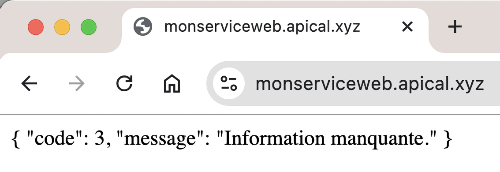
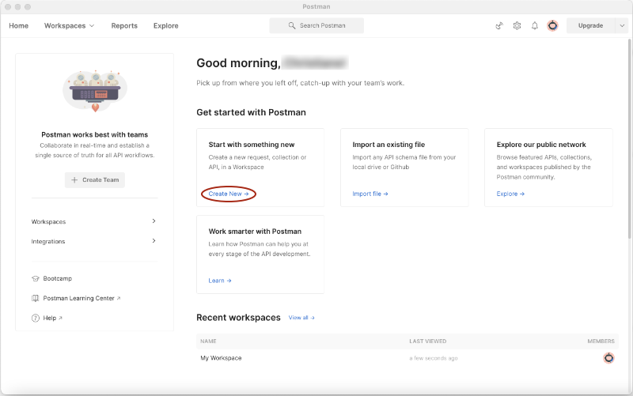
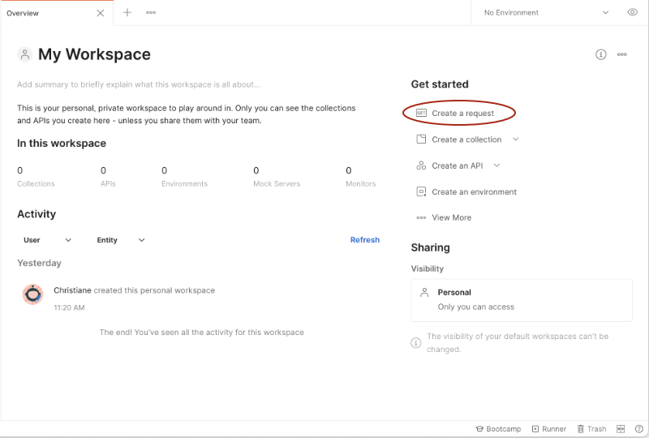
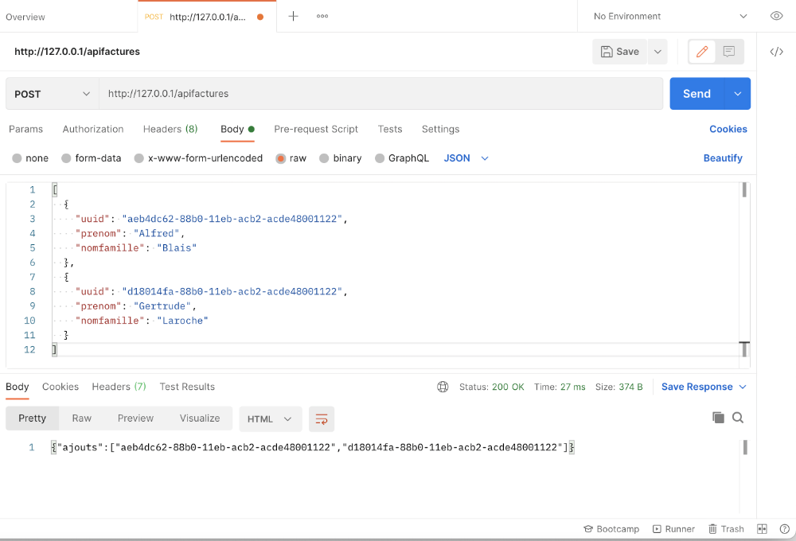

# Synchronisation des données locales dans le nuage

## Approches possibles pour la synchronisation

Si votre application mobile utilise une base de données locale, il faut prévoir un mécanisme pour que les données soient reproduites dans l'infonuagique afin de limiter les risques de pertes en cas de problème ou lors d'un changement d'appareil mobile.

Selon les besoins de votre application et vos aptitudes en programmation, vous pouvez opter pour différentes approches.

### Copie du fichier SQLite

Dans sa forme la plus simple, la synchronisation peut consister à copier le fichier SQLite sur un serveur distant.

Ceci assure qu'en cas de problème local, les données pourront être retrouvées à partir d'un serveur distant.

Par contre, SQLite n'est pas conçu pour un accès à distance alors cette solution ne sert que pour la sauvegarde des données.

### Synchronisation dans un sens

Une solution plus flexible consiste à [créer une base de données sur un serveur distant – par exemple une base de données MySQL – puis à y recopier les modifications en appelant un service Web](synchronisation-des-donnees-locales-dans-le-nuage.md#service-web-pour-synchroniser-les-donnees).

De cette façon, les données pourront être accessibles à distance.

Avec cette approche, l'unique source de vérité pour les données est la base de données locale. Si des modifications sont faites à distance, elle seront écrasées lors de la prochaine synchronisation.

### Synchronisation dans deux sens

La synchronisation dans les deux sens est une solution encore plus intéressante mais également plus complexe à mettre en oeuvre.

Les concepts pour développer une telle synchronisation sont exposées dans la fiche « [Synchronisation dans les deux sens](synchronisation-des-donnees-locales-dans-le-nuage.md#synchronisation-dans-les-deux-sens) ».

### Outils spécialisés

Il existe des outils spécialisés qui se chargent de toute la poutine pour synchroniser une base de données locale dans le nuage.

Avec SwiftData, [la synchronisation dans iCloud est relativement facile à mettre en place](synchronisation-des-donnees-locales-dans-le-nuage.md#synchroniser-les-donnees-dans-icloud-avec-swiftdata).

Voici quelques autres outils qui sont généralement efficaces. Cependant, pour la plupart, la version gratuite offre une quantité de données limitée.

L'outil privilégié dans le monde Apple avant la venue de SwiftData était CloudKit : [https://developer.apple.com/icloud/cloudkit](https://developer.apple.com/icloud/cloudkit/).

Au moment d'écrire ces lignes, la version gratuite de CloudKit permettait 10Go de stockage pour les ressources (**assets**), 100Mo pour les bases de données, 2Go de transfert et 40 requêtes/seconde.

Parse est un autre outil intéressant : [https://parseplatform.org](https://parseplatform.org/).

Au moment d'écrire ces lignes, la version gratuite de Parse permettait 1 000 000 requêtes et 1 000 000 modifications par mois ainsi qu'un espace de stockage de 1Go.

??? info "Pour plus d'information"

    « Determining If CloudKit Is Right for Your App ». Apple. <https://developer.apple.com/documentation/cloudkit/determining_if_cloudkit_is_right_for_your_app>

    « Data Synchronization ». objc. <https://www.objc.io/issues/10-syncing-data/data-synchronization/>

    « A Guide to CloudKit: How to Sync User Data Across iOS Devices ». Toptal. <https://www.toptal.com/ios/sync-data-across-devices-with-cloudkit>

## Service Web pour synchroniser les données

Je vous démontre ici comment écrire un service Web en PHP qui interagit avec une base de données MySQL afin de recopier des données locales dans une base de données distante.

Ce service peut être utilisé avec une application mobile pour iOS ou pour Android de même qu'avec tout autre type d'application qui utilise des données locales.

### Synchronisation vs enregistrement au fur et à mesure dans la base de données distante

Quand on travaille avec une base de données locale et une base de données distante, il faut distinguer deux figures de cas :

- les modifications sont effectuées sur la base de données locale et sur la base de données distante au fur et à mesure
- les modifications sont effectuées seulement sur la base de données locales puis, à un moment précis, les données locales sont synchronisées avec les données distantes.

Ces deux figures de cas sont complémentaires.

En temps normal, l'application utilisera la première approche : chacune des opérations sera effectuée avec la base de données locales ET avec la base de données distante.

Mais dans le cas où l'application roule alors qu'elle n'a pas accès à Internet, seules les données locales pourront être modifiées.

C'est là qu'entre en jeu la synchronisation. Elle permet de comparer les données locales et les données distantes afin d'effectuer les opérations d'ajout, de modification et de suppression qui n'ont pas encore été effectuées sur les données distantes.

Ici, je vous montre comment développer un service Web qui permettra d'effectuer cette synchronisation.

### Serveurs de développement

Pour effectuer la copie des données locales, il faut que l'application mobile ait accès à un service Web qui interagira avec la base de données distante.

Pendant la phase de développement de votre application, le service Web peut tourner localement. Vous aurez besoin d'un serveur HTTP et d'un serveur de bases de données.

Ces serveurs peuvent être installés sur votre ordinateur à l'aide d'un environnement de développement Web.

Quand vous aurez terminé le développement et la phase de tests de votre service Web, vous pourrez le mettre en ligne chez un hébergeur, comme vous le feriez pour un site Web.

### Structure des informations envoyées au service Web puis retournées par le service Web

Le format JSON est très utilisé pour échanger des données entre applications.

L'application mobile doit fournir au service Web une représentation JSON des données à synchroniser.

De son côté, le service Web recevra ces données et il s'en servira dans son traitement.

Il remplira un tableau associatif avec les informations qu'il souhaite fournir en retour à l'application mobile.

À la fin du traitement, le service convertira ce tableau au format JSON puis il fera un `echo` de cette valeur. C'est ce `echo` qui sera la valeur de retour du service Web.

L'application mobile pourra lire l'information retournée et réagir en conséquence.

```php title="Fichier monservice/synchro-clients.php"
...
$tableauRetour = [...];

// Retrouve les données envoyées par l'application mobile.
 $jsonBrut = file_get_contents('php://input');   // $_POST ne fonctionne que pour les Content-Type application/x-www-form-urlencoded ou multipart/form-data

 if ($jsonBrut == null) {
    $tableauRetour['erreurs'][] = ['code' => 5, 'message' => "Aucune donnée locale à synchroniser n'a été reçue."];
 }
else {
    $donnees = json_decode($jsonBrut);
    ...
    $tableauRetour ...;
}

// Retourne les informations à l'application mobile.
 // Remarquez que les paramètres JSON_PRETTY_PRINT, JSON_UNESCAPED_UNICODE et JSON_UNESCAPED_SLASHES assurent les caractères spéciaux seront correctement encodés.
echo json_encode($tableauRetour, JSON_PRETTY_PRINT | JSON_UNESCAPED_UNICODE | JSON_UNESCAPED_SLASHES);
```

### Sécurité et autorisations

Tout service Web qui manipule des données doit se soucier des problèmes de sécurité.

Entre autres, il faut mettre en place un mécanisme d'authentification auprès du service Web qui assurera que seules les applications autorisées peuvent faire appel au service Web.

Les concepts de l'authentifications auprès d'un service Web sont expliqués dans la fiche « [L'authentification auprès du service Web](consommer-un-service-web-avec-swiftui.md#lauthentification-aupres-du-service-web) ».

### Branchement à la base de données

Le service Web doit réussir à se brancher à la base de données.

En cas d'erreur, il se chargera d'initialiser un élément du tableau associatif afin de laisser savoir qu'il y a eu un problème.

Important : les informations d'authentification pour la BD ne doivent pas être inscrites dans un fichier situé à la racine du site Web ni dans un sous-dossier.   
  
Je vous propose de les placer dans un dossier placé directement à la racine de votre dossier personnel chez votre hébergeur, donc en dehors de la racine du service Web.

```php title="Fichier /safe-config/monservice-config.inc (safe-config doit être hors de la racine Web)"
<?php
  return [
    'serveurBD' => '127.0.0.1',
    'nomBD' => 'mabd',
    'usagerBD' => 'usagerbd',
    'motDePasseBD' => 'motdepasseenclair'
];
```

```php title="Fichier monservice/synchro-clients.php (PHP 8.x)"
$dossierRacine = dirname(__FILE__, 2);   // ajuster selon le niveau de hiérarchie du fichier actuel
$config = require "$dossierRacine/safe-config/monservice-config.inc";

$serveurBD = $config['serveurBD'];
$nomBD = $config['nomBD'];
$usagerBD = $config['usagerBD'];
$motDePasseBD = $config['motDePasseBD'];
// Branchement à la base de données.
$continuer = false;
try {
    $mysqli = new mysqli($serveurBD, $usagerBD, $motDePasseBD, $nomBD);
    $mysqli->set_charset("utf8mb4");
    $continuer = true;
    ...
} catch (Exception $e) {
    $tableauRetour['erreurs'][] = ['code' => 2, 'message' => "Échec lors de la connexion à la base de données."];
}
if ($continuer) {
    ...
}
```

### Comparer les enregistrements des BD locale et distante

Il faut distinguer trois figures de cas :

- ajout : l'enregistrement n'est pas encore dans la BD distante. Il est seulement dans la BD locale.
- modification : l'enregistrement est dans la BD distante mais ses données sont différentes de celles de la BD locale.
- suppression : l'enregistrement est encore dans la BD distante alors qu'il a été supprimé de la BD locale.

À première vue, on pourrait utiliser l'identifiant d'un enregistrement pour comparer sa présence dans la BD locale et dans la BD distante.

Le problème, c'est qu'en cas d'ajout, il faudrait forcer l'identifiant afin d'assurer que les deux bases de données puissent demeurer synchronisées. Ceci empêcherait la synchronisation à partir de plusieurs applications différentes puisque chacune pourrait faire un ajout local avec le même identifiant.

#### UUID ou ULID

Pour permettre la synchronisation à partir de plusieurs sources, il est possible d'utiliser un [identifiant unique universel](le-modele.md#generer-un-identifiant-unique) (**Universally unique identifier**, UUID) comme valeur de base pour la synchronisation.

L'utilisation d'un [ULID](le-modele.md#generer-un-identifiant-unique) (**Universally Unique Lexicographically sortable IDentifier**) est également possible.

Ici, le UUID a été utilisé.

Le UUID est une chaîne hexadécimale au format aaaaaaaa-bbbb-cccc-dddd-eeeeeeeeeeee.

Il faut donc ajouter un champ à chacune des tables et s'assurer de le remplir adéquatement.

Plusieurs langages et SGBD permettent de générer un UUID par programmation :

- Swift : [UUID().uuidString](https://developer.apple.com/documentation/foundation/uuid/1779712-uuidstring)
- Kotlin :  [UUID.randomUUID()](https://www.uuidgenerator.net/dev-corner/kotlin)
- MySQL : [UUID()](https://dev.mysql.com/doc/refman/8.0/en/miscellaneous-functions.html#function_uuid)

Pour remplir manuellement ce champ dans une base de données existante, je vous propose trois techniques simples.

##### Terminal

Il est très simple de générer un UUID dans le Terminal macOS à l'aide de la commande [uuidgen](https://man7.org/linux/man-pages/man1/uuidgen.1.html).

```text title="Terminal"
uuidgen
```

##### Site Web générateur de UUID

Vous pouvez également travailler à partir d'un site générateur de UUID, par exemple [https://www.uuidgenerator.net](https://www.uuidgenerator.net/).

##### Avec MySQL

Ouvrez un éditeur MySQL, par exemple phpMyAdmin, puis exécutez la requête :

```sql title="MySQL"
SELECT UUID();
```

### Une bonne base pour votre service Web

Je vous propose ici une première version du service Web que vous pouvez adapter pour vos besoins.

Cette version est perfectible et se veut un simple départ pour éviter de tout construire à partir de zéro.

```php title="Fichier monservice/synchro-clients.php (PHP 8.x)"
<?php

/**
 * Synchronisation à sens unique des données locales vers MySQL.
 *
 * L'application qui consomme ce service Web doit fournir des données par POST au format :
 * [
 *     {"uuid": "...", "prenom": "...", "nomfamille": "..."},
 *     {"uuid": "...", "prenom": "...", "nomfamille": "..."}
 * ]
 *
 * @author Christiane Lagacé <christianelagace.com>
 *
 * @return String chaîne JSON au format :
 * {
 *     "erreurs" : [
 *         {"code" : 99, "message" : "..."},
 *         {"code" : 99, "uuid" : "...", "message" : "..."}
 *     ],
 *     "ajouts" : ["UUID1", "UUID2", ...],
 *     "modifications" : ["UUID3", "UUID4", ...],
 *     "suppressions" : ["UUID5", "UUID6", ...],
 *     "jwt" : "..."
 * }
 *
 * Codes d'erreurs :  1 : Accès refusé.
 *                    2 : Échec lors de la connexion à la base de données.
 *                    3 : Un problème empêche de vérifier les informations d'authentification.
 *                    4 : Les informations d'authentification ne sont pas valides ou le jeton est expiré.
  *                    5 : Aucune donnée locale à synchroniser n'a été reçue.
 *                    6 : Il n'est pas possible de synchroniser les ajouts et les modifications.
 *                    7 : Il n'est pas possible de vérifier s'il y a des enregistrements à supprimer dans la base de données distante.
 *                    8 : L'ajout d'un enregistrement a échoué.
 *                    9 : La mise à jour d'un enregistrement a échoué.
 *                   10 : La suppression d'un enregistrement a échoué.
 */
$dossierRacine = dirname(__FILE__, 2);   // ajuster selon le niveau de hiérarchie du fichier actuel
// Le dossier du fichier journal (log) doit exister au même niveau que le dossier du service Web.
define('LOG_FILE', $dossierRacineServeur . DIRECTORY_SEPARATOR . 'log' . DIRECTORY_SEPARATOR . 'apifactures.log');
$config = require "$dossierRacine/safe-config/monservice-config.inc";
$serveurBD = $config['serveurBD'];
$nomBD = $config['nomBD'];
$usagerBD = $config['usagerBD'];
$motDePasseBD = $config['motDePasseBD'];
$messageAccesRefuse = "Accès refusé.";
$codeAccesRefuse = 1;
$messageErreurConnexion = "Échec lors de la connexion à la base de données.";
$codeErreurConnexion = 2;
$messageErreurVerifierAuthentification = "Un problème empêche de vérifier les informations d'authentification.";
$codeErreurVerifierAuthentification = 3;

$messageErreurInformationsAuthentification = "Les informations d'authentification ne sont pas valides ou le jeton est expiré.";
$codeErreurInformationsAuthentification = 4;

$messageErreurPost = "Aucune donnée locale à synchroniser n'a été reçue.";
$codeErreurPost = 5;

$messageErreurSynchroAjout = "Il n'est pas possible de synchroniser les ajouts et les modifications.";
$codeErreurSynchroAjout = 6;

$messageErreurSynchroSuppression = "Il n'est pas possible de vérifier s'il y a des enregistrements à supprimer dans la base de données distante.";
$codeErreurSynchroSuppression = 7;

$messageErreurAjout = "L'ajout d'un enregistrement a échoué.";
$codeErreurAjout = 8;

$messageErreurMiseAJour = "La mise à jour d'un enregistrement a échoué.";
$codeErreurMiseAJour = 9;

$messageErreurSuppression = "La suppression d'un enregistrement a échoué.";
$codeErreurSuppression = 10;

$tableauRetour = [
    'erreurs' => [],
    'ajouts' => [],
    'modifications' => [],
    'suppressions' => [],
    'jwt' => ''
 ];

// Branchement à la base de données
// *****************************************************************
try {
    $mysqli = new mysqli($serveurBD, $usagerBD, $motDePasseBD, $nomBD);
    $mysqli->set_charset("utf8mb4");
    $continuer = true;
} catch (Exception $e) {
    $continuer = false;
    log_error($messageErreurConnexion);
    $tableauRetour['erreurs'][] = ['code' => $codeErreurConnexion,'message' => $messageErreurConnexion];
}

if ($continuer) {

     // Récupération des données envoyées par l'application mobile
    // *****************************************************************
     $jsonBrut = file_get_contents('php://input'); // $_POST ne fonctionne que pour les Content-Type application/x-www-form-urlencoded ou multipart/form-data

    if ($jsonBrut == null) {
         log_error($messageErreurPost);
         $tableauRetour['erreurs'][] = ['code' => $codeErreurPost, 'message' => $messageErreurPost];
     }
     else {
        $clientsSqlite = json_decode($jsonBrut);   // liste des clients dans la BD SQLite

        //log_info("Données reçues :");
        //log_info($clientsSqlite);

        // Vérification des droits
        // *****************************************************************
        // ...
        $tableauRetour['jwt'] = "...";

         // Recherche des enregistrements à supprimer
        // *****************************************************************
        $requete = "SELECT uuid, nomfamille, prenom FROM clients";

        try {
            $resultat = $mysqli->query($requete);

            if ($mysqli->affected_rows > 0) {
                 while ($enreg = $resultat->fetch_row()) {
                    // L'enregistrement n'est pas dans SQLite : on le supprime.
                    // *****************************************************************
                    if (!presentDansTableauDObjets($enreg[0], $clientsSqlite, 'uuid')) {
                        if (suppressionClient($enreg[0], $enreg[1], $enreg[2])) {
                            $tableauRetour['suppressions'][] = $enreg[0];
                        }
                    }
                }
            }

             $resultat->free();

        } catch (Exception $e) {
            log_error("$messageErreurSynchroSuppression - $mysqli->error");
            $tableauRetour['erreurs'][] = ['code' => $codeErreurSynchroSuppression, 'message' => $messageErreurSynchroSuppression];
        }

        // Recherche des enregistrements à ajouter ou à modifier
         // *****************************************************************
         $requete = "SELECT prenom, nomfamille FROM clients WHERE uuid = ?";

        try {
            $stmt = $mysqli->prepare($requete);

            foreach($clientsSqlite as $clientSqlite) {
                 $stmt->bind_param('s', $clientSqlite->uuid);
                 $stmt->execute();
                 $stmt->store_result();

                 if ($stmt->errno != 0) {
                     log_error("$messageErreurSynchroAjout - uuid: $clientSqlite->uuid - nom: $clientSqlite->nomfamille - prenom: $clientSqlite->prenom - stmt->error");
                     $tableauRetour['erreurs'][] = ['code' => $codeErreurSynchroAjout, 'uuid' => $clientSqlite->uuid, 'message' => $messageErreurSynchroAjout];
                 }
                 else {
                     // L'enregistrement existait dans la BD distante.
                     // *****************************************************************
                     if ($stmt->num_rows > 0) {
                         $stmt->bind_result($prenom, $nomfamille);
                          $stmt->fetch();

                         // L'enregistrement est différent : on fait la mise à jour.
                         // *****************************************************************
                         if ($prenom != $clientSqlite->prenom || $nomfamille != $clientSqlite->nomfamille) {
                             if (miseAJourClient($clientSqlite->uuid, $clientSqlite->prenom, $clientSqlite->nomfamille)) {
                                 $tableauRetour['modifications'][] = $clientSqlite->uuid;
                             }
                         }
                     }
                     else {
                         // L'enregistrement n'existait pas : on l'ajoute.
                         // *****************************************************************
                         if (ajoutClient($clientSqlite->uuid, $clientSqlite->prenom, $clientSqlite->nomfamille)) {
                             $tableauRetour['ajouts'][] = $clientSqlite->uuid;
                         }
                     }
                 }
            }

            $stmt->close();

        } catch (Exception $e) {
             log_error("$messageErreurSynchroAjout - $mysqli->error");
             $tableauRetour['erreurs'][] = ['code' => $codeErreurSynchroAjout, 'message' => $messageErreurSynchroAjout];
        }
    }
}

//log_info("Informations retournées :");
//log_info($tableauRetour);

// Retour des informations à l'application mobile
// *****************************************************************
// Remarquez que les paramètres JSON_PRETTY_PRINT, JSON_UNESCAPED_UNICODE et JSON_UNESCAPED_SLASHES assurent les caractères spéciaux seront correctement encodés.
echo json_encode($tableauRetour, JSON_PRETTY_PRINT | JSON_UNESCAPED_UNICODE | JSON_UNESCAPED_SLASHES);

/**
 * Met à jour le client dans la BD distante selon son UUID.
 *
 * @param String $uuid       Identifiant unique universel du client.
 * @param String $prenom     Prénom à enregistrer.
 * @param String $nomfamille Nom de famille à enregistrer.
 *
 * @author Christiane Lagacé <christianelagace.com>
 *
 * @return bool True si l'opération a réussi.
 *
 */
function miseAJourClient($uuid, $prenom, $nomfamille) {
    global $mysqli;
    global $messageErreurMiseAJour;
    global $codeErreurMiseAJour;
    global $tableauRetour;
    $retour = false;

    $requete = "UPDATE clients SET prenom = ?, nomfamille = ? WHERE uuid = ?";

    try {
        $stmt = $mysqli->prepare($requete);
        $stmt->bind_param('sss', $prenom, $nomfamille, $uuid);
        $stmt->execute();

        if (0 == $stmt->errno) {
            $retour = true;
        }
        else {
            log_error("$messageErreurMiseAJour - uuid: $uuid - nom: $nomfamille - prenom: $prenom - $stmt->error");
            $tableauRetour['erreurs'][] = ['code' => $codeErreurMiseAJour, 'uuid' => $uuid, 'message' => $messageErreurMiseAJour];
        }

        $stmt->close();

    } catch (Exception $e) {
        log_error("$messageErreurMiseAJour - uuid: $uuid - nom: $nomfamille - prenom: $prenom - $mysqli->error");
        $tableauRetour['erreurs'][] = ['code' => $codeErreurMiseAJour, 'uuid' => $uuid, 'message' => $messageErreurMiseAJour];
    } catch (Error $e) {
        log_error("$messageErreurMiseAJour - uuid: $uuid - nom: $nomfamille - prenom: $prenom - " . $e->getMessage());
        $tableauRetour['erreurs'][] = ['code' => $codeErreurMiseAJour, 'uuid' => $uuid, 'message' => $messageErreurMiseAJour];
    }

    return $retour;
}

 /**
 * Ajoute un client dans la BD distante.
 *
 * @param String $uuid       Identifiant unique universel à enregistrer.
 * @param String $prenom     Prénom à enregistrer.
 * @param String $nomfamille Nom de famille à enregistrer.
 *
 * @author Christiane Lagacé <christianelagace.com>
 *
 * @return bool True si l'opération a réussi.
 *
 */
function ajoutClient($uuid, $prenom, $nomfamille) {
    global $mysqli;
    global $messageErreurAjout;
    global $codeErreurAjout;
    global $tableauRetour;
    $retour = false;

    $requete = "INSERT INTO clients (uuid, prenom, nomfamille) VALUES (?, ?, ?)";

    try {
        $stmt = $mysqli->prepare($requete);
        $stmt->bind_param('sss', $uuid, $prenom, $nomfamille);
        $stmt->execute();

        if (0 == $stmt->errno) {
            $retour = true;
        }
        else {
            log_error("$messageErreurAjout - uuid: $uuid - nom: $nomfamille - prenom: $prenom - $stmt->error");
            $tableauRetour['erreurs'][] = ['code' => $codeErreurAjout, 'uuid' => $uuid, 'message' => $messageErreurAjout];
        }

        $stmt->close();

    } catch (Exception $e) {
        log_error("$messageErreurAjout - uuid: $uuid - nom: $nomfamille - prenom: $prenom - $mysqli->error");
        $tableauRetour['erreurs'][] = ['code' => $codeErreurAjout, 'uuid' => $uuid, 'message' => $messageErreurAjout];
    } catch (Error $e) {
        log_error("$messageErreurAjout - uuid: $uuid - nom: $nomfamille - prenom: $prenom - " . $e->getMessage());
        $tableauRetour['erreurs'][] = ['code' => $codeErreurAjout, 'uuid' => $uuid, 'message' => $messageErreurAjout];
    }

    return $retour;
}

 /**
 * Supprime un client de la BD distante selon son UUID.
 *
 * @param String $uuid       Identifiant unique universel du client.
 * @param String $nomfamille Nom de famille du client.
 * @param String $prenom     Prénom du client.
 *
 * @author Christiane Lagacé <christianelagace.com>
 *
 * @return bool True si l'opération a réussi.
 *
 */
 function suppressionClient($uuid, $nomfamille, $prenom) {
    global $mysqli;
     global $messageErreurSuppression;
    global $codeErreurSuppression;
    global $tableauRetour;
    $retour = false;

    $requete = "DELETE FROM clients WHERE uuid = ?";

    try {
        $stmt = $mysqli->prepare($requete);
        $stmt->bind_param('s', $uuid);
        $stmt->execute();

        if (0 == $stmt->errno) {
            $retour = true;
        }
        else {
            log_error("$messageErreurSuppression - uuid: $uuid - nom: $nomfamille - prenom: $prenom - $stmt->error");
            $tableauRetour['erreurs'][] = ['code' => $codeErreurSuppression, 'uuid' => $uuid, 'message' => $messageErreurSuppression];
        }

        $stmt->close();

    } catch (Exception $e) {
        log_error("$messageErreurSuppression - uuid: $uuid - nom: $nomfamille - prenom: $prenom - $mysqli->error");
        $tableauRetour['erreurs'][] = ['code' => $codeErreurSuppression, 'uuid' => $uuid, 'message' => $messageErreurSuppression];
    } catch (Error $e) {
        log_error("$messageErreurSuppression - uuid: $uuid - nom: $nomfamille - prenom: $prenom - " . $e->getMessage());
        $tableauRetour['erreurs'][] = ['code' => $codeErreurSuppression, 'uuid' => $uuid, 'message' => $messageErreurSuppression];
    }

    return $retour;
}

 /**
 * Recherche une valeur dans un tableau d'objets.
 *
 * @param mixed $valeur Valeur recherchée.
 * @param array $tableau Tableau d'objets dans lequel on effectue la recherche.
 * @param string $champ Nom du champ dans lequel on recherche la valeur.
 *
 * @author Christiane Lagacé <christianelagace.com>
 *
 * @return bool True si la valeur a été trouvée.
 *
 */
function presentDansTableauDObjets($valeur, $tableau, $champ) {
    $retour = false;

     foreach($tableau as $objet) {
        if ($objet->$champ == $valeur) {
            $retour = true;
            break;
        }
    }

     return $retour;
}

/**
 * Enregistre la date suivie d'un message d'information dans le fichier journal.
 *
 * Suppositions critiques : Le chemin complet du fichier dont le nom et le chemin sont dans la constante LOG_FILE doit exister (le fichier sera créé s'il n'existe pas).
 * Les droits sur ce fichier et/ou son dossier doivent permettre au serveur Web de lire et d'écrire dans ce fichier.
 *
 * @param String $message Message à inscrire dans le journal.
 *
 * @author Christiane Lagacé <christianelagace.com>
 *
 */
function log_info($message) {
    if (is_array($message) || is_object($message)) {
        $message = print_r($message, true);
    }

     if (defined('LOG_FILE')) {
        error_log(date("F j, Y, g:i a") . " - Information: $message" . PHP_EOL, 3, LOG_FILE);
    }
    else {
        error_log(date("F j, Y, g:i a") . " - Information: $message". PHP_EOL);
    }
}

 /**
 * Enregistre la date suivie d'un message d'erreur dans le fichier journal.
 *
 * Suppositions critiques : Le chemin complet du fichier dont le nom et le chemin sont dans la constante LOG_FILE doit exister (le fichier sera créé s'il n'existe pas).
 * Les droits sur ce fichier et/ou son dossier doivent permettre au serveur Web de lire et d'écrire dans ce fichier.
 *
 * @param String $message Message à inscrire dans le journal.
 *
 * @author Christiane Lagacé <christianelagace.com>
 *
 */
function log_error($message) {
    if (is_array($message) || is_object($message)) {
        $message = print_r($message, true);
    }

     if (defined('LOG_FILE')) {
        error_log(date("F j, Y, g:i a") . " - Erreur: $message" . PHP_EOL, 3, LOG_FILE);
    }
    else {
        error_log(date("F j, Y, g:i a") . " - Erreur: $message". PHP_EOL);
    }
}

$dossierRacine = dirname(__FILE__, 2);   // ajuster selon le niveau de hiérarchie du fichier actuel
$config = require "$dossierRacine/safe-config/monservice-config.inc";
```

### Tester le service Web manuellement

Avant de tenter de consommer le service Web dans une application mobile, il est bon de tester son fonctionnement de façon manuelle.

La technique pour effectuer un tel test est expliquée dans la fiche « [Tester un service Web (API) manuellement avec Postman](synchronisation-des-donnees-locales-dans-le-nuage.md#tester-un-service-web-api-manuellement-avec-postman) ».

### Consommer le service Web

Une fois le service Web écrit et testé, vous êtes prêts à le consommer dans votre application.

- [avec SwiftUI](../complements/fonctions-obsoletes-ou-anciennes-syntaxes.md#consommer-un-service-web-technique-traditionnelle)

??? info "Pour plus d'information"

    « How to Test and Play with Web APIs the Easy Way with Postman ». Free Code Camp. [https://www.freecodecamp.org/news/how-to-test-and-play-with-web-apis-the-easy-way-with-postman](https://www.freecodecamp.org/news/how-to-test-and-play-with-web-apis-the-easy-way-with-postman/)

    « Debug a PHP HTTP request ». phpStorm. <https://www.jetbrains.com/help/phpstorm/debugging-a-php-http-request.html#create_http_request_debug_config>

## Synchronisation dans les deux sens

Si vous avez bien compris comment développer un service Web pour effectuer une [synchronisation dans un sens](synchronisation-des-donnees-locales-dans-le-nuage.md#service-web-pour-synchroniser-les-donnees), vous êtes maintenant prêts pour l'étape suivante : la synchronisation dans deux sens.

L'avantage de cette technique, c'est que si les données sont modifiées directement en ligne ou encore si la synchronisation provient de plusieurs appareils mobiles, les données présentes dans la base de données distante seront également disponibles dans chacune des bases de données locales.

Je vous expose ici les grands principes qui permettent de développer l'algorithme qui effectuera la synchronisation.

### Caractéristiques de la base de données

Pour faciliter la synchronisation dans les deux sens, chaque table de la base de données locale et de la base de données distante doit avoir un identifiant qui n'est pas auto-incrémenté, par exemple un [UUID](le-modele.md#generer-un-identifiant-unique) ou un [ULID](le-modele.md#generer-un-identifiant-unique). Il y aura en plus un champ `date_modification`.

### Opération de synchronisation bidirectionnelle

C'est grâce aux valeurs du champ `date_modification` que le service Web saura si la modification la plus récente, donc celle qu'il faut copier, est dans la base de données locale ou dans la base de données distante.

Il devra en tout temps connaître la date et l'heure de la dernière synchronisation. Ceci pourrait être stocké par exemple dans une table de la BD distante.

Ajout/Suppression : si un enregistrement est dans la BD locale mais pas dans la distante, ou vice-versa, il vérifiera si la date de l'enregistrement est avant ou après la dernière synchronisation.

Si elle est après, il fera l'ajout dans l'autre BD.

Si elle est avant, il supprimera l'enregistrement.

Modification : si un enregistrement est dans les deux bases de données mais que les données sont différentes, il prendra l'enregistrement qui a été modifié en dernier et il copiera les valeurs dans l'autre.

Il terminera par une mise à jour de la date de dernière synchronisation.

## Tester un service Web (API) manuellement avec Postman

Avant de tester un service Web à l'aide d'une application, c'est une bonne idée de le tester manuellement.

### Service Web GET

Lorsqu'un service Web REST travaille avec le verbe GET, il est facile de le tester directement dans le navigateur.

Il suffit d'entrer l'URL dans le navigateur et de le faire suivre par les paramètres dont le service Web a besoin.

La réponse du service apparaîtra directement dans la fenêtre du navigateur.



### Service Web POST

Il est également possible de tester un service Web qui utilise le verbe POST. Il faut à ce moment installer une application spécialisée.

Cette technique permet de fournir des données dans le corps du message (**body**, **payload**) de même que dans l'en-tête (**header**).

Je vais vous faire une démonstration ici avec Postman. Vous pouvez télécharger cette application ici : <https://www.postman.com/downloads/>

Il serait possible de faire le même travail avec tout autre testeur de requêtes REST, par exemple [Bruno](https://www.usebruno.com/) ou [curl](https://curl.se/).

Notez que Postman existe également en version en ligne mais seule la version de bureau permet de faire des tests sur un serveur local.

Une fois votre compte Postman créé, cliquez sur **Create New** dans la zone **Start with something new**.



Dans la fenêtre **My Workspace**, clquez sur **Create a request** dans la zone **Get Started**.



Dans la zone d'URL, choisissez **POST** puis spécifiez l'URL de votre service Web.

Sous l'URL, cliquez sur **Body** pour simuler les valeurs JSON que l'application mobile pourrait passer.

Choisissez le type **raw** puis, à droite complètement, sélectionnez **JSON**.

Entrez au format JSON les données que vous désirez envoyer dans le corps de la requête HTTP.

Si vous avez besoin d'ajouter des informations dans l'en-tête du message, par exemple un jeton JWT, cliquez sur **Headers** puis ajoutez la clé et la valeur à envoyer.

Cliquez ensuite sur **Send**.

La valeur de retour du service Web apparaît au bas de l'écran.



## Synchroniser les données dans iCloud avec SwiftData

Avec un compte développeur Apple, il est possible de synchroniser la base de données locale directement dans iCloud.

En plus d'assurer que les données ne seront pas perdues en cas de problème avec l'appareil, cette technique permet de répliquer les données entre différents appareils, par exemple entre un iPhone et un iPad.

Nous n'irons pas plus loin dans cette avenue car cette technique, qui nécessite un compte payant, dépasse ce qui est couvert dans cette formation.

??? info "Pour plus d'information"

    « Syncing SwiftData with iCloud: A Step-by-Step Guide to Setting Up Cloud Sync in Your SwiftUI App ». DevFright. <https://www.devfright.com/syncing-swiftdata-with-icloud-a-step-by-step-guide-to-setting-up-cloud-sync-in-your-swiftui-app/>

    « How to sync SwiftData with iCloud ». Hacking with Swift. <https://www.hackingwithswift.com/quick-start/swiftdata/how-to-sync-swiftdata-with-icloud>
