Un peu d'information et de vocabulaire sur la fenêtre Mac vous aidera à bien comprendre les étapes pour réaliser les tâches courantes.

## Menu

Le menu de l'application active apparaît toujours dans le haut de l'écran.

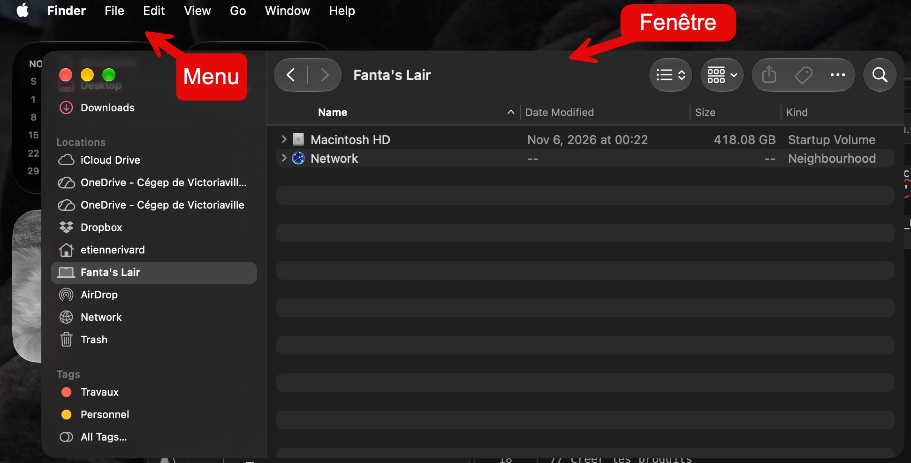

## Quai (Dock)

Le Quai affiche la liste des applications ouvertes ou gardées dans le Quai.

Les applications ouvertes ont un point noir sous leur icône.

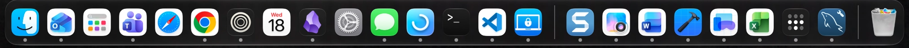

### Garder dans le Quai


Pour garder une application dans le Quai même si elle n'est pas ouverte :

- Clic droit sur son icône
- **Options**
- **Garder dans le Dock**

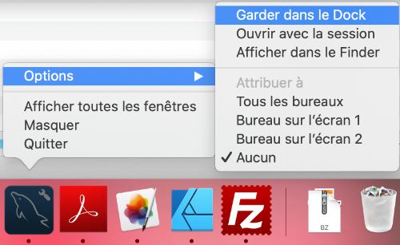

Sous Mac, les boutons pour ajuster rapidement la taille d'une application sont situés dans le coin supérieur gauche de la fenêtre de l'application.


## Refermer une application

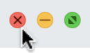

Le bouton rouge a une signification évidente : il permet de refermer une application.

Son équivalent avec le clavier : <kbd>⌘ Cmd</kbd>+<kbd>W</kbd>

## Minimiser une application


Un clic sur le bouton jaune permet de conserver l'application ouverte mais de libérer l'espace qu'elle prend à l'écran.

Son équivalent avec le clavier : <kbd>⌘ Cmd</kbd>+<kbd>M</kbd>

## Afficher une application en plein écran


Le bouton vert permet d'afficher l'application de façon à ce que sa fenêtre prenne tout l'espace disponible sur l'écran.

Son équivalent avec le clavier : <kbd>⌘ Cmd</kbd>+<kbd>⌃ Ctrl</kbd>+<kbd>F</kbd>

Pour accéder au Dock, qui est désormais caché, il suffit de déplacer la souris tout en bas de l'écran et le Dock apparaîtra.

# Spotlight  

Pour lancer Spotlight :  <kbd>⌘ Cmd</kbd> + <kbd>Espace</kbd>  OU l’icône de loupe .

## Spotlight pour lancer une application

Pour lancer une application avec Spotlight :

- Appuyez sur <kbd>⌘ Cmd</kbd> + <kbd>Espace</kbd>
- Commencez à taper le nom de l'application. Spotlight vous fera des suggestions à mesure qu'il trouve des correspondances avec les lettres entrées.
- Lorsque l'application désirée est entrée, appuyez sur <kbd>Entrée</kbd>

Dans cet exemple, le terminal est apparu comme suggestion principale après avoir tapé seulement deux lettres.

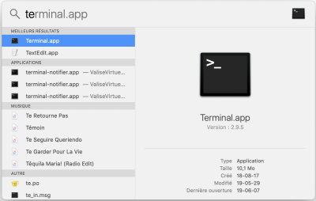

## Spotlight pour trouver un fichier

Vous recherchez une photo de votre chat Roger ? Ouvrez Spotlight et commencez à taper le nom du fichier de la photo.

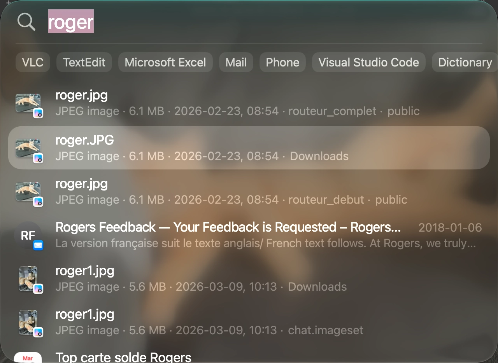


## Afficher la hiérarchie du dossier dans le bas de l’écran (Barre de chemin - Path bar)

- Ouvrez le Finder.
- Rendez-vous dans le menu **Présentation**.
- Cliquez sur **Afficher la barre du chemin d'accès** ou faites  <kbd>⌘ Cmd</kbd>+<kbd>⌥ Option</kbd>+<kbd>P</kbd>.

Dans le bas de la fenêtre du Finder, vous verrez une barre qui montre chacun des dossiers qui ont été traversés pour se rendre au dossier affiché.

Un double-clic sur un de ces dossiers permet d'accéder à ce dossier, ce qui facilite grandement la navigation.

## Ajouter des raccourcis et emplacements dans la barre latérale

- Ouvrez le Finder.
- Rendez-vous dans le menu **Finder** / **Réglages**.
- Dans l'onglet **Barre latérale**, cochez les raccourcis et emplacements désirés (ex : Bureau).
- Les raccourcis et emplacements cochés sont désormais accessibles directement à partir de la barre latérale du Finder.

## Afficher les extensions de fichiers

- Ouvrez le Finder.
- Rendez-vous dans le menu **Finder** / **Réglages**.
- Dans l'onglet **Avancé**, cochez **Afficher toutes les extensions de fichiers**.

## Afficher / cacher les fichiers et dossiers cachés

### Raccourci-clavier

Pour voir les fichiers et dossiers cachés, appuyez sur les touches <kbd>⌘ Cmd</kbd> + <kbd>⇧ Maj</kbd> + <kbd>.</kbd>.

Ils seront affichés à chaque fois que vous ouvrez le Finder et ce, tant que vous ne donnez pas l'ordre inverse.

Refaites cette combinaison de touches pour ne plus les voir.

### Commande dans le Terminal

Il est également possible d'obtenir le même résultat à l'aide de cette commande dans le Terminal.

```bash title="Terminal"
defaults write com.apple.finder AppleShowAllFiles true; killall Finder
```

Vous entrez cette commande une seule fois. Après, les fichiers cachés seront toujours visibles dans le Finder.

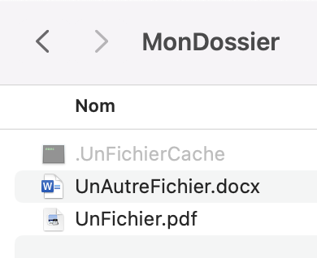

## Lister les fichiers cachés dans le Terminal

Peu importe les configurations du Finder, il est possible en tout temps de voir les fichiers cachés à partir d'une fenêtre Terminal à l'aide de la commande `ls` avec l'argument `-a` (qui veut dire all).

```bash title="Terminal"
ls -a
```

```bash title="Résultat à l'écran"
monnom@MacBook-Pro-de-MonNom MonDossier % ls
UnAutreFichier.docx     UnFichier.pdf

monnom@MacBook-Pro-de-MonNom MonDossier % ls -a
.      .UnFichierCache         UnFichier.pdf
..     UnAutreFichier.doc
```

# Installation sur un Mac à partir de fichiers .zip, .pkg, .dmg ou .app

La façon la plus simple pour installer une application sur un Mac, c'est à partir de l'App Store. L'installation à partir de l'App Store nécessite simplement un compte chez Apple. Vous n'avez pas besoin de détenir le privilège d'administration sur votre ordinateur.

Si l'application dont vous avez besoin n'est pas disponible sur cette plateforme, vous pourrez tout de même l'installer à partir d'un fichier téléchargé.

Les étapes seront différentes selon l'extension du fichier que vous aurez téléchargé.

Attention : l'installation à partir d'un fichier téléchargé nécessite généralement le mot de passe de l'administrateur sur l'ordinateur.  

## Fichier .zip

1. Décompresser  
1. Si contenu est .pkg ou .dmg -> Double-clic du fichier 
1. Si contenu est .app, mettre dans /Users/monuser/Applications.  

## Fichier .dmg

Une fois un fichier .dmg lancé, l'image du disque est montée et l'installation débute automatiquement.

Certains .dmg contiennent directement un fichier .app. D'autres contiennent un .pkg (voir prochaine section).

À la fin du processus d'installation, une fenêtre Finder apparaitra, avec une apparence différente de ce qu'on voit habituellement.

Si le .dmg contenait un .app, vous verrez l'application à gauche et le dossier `Applications` à droite. Faites glisser l'application dans le dossier, directement à partir de cette fenêtre, et le tour est joué.

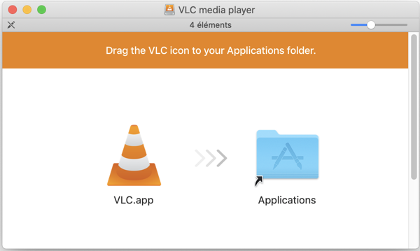

Vous devez finalement aller dans le Finder pour éjecter l'image disque.

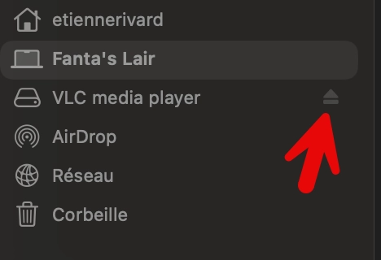

Il est à noter qu'on retrouve parfois des fichiers .dmg qui contiennent un fichier .pkg. Il faut à ce moment double-cliquer sur le .pkg pour poursuivre le processus (voir la section qui suit).

## Fichier .pkg

Un double-clic sur un fichier .pkg lancera le [programme d'installation de macOS](https://en.wikipedia.org/wiki/Installer_(macOS)).

Pour lancer l'installation, cliquez sur **Continuer** dans le programme d'installation et suivez les étapes.

!!! note 
  Les scripts inclus dans un fichier .pkg se chargent généralement de copier l'application dans le dossier Applications.

## Fichier .app

Les fichiers .app constituent les applications en tant que telles. Ils peuvent fonctionner à partir de n'importe quel dossier mais ils sont généralement regroupés dans le dossier `/Applications`, directement sous Macintosh HD.

# Installation sur un Mac sans les droits d'administrateur

Si vous n'êtes pas administrateur de votre ordinateur, vous pourriez tout de même réussir à installer certaines applications.

## AppStore

À partir de l'AppStore, il n'y a pas de problème. Vous avez besoin d'un compte chez Apple. Le processus d'installation se chargera de copier le fichier .app, qui représente l'application, dans le dossier `/Applications` et ce, même si vous ne détenez pas le privilège d'administration de l'ordinateur.

## Fichier téléchargé

Si vous tentez une installation à partir d'un fichier téléchargé, tout dépend du type du fichier que vous avez en main.

### Fichier .app

Un fichier .app est l'application en tant que telle. Ce fichier peut être placé n'importe où sur votre ordinateur.

L'endroit de prédilection est le dossier `/Applications` mais vous devez déternir les droits d'administration sur l'ordinateur pour y copier des fichiers.

Si vous ne détenez pas ces droit, un endroit intéressant est le dossier Applications sous votre dossier personnel (`/Users/monnom/Applications`).

### Fichier .dmg

Les fichiers .dmg sont la solution la plus répendue pour installer un fichier à partir du Web.

Pour effectuer une installation sans détenir les droits d'administration, suivez ces étapes :

- Ouvrez le Finder puis double-cliquez sur le fichier.
- Lorsqu'une fenêtre vous invite à faire glisser le .app dans le dossier `/Applications`, NE LE FAITES PAS!

  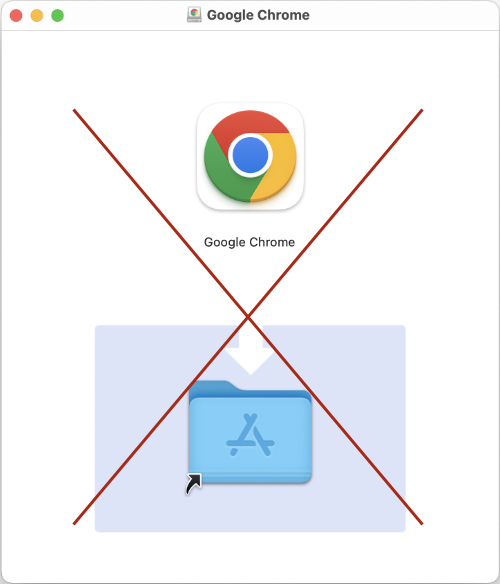
- **Dans cette fenêtre**, faites un clic droit sur l'icône qui représente l'application puis choisissez **Copier**.
- Ouvrez une nouvelle fenêtre Finder.
- Rendez-vous dans le dossier désiré (ex : `/Users/monnom/Applications`) puis faites clic droit / **Coller**.

### Fichier .pkg

Avec un fichier .pkg, c'est un peu plus complexe. De plus, puisque ce type de fichier est souvent utilisé pour sa capacité à inclure des scripts, il est posssible que la simple copie du fichier .app ne soit pas suffisante.

Ça vaut tout de même le coup d'essayer.

Ouvrez une fenêtre Terminal puis lancez la commande suivante pour extraire le contenu du fichier :

```bash title="Terminal"
pkgutil –-expand nomDuPaquet.pkg destination
```

Par exemple, pour extraire dans le dossier `tempo` (qui ne doit pas exister pour le moment) le contenu du fichier `MicrosoftOfficeInstaller.pkg` qui est présentement dans le dossier des téléchargements :

```bash title="Terminal"
cd /Users/monnom/Downloads
pkgutil –expand MicrosoftOfficeInstaller.pkg tempo
```

Vous pouvez maintenant ouvrir le dossier `tempo` dans Finder. Malheurseusement, dans le cas présenté ici (comme c'est souvent le cas), le fichier .pkg contenait d'autres fichiers .pkg qui, eux, ne pouvaient pas être traités par la commande `pkgutil`.

# Lancer une application qui ne provient pas de l'AppStore

La première fois que vous tentez d'ouvrir une application qui ne provient pas de l'AppStore, vous pourriez avoir un avertissement du genre « Impossible d'ouvrir l'application, car cette app provient d'un développeur non identifié. ».

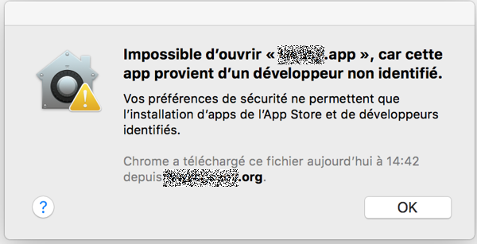

Selon votre version de macOS, vous pourriez plutôt obtenir le message « Élément xyz.app non ouvert. Apple n'a pas pu vérifier que xyz.app ne contient pas de logiciels malveillants susceptibles d'endommager votre Mac ou de porter atteinte à la confidentialité de vos données. »


Pour ouvrir tout de même cette application, parfois cette technique est suffisante :

- Dans le Finder, rendez-vous dans le dossier qui contient le fichier .app de l'application (il s'agit généralement du dossier `Applications` qui apparaît dans la zone de gauche du Finder).
- Faites un clic droit sur le fichier puis choisissez **Ouvrir**.
- Un fenêtre vous indiquera que l'application ne provient pas d'un développeur identifié. Cliquez sur **Ouvir** pour l'ouvrir malgré tout.

  

Si l'application est toujours bloquée et que vous savez qu'elle ne pose pas de danger pour votre ordinateur, vous pouvez l'ouvrir en suivant ces étapes :

- Rendez-vous dans le menu  / **Réglages système** / **Confidentialité et sécurité**.
- Faites défiler l'écran jusqu'à la section **Sécurité**.
- Si vous voyez le message « L'élément xyz.app a été bloqué pour protéger votre Mac », cliquez sur **Ouvrir quand même**.

  
- Dans la fenêtre qui apparaît, appuyez à nouveau sur **Ouvrir quand même**.  

  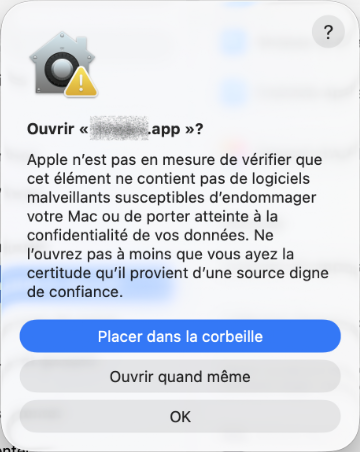

La prochaine fois que vous ouvrirer l'application, tout se passera sans problème et aucun avertissement ne sera affiché.

# Effectuer une impression d'écran, incluant la possibilité d'une page Web plus longue que l'écran!

Sous MacOS, différentes techniques vous permettent d'effectuer une impression d'écran de l'écran complet ou d'une partie de l'écran.

Certaines fonctionnalités sont incluses directement dans le système d'exploitation alors que d'autres nécessitent l'installation d'un outil supplémentaire.

## Enregistrer l'impression d'écran sur le bureau

Pour effectuer une impression d'écran sous Mac sans avoir à installer quoi que ce soit :


- <kbd>⌘ Command</kbd>+<kbd>⇧ Shift</kbd>+<kbd>3</kbd> : une image de l'écran en entier.
- <kbd>⌘ Command</kbd>+<kbd>⇧ Shift</kbd>+<kbd>4</kbd> : sélectionner une partie de l'écran. 


L'image est enregistrée directement sur le bureau. Vous pouvez la copier/coller ou simplement la faire glisser à l'endroit désiré.

## Impression d'écran qui contient le curseur

- Lancez l'utilitaire Aperçu (**Preview** en anglais).
- Dans le menu en haut de la fenêtre, rendez-vous dans **Fichier** / **Effectuer une capture d'écran** / **À partir de l'écran entier**.
- Vous disposez d'environ 10 secondes pour placer la souris à l'endroit désiré. L'impression d'écran sera déclenchée automatiquement.

## Impression d'écran d'une page Web qui fait plus d'un écran de long

Dans Google Chrome, il existe un petit utilitaire qui permet de générer une image d'une page Web complète. On dira qu'on fait une impression d'écran **avec scroll**.

Pour y arriver, ouvrez les outils de développement de Chrome. Trois techniques permettent d'y arriver :

- clic sur les trois points verticaux à droite de la barre d'URL / **Plus d'outils** / **Outils de développement**

  ou
- clic droit dans une page Web / **Inspecter**

  ou
- à l'aide du raccourci-clavier <kbd>⌘ Cmd</kbd>+<kbd>⌥ Option</kbd>+<kbd>I</kbd>.

Ouvrez ensuite la fenêtre de commande des outils de développement :

- clic sur les trois points verticaux à droite de la fenêtre des outils de développement / **Exécuter la commande** (en anglais : **Run command**)

  

  ou
- à l'aide du raccourci-clavier <kbd>⌘ Cmd</kbd>+<kbd>⇧ Maj</kbd>+<kbd>P</kbd>.

Inscrivez `screenshot`.

Si vous n'obtenez aucun résultat, inscrivez plutôt le mot `capture`.

L'option **Effectuer une capture d'écran en taille réelle** (en anglais : **Capture full size screenshot**) générera une image de la page Web complète, incluant ce qui déborde de la fenêtre.

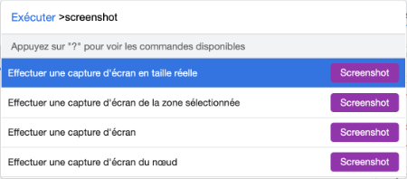

L'image générée apparaîtra dans la zone de téléchargement au bas de l'écran de Chrome.
