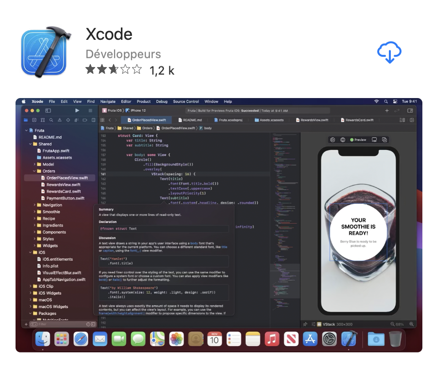
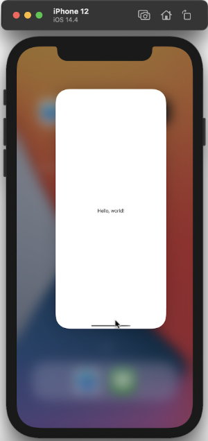
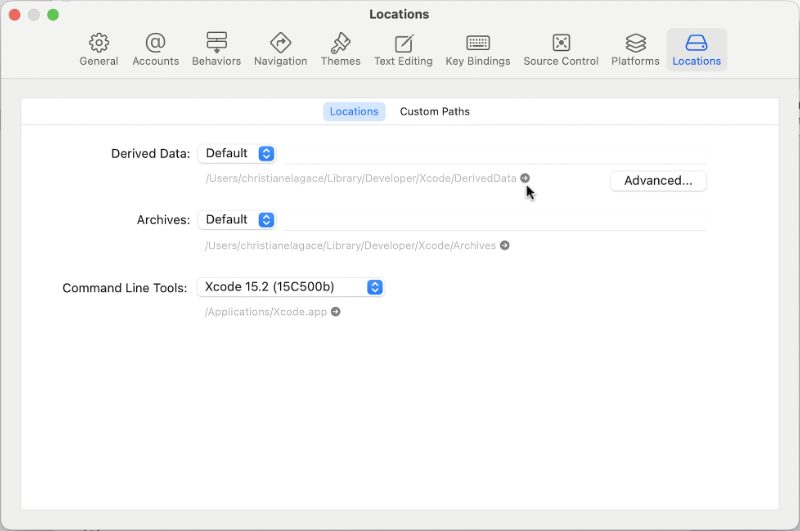
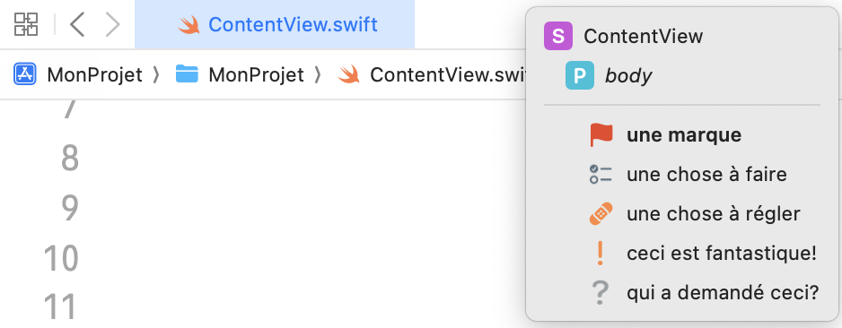
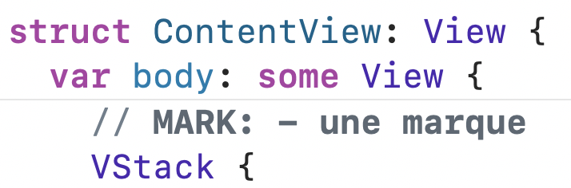
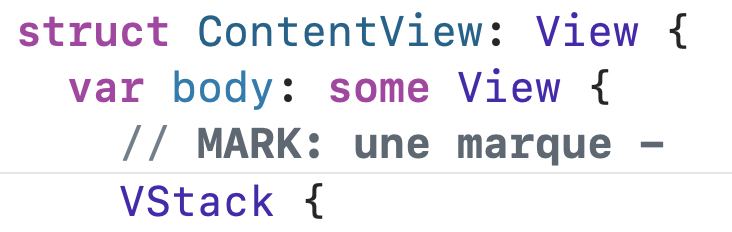
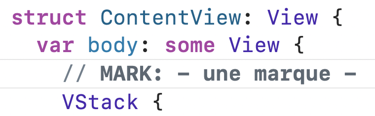

# Travailler avec Xcode

## Installation de Xcode

Xcode est l'environnement de développement (ou IDE : **Integrated Development Environment**) de prédilection pour développer des applications pour macOS ou pour iOS.

Il offre tout ce qu'un IDE digne de ce nom doit offrir :

- éditeur de code avec coloration syntaxique, complétion de code, détection d'erreurs en temps réel, <kbd>⌘ Cmd</kbd>+Clic pour atteindre une définition de classe ou de fonction, etc.
- éditeur d'interface
- débogueur
- simulateur pour iPhone, iPad, Apple Watch, etc.
- intégration de Git

Xcode ne fonctionne que sur macOS.

Il est gratuit et peut être téléchargé sur l'App Store.



## Configurer le clavier du simulateur

Quand j'ai voulu tester ma toute première application iOS, je me suis butée à un clavier configuré en Azerty. Mais comment remettre mon clavier Querty en place sur le simulateur de Xcode?

Eh bien, il faut savoir que le simulateur contient de nombreuses fonctionnalités du iPhone. Pour régler le clavier :

- Refermez l'application dans le simulateur avec une de ces techniques :
  - en vous rendant dans le menu **Device** / **Home**

    ou
  - en cliquant sur l'icône de maison dans le haut du simulateur

    ou
  - en faisant glisser la barre d'accueil vers le haut

    
- Ouvrez l'aplication Réglages. Si elle n'est pas visible sur l'écran du simulateur, faites glisser l'écran vers la gauche ou vers la droite à l'aide de la souris afin de voir les icônes disponibles sur les autres pages de l'écran.
- Rendez-vous dans **Général** / **Claviers** / **Claviers**.
- Sélectionnez le clavier désiré.

Sur le simulateur, pour voir le clavier iOS : <kbd>⌘ Cmd</kbd>+<kbd>K</kbd> ou dans le menu du simulateur : **I/O** / **Keyboard** / **Toggle Software Keyboard**.

## Les raccourcis clavier de Xcode

| Raccourci clavier Mac | Rôle | Autre technique |
| --- | --- | --- |
| <kbd>⇧ Maj</kbd> + <kbd>⌃ Ctrl</kbd> + <kbd>⌘ Cmd</kbd> + <kbd>M</kbd> | Afficher / Cacher la mini-carte (minimap), cette section verticale qui montre l'ensemble du code de la page en miniature. |  |
| <kbd>⌃ Ctrl</kbd> + <kbd>6</kbd> | Afficher les items de la page : structures, classes, variables afin de permettre d'y accéder plus rapidement. |  |
| <kbd>⇧ Maj</kbd> + <kbd>⌘ Cmd</kbd> + <kbd>O</kbd> | Ouvrir rapidement un fichier. |  |
| <kbd>⌃ Ctrl</kbd> + <kbd>I</kbd> | Refaire l'indentation du code (commencer par tout sélectionner avec <kbd>⌘ Cmd</kbd> + <kbd>A</kbd>). |  |
| <kbd>⌥ Option</kbd> + <kbd>⌘ Cmd</kbd> + <kbd>2</kbd> | Afficher l'historique des modifications du fichier. | Aussi disponible en cliquant sur l'icône d'horloge dans l'inspecteur de propriétés ou à l'aide du menu **View** / **Inspectors** / **History**. |
| <kbd>⌘ Cmd</kbd> + <kbd>É</kbd> | Commenter / Décommenter les lignes sélectionnées. | Aussi disponible sur la Touch Bar.  Commentaire sur la Touch Bar  ou  Menu **Editor** / **Structure** / **Comment Selection** |
| <kbd>⌃ Ctrl</kbd> + <kbd>⌘ Cmd</kbd> + <kbd>E</kbd> | Modifier simultanément toutes les occurences du mot qui sont visibles dans la même portée. | <kbd>⌘ Cmd</kbd> + clic sur un mot / **Edit all in scope** ou  Menu **Editor** / **Edit all in scope** |
| <kbd>⌥ Option</kbd> + sélection | Sélectionner une colonne sur plusieurs lignes (sélection rectangulaire). |  |
| <kbd>⇧ Maj</kbd> + <kbd>⌃ Ctrl</kbd> + clic | Sélection multiple |  |
| <kbd>⌥ Option</kbd> + <kbd>⌘ Cmd</kbd> + <kbd>E</kbd> | Sélectionner la prochaine occurence du mot actuellement sélectionné, créant une sélection multiple (peut être fait à répétition pour sélectionner toutes les occurences dans la page). | Menu **Find** pour rechercher un mot puis **Find and Select Next** |
| <kbd>⌥ Option</kbd> + Sélection | Sélectionner une colonne sur plusieurs lignes (sélection rectangulaire). |  |
| <kbd>⌥ Option</kbd> + <kbd>⌘ Cmd</kbd> + <kbd>É</kbd> | Génèrer les informations de base de la documentation d'une fonction. |  |
| <kbd>⌘ Cmd</kbd> + <kbd>D</kbd> | Dupliquer la ligne courante | Menu **Edit** / **Duplicate** |
|  |  |  |

### Les raccourcis que j'aime ajouter

Nous avons tous nos habitudes. L'utilisation de raccourcis-clavier en fait partie.

Certains raccourcis que nous aimons viennent d'autres logiciels et il est possible de les configurer dans Xcode.

Voici ceux que j'aime [configurer dans Xcode](travailler-dans-xcode.md#personnaliser-les-raccourcis-clavier).

| Raccourci clavier Mac | Rôle | Autre technique |
| --- | --- | --- |
| <kbd>⌘ Cmd</kbd>+ <kbd>⌫ Retour arrière</kbd> | Supprimer une ligne entière |  |
|  |  |  |

## Forcer une recompilation à neuf

Pendant le développement d'une application avec Xcode, il m'est arrivé de modifier une configuration qui a généré une erreur de type « Build Failed ». Même après avoir tout remis dans son état original, je n'arrivais plus à compiler mon application.

Si cela vous arrive, vous serez heureux d'apprendre qu'il est possible de forcer une compilation à neuf à l'aide de l'option de menu **Product** / **Clean Build Folder**.


## Renommer un projet SwiftUI dans Xcode

Pour renommer correctement un projet dans Xcode :

- Dans le Finder, renommez le dossier du projet. Ex : `LeProjet`.
- Renommez le fichier .xcodeproj pour que son nom débute par le nom du dossier du projet. Ex : `LeProjet.xcodeproj`.
- Ouvrez maintenant le projet dans Xcode. Une façon simple consiste à faire glisser le fichier .xcodeproj sur la vignette de Xcode dans le Dock (Xcode doit avoir été ouvert au préalable ou sa vignette doit toujours être gardée dans le Dock).
- Ouvrez le navigateur de projet de Xcode en cliquant sur l'icône de chemise  dans la zone de gauche. L'ancien nom du projet apparaît toujours comme nom du sous-dossier. Renommez-le directement dans Xcode.
- Renommez le fichier dont le nom se termine par App.swift. Ex : `LeProjetApp.swift`. Remarquez que si le nouveau nom comporte des traits d'union, ils doivent être remplacés par des barres de soulignement (Ex : pour le projet `MonProjet-2`, on aura`MonProjet_2App.swift` ).
- Renommez également la structure qui y est définie. Ex : `struct LeProjetApp`. Ici aussi les traits d'union doivenet être remplacés par des barres de soulignement.
- Dans chacun des fichiers, l'ancien nom du projet apparaît dans le commentaire d'en-tête. Modifiez ce nom partout.
- Dans le navigateur de projet de Xcode, cliquez sur le nom du projet. Dans la zone centrale, le nom du projet est déjà corrigé. Il reste à modifier le nom de la cible sous **TARGETS**.
- Rendez-vous dans l'onglet **General** /section **Identity** puis modifiez le **Bundle Identifier**. Ex : `com.monnom.leprojet`
- Pour que le bon nom apparaisse sous l'AppIcon quand l'application est installée sur un téléphone ou dans le simulateur, rendez-vous dans l'onglet **General** / section **Identity** puis entrez le nom désiré dans la zone **Display Name**. Le nom n'a pas besoin d'être identique au nom du projet. On mettra par exemple un espace entre deux mots. Ex : `Le projet`.
- Dans l'onglet **Build Settings**, entrez `DEVELOPMENT_ASSET_PATHS` dans la zone **Filter** dans le haut de l'écran. La configuration recherchée est sous la section **Deployment**. Modifiez la valeur qui apparaît pour qu'elle soit au format `"LeProjet/Preview Content"`.
- Si le projet utilise un fichier `Info.plist`, entrez `Info.plist file` dans la zone **Filter** dans le haut de l'écran. Corrigez le nom du dossier à cet endroit.
- Il reste à redéfinir le schéma actif. Dans la barre de titre de Xcode, cliquez sur le nom de l'ancien schéma puis choisissez **Manage Schemes**. Supprimez l'ancien schéma puis créez-en un nouveau en conservant les valeurs par défaut.
- Le projet est maintenant entièrement fonctionnel sous son nouveau nom!

### En cas d'erreur

Si, après avoir renommé votre projet, vous obtenez l'erreur « Cannot preview in this file - Active scheme does not build this file » :

- Rendez-vous dans le menu **Xcode** / **Settings**.
- Dans l'onglet **Locations**, cliquez sur la flèche située à droite du chemin sous **Derived Data**.

  
- Ceci ouvre le Finder et montre le dossier `Derived Data`. Supprimez le dossier `Derived Data`.
- Redémarrez Xcode.

## Annotations MARK, TODO, FIXME

Xcode nous offre des annotations bien pratiques pour identifier des parties de notre code :

- `// MARK: -` une marque
- `// TODO:` une chose à faire
- `// FIXME:` une chose à régler

Il est même possible d'ajouter d'autres marques pour noter des exclamations et des interrogations :

- `// !!!:` ceci est fantastique!
- `// ???:` qui a demandé ceci?

Ces annotations permettent bien sûr d'identifier clairement des parties de notre code.

Elles permettent également de se rendre rapidement à la ligne annotée en cliquant sur la barre de navigation située dans le haut de l'écran, juste en haut de la fenêtre de code (en anglais, on l'appelle **jump bar menu**).


Un clic sur la dernière entrée du **jump bar menu** présente les classes, structures, méthodes et propriétés de même que les annotations.



#### Barre horizontale de séparation

Dans l'image précédente, remarquez la barre horizontale avant l'annotation `MARK` représentée par un drapeau rouge.

La même barre horizontale apparaît dans le code.

Cette barre horizontale apparaît puisque le texte de l'annotation a débuté par un trait d'union.

Il aurait été également possible d'utiliser le trait d'union pour `// TODO:`, `// FIXME:`, `// !!!:` et `// ???:`.

En jouant avec les traits d'union, il est possible :

- d'ajouter une barre horizontale avant la marque :

  ```swift title="Swift"
  // MARK: - une marque
  ```

  
- d'ajouter une barre horizontale après la marque :

  ```swift title="Swift"
  // MARK: une marque -
  ```

  
- d'ajouter une barre avant et une barre après la marque :

  ```swift title="Swift"
  // MARK: - une marque -
  ```

  

### Pour plus d'information

« Apple Developer ». Editing source files in Xcode - Annotate your code for visibility. <https://developer.apple.com/documentation/xcode/creating-organizing-and-editing-source-files#Annotate-your-code-for-visibility>
