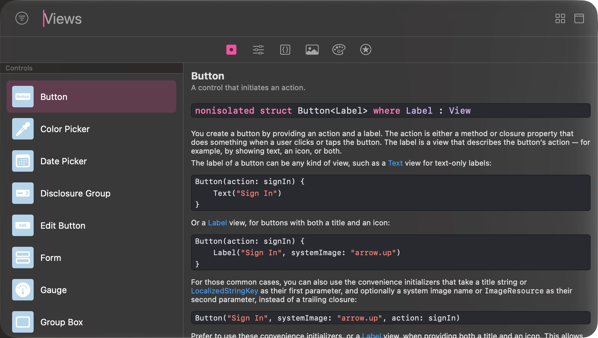
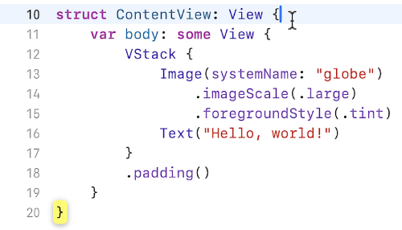
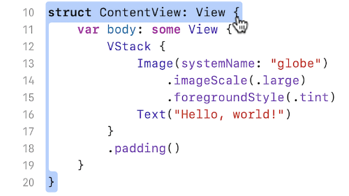

# Travailler dans Xcode

## La bibliothèque d'objets (object library)

Pour chercher un élément à ajouter à une vue, utilisez la bibliothèque d'objets.  

Deux façons de l'afficher :

- le menu **View** / **Show Library**.  
- <kbd>⇧ Maj</kbd> +<kbd>⌘ Cmd</kbd> + <kbd>L</kbd>.  

## Voir l'accolade correspondante

Lorsque le code devient un peu plus étoffé, il peut devenir difficile de retrouver l'accolade fermante qui correspond à une accolade ouvrante. Même chose pour les parenthèses.

Xcode nous offre quelques techniques pour nous aider à nous retrouver.

### Clic

Quand on clique juste à droite d'une accolade, l'accolade correspondante apparaît en jaune pendant environ une seconde.

### Double-clic

 Un double-clic directement sur une accolade permet de voir en bleu toute la zone incluse dans cette accolade.

Ceci fonctionne aussi pour les parenthèses.

### Command + pointer

Voici une autre technique pour voir l'accolade correspondante.

- Appuyez sur la touche <kbd>⌘ Cmd</kbd>.
- **Pointez** une accolade (ne pas cliquer).
- Au besoin, faites défiler l'écran sans lâcher la touche <kbd>⌘ Cmd</kbd> afin de voir la fin de la correspondance.

## Formater le code  

### Réindenter le code

Pour réindenter tout le code d'un fichier :

1. <kbd>⌘ Cmd</kbd>+<kbd>A</kbd> pour sélectionner tout le texte.  
2. <kbd>⌃ Ctrl</kbd>+<kbd>I</kbd> pour réindenter.  

### Mettre des instructions en commentaire

Xcode permet de mettre rapidement une série de lignes en commentaire.

Cette technique ajoutera les caractères `//` devant les lignes sélectionnées.

1. Sélectionnez les lignes à mettre en commentaire.
1. <kbd>⌘ Cmd</kbd> + <kbd>É</kbd>