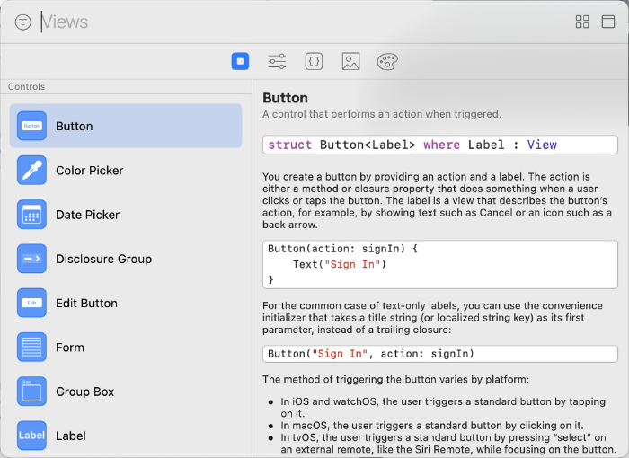
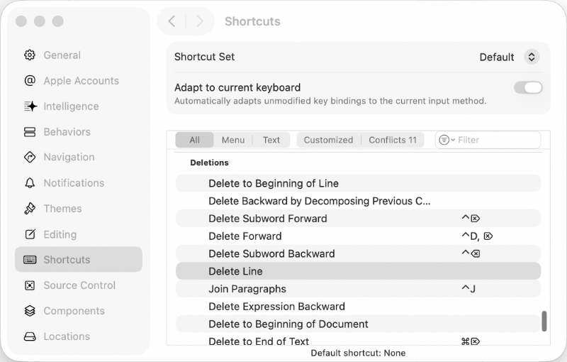
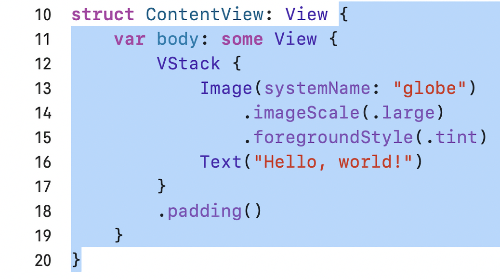
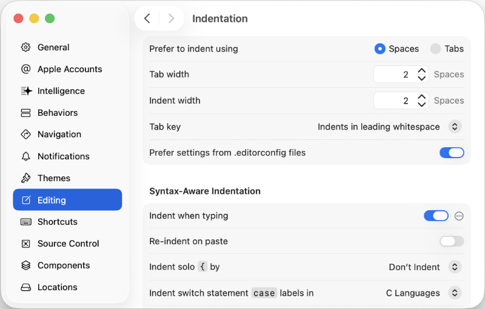

# Travailler dans Xcode

## La bibliothèque d'objets (object library)

La bibliothèque d'objets (en anglais : **Object library**), permet d'ajouter à vos vues des éléments visuels, par exemple du texte, des boutons, des cases de saisie.

Son utilisation n'est pas obligatoire. Si vous connaissez le nom des éléments visuels à ajouter, vous pouvez les entrer directement dans le code source.

La bibliothèque d'objets est en quelques sortes un outil pour retrouver des éléments visuels sans avoir à mémoriser leurs noms.

Par défaut, cette bibliothèque n'est pas visible dans Xcode.

Pour l'afficher :

- Rendez-vous dans le menu **View** / **Show Library**.

  ou
- Appuyez sur les touches <kbd>⇧ Maj</kbd> +<kbd>⌘ Cmd</kbd> + <kbd>L</kbd>.

## Les raccourcis clavier de Xcode

| Raccourci clavier Mac | Rôle | Autre technique |
| --- | --- | --- |
| <kbd>⇧ Maj</kbd> + <kbd>⌃ Ctrl</kbd> + <kbd>⌘ Cmd</kbd> + <kbd>M</kbd> | Afficher / Cacher la mini-carte (minimap), cette section verticale qui montre l'ensemble du code de la page en miniature. |  |
| <kbd>⌃ Ctrl</kbd> + <kbd>6</kbd> | Afficher les items de la page : structures, classes, variables afin de permettre d'y accéder plus rapidement. |  |
| <kbd>⇧ Maj</kbd> + <kbd>⌘ Cmd</kbd> + <kbd>O</kbd> | Ouvrir rapidement un fichier. |  |
| <kbd>⌃ Ctrl</kbd> + <kbd>I</kbd> | Refaire l'indentation du code (commencer par tout sélectionner avec <kbd>⌘ Cmd</kbd> + <kbd>A</kbd>). |  |
| <kbd>⌥ Option</kbd> + <kbd>⌘ Cmd</kbd> + <kbd>2</kbd> | Afficher l'historique des modifications du fichier. | Aussi disponible en cliquant sur l'icône d'horloge dans l'inspecteur de propriétés ou à l'aide du menu **View** / **Inspectors** / **History**. |
| <kbd>⌘ Cmd</kbd> + <kbd>É</kbd> | Commenter / Décommenter les lignes sélectionnées. | Aussi disponible sur la Touch Bar.  Commentaire sur la Touch Bar  ou  Menu **Editor** / **Structure** / **Comment Selection** |
| <kbd>⌃ Ctrl</kbd> + <kbd>⌘ Cmd</kbd> + <kbd>E</kbd> | Modifier simultanément toutes les occurences du mot qui sont visibles dans la même portée. | <kbd>⌘ Cmd</kbd> + clic sur un mot / **Edit all in scope** ou  Menu **Editor** / **Edit all in scope** |
| <kbd>⌥ Option</kbd> + sélection | Sélectionner une colonne sur plusieurs lignes (sélection rectangulaire). |  |
| <kbd>⇧ Maj</kbd> + <kbd>⌃ Ctrl</kbd> + clic | Sélection multiple |  |
| <kbd>⌥ Option</kbd> + <kbd>⌘ Cmd</kbd> + <kbd>E</kbd> | Sélectionner la prochaine occurence du mot actuellement sélectionné, créant une sélection multiple (peut être fait à répétition pour sélectionner toutes les occurences dans la page). | Menu **Find** pour rechercher un mot puis **Find and Select Next** |
| <kbd>⌥ Option</kbd> + Sélection | Sélectionner une colonne sur plusieurs lignes (sélection rectangulaire). |  |
| <kbd>⌥ Option</kbd> + <kbd>⌘ Cmd</kbd> + <kbd>É</kbd> | Génèrer les informations de base de la documentation d'une fonction. |  |
| <kbd>⌘ Cmd</kbd> + <kbd>D</kbd> | Dupliquer la ligne courante | Menu **Edit** / **Duplicate** |
|  |  |  |

### Les raccourcis que j'aime ajouter

Nous avons tous nos habitudes. L'utilisation de raccourcis-clavier en fait partie.

Certains raccourcis que nous aimons viennent d'autres logiciels et il est possible de les configurer dans Xcode.

Voici ceux que j'aime [configurer dans Xcode](travailler-dans-xcode.md#personnaliser-les-raccourcis-clavier).

| Raccourci clavier Mac | Rôle | Autre technique |
| --- | --- | --- |
| <kbd>⌘ Cmd</kbd>+ <kbd>⌫ Retour arrière</kbd> | Supprimer une ligne entière |  |
|  |  |  |

## Personnaliser les raccourcis clavier

Pour ajouter ou modifier des raccourcis clavier dans Xcode :

- Rendez-vous dans le menu **Xcode** / **Settings**.
- Sélectionnez l'option **Shortcuts**.
- Repérez l'opération pour laquelle vous désirez ajouter ou modifier un raccourci clavier. Vous pouvez entrer un mot dans la zone de recherche pour la retrouver plus facilement.

  
- Sur la ligne de cette opération, double-cliquez dans la zone qui contient les raccourcis clavier. Cette zone pourrait être vide si l'option n'est associée à aucun raccourci.
- Appuyez sur les touches que vous désirez associer à l'opération. Si la combinaison de touches est déjà utilisée, Xcode l'indiquera au bas de la fenêtre.

  Par exemple, j'aime utiliser <kbd>⌘ Cmd</kbd>+ <kbd>⌫ Retour arrière</kbd> pour supprimer une ligne entière puisque ce raccourci clavier est utilisé dans de nombreux éditeurs. Xcode m'indique que ce raccourci est déjà utilisé mais je choisis de l'utiliser quand même. Pour que le nouveau raccourci clavier prenne effet, il faut résoudre le conflit, c'est-à-dire défaire le lien entre ce raccourci clavier et l'opération qui lui était originalement affectée.

## Voir l'accolade correspondante

Lorsque le code devient un peu plus étoffé, il peut devenir difficile de retrouver l'accolade fermante qui correspond à une accolade ouvrante. Même chose pour les parenthèses.

Xcode nous offre quelques techniques pour nous aider à nous retrouver.

### Clic

Quand on clique juste à droite d'une accolade, l'accolade correspondante apparaît en jaune pendant environ une seconde.

### Double-clic

 Un double-clic directement sur une accolade permet de voir en bleu toute la zone incluse dans cette accolade.

Ceci fonctionne aussi pour les parenthèses.

### Command + pointer

Voici une autre technique pour voir l'accolade correspondante.

- Appuyez sur la touche <kbd>⌘ Cmd</kbd>.
- **Pointez** une accolade (ne pas cliquer).
- Au besoin, faites défiler l'écran sans lâcher la touche <kbd>⌘ Cmd</kbd> afin de voir la fin de la correspondance.

## Indentation du code

Avec Swift, l'application fonctionnera même si le code est mal indenté mais le programmeur aura du mal à s'y retrouver.

### Réindenter le code

Pendant que vous codez, vous pouvez à tout moment réindenter votre code comme suit :

- Appuyez sur <kbd>⌘ Cmd</kbd>+<kbd>A</kbd> pour sélectionner tout le texte.
- Appuyez sur <kbd>⌃ Ctrl</kbd>+<kbd>I</kbd> pour réindenter.

### Changer la taille des tabulations

Par défaut, Xcode travaille avec des tablulations de 4 espace.

J'aime bien réduire les tabulations à deux espaces.

Pour obtenir cette configuration :

- Rendez-vous dans le menu **Xcode** / **Settings**.
- Cliquez sur l'option **Editing**.
- Sélectionnez **Indentation**.
- Vis-à-vis **Tab Width** et **Indent Width**, entrez le nombre d'espaces désiré pour chaque tabulation.  

  
- Pour que le code existant utilise vos nouvelles configurations, appuyez sur <kbd>⌘ Cmd</kbd>+<kbd>A</kbd> puis sur <kbd>⌃ Ctrl</kbd>+<kbd>I</kbd>.

## Mettre des instructions en commentaire

Xcode permet de mettre rapidement une série de lignes en commentaire.

Ces techniques ajouteront les caractères `//` devant les lignes sélectionnées.

- Sélectionnez les lignes à mettre en commentaire.
- Effectuez l'une de ces actions :
  - Appuyez sur <kbd>⌘ Cmd</kbd> + <kbd>É</kbd>

    ou
  - Si votre MacBook est muni d'une Touch Bar, appuyez sur le symbole 

    ou
  - Rendez-vous dans le menu **Editor** / **Structure** / **Comment Selection**
